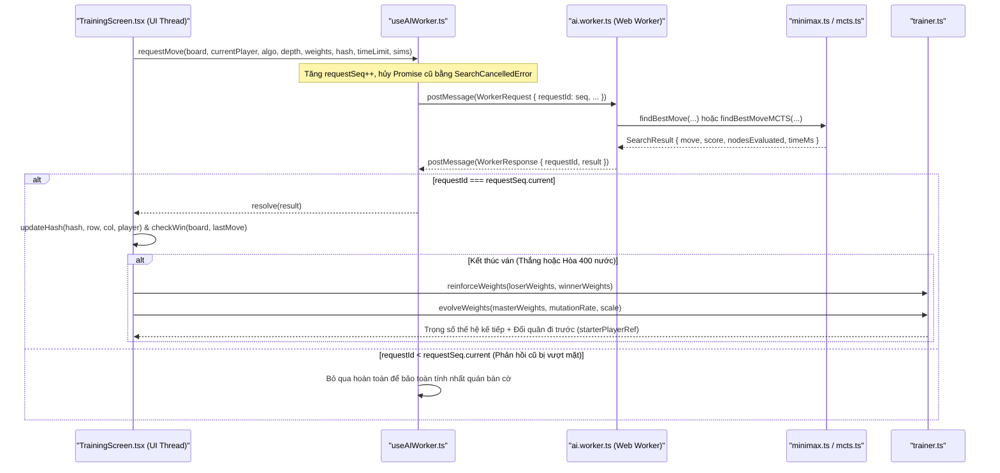
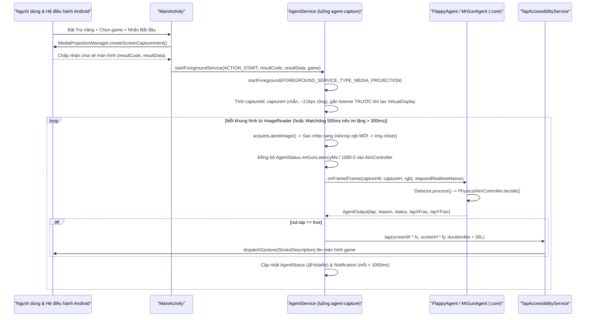

# Tài liệu Kiến trúc & Giải phẫu Mã nguồn Toàn diện — `AI_Lab`

> **Phạm vi tài liệu**: Toàn bộ kho mã nguồn `AI_Lab` tại `d:\Project\AI_Lab` (bao gồm cả **Hệ thống 1: `AI Game Arena`** trên nền Web/Desktop Electron và **Hệ thống 2: `AI Arena Agent`** trên nền Android + JVM Kotlin thuần).
> **Nguyên tắc biên soạn**: Đọc trực tiếp 100% từng tệp mã nguồn, cấu hình, script và bộ kiểm thử trong dự án; giữ nguyên chính xác mọi định danh kỹ thuật trong dấu backtick.

---

## Mục lục

1. [Tổng quan Dự án (Project Overview)](#1-tổng-quan-dự-án-project-overview)
2. [Kiến trúc Tổng thể & Luồng Dữ liệu (Architecture & End-to-End Data Flow)](#2-kiến-trúc-tổng-thể--luồng-dữ-liệu-architecture--end-to-end-data-flow)
3. [Cấu trúc Thư mục & Bản đồ Toàn bộ Tệp nguồn (Complete Directory & File Map)](#3-cấu-trúc-thư-mục--bản-đồ-toàn-bộ-tệp-nguồn-complete-directory--file-map)
4. [Phân tích Chi tiết Từng Module & Tệp Mã nguồn (Deep-Dive Source Reference)](#4-phân-tích-chi-tiết-từng-module--tệp-mã-nguồn-deep-dive-source-reference)
5. [Mô hình Dữ liệu, Lưu trữ & Giao thức / API (Data Schemas, Storage & Protocols)](#5-mô-hình-dữ-liệu-lưu-trữ--giao-thức--api-data-schemas-storage--protocols)
6. [Giao diện Người dùng, Luồng Màn hình & Thiết kế (UI/UX, Screens & Design System)](#6-giao-diện-người-dùng-luồng-màn-hình--thiết-kế-uiux-screens--design-system)
7. [Cấu hình, Môi trường & Lệnh Chạy / Build / Test / Đóng gói (Setup & Operations)](#7-cấu-hình-môi-trường--lệnh-chạy--build--test--đóng-gói-setup--operations)
8. [Quy ước Mã nguồn, Bất biến Kỹ thuật & Các Điểm Dễ Lỗi (Invariants, Security & Gotchas)](#8-quy-ước-mã-nguồn-bất-biến-kỹ-thuật--các-điểm-dễ-lỗi-invariants-security--gotchas)
9. [Nhật ký Cập nhật Tài liệu (Documentation Changelog)](#9-nhật-ký-cập-nhật-tài-liệu-documentation-changelog)

---

## 1. Tổng quan Dự án (Project Overview)

### 1.1 Bài toán Thực tế, Đối tượng Sử dụng & Bối cảnh Vận hành

`AI_Lab` là một phòng thí nghiệm trí tuệ nhân tạo đa nền tảng kết hợp hai hệ thống bổ trợ trực tiếp cho nhau:

1. **`AI Game Arena` (Web SPA & Ứng dụng Desktop Windows qua Electron — thư mục gốc & `src/`)**:
   - **Bài toán giải quyết**: Các thuật toán tìm kiếm cây trò chơi, học tăng cường (Reinforcement Learning) và tiến hóa thần kinh (Neuroevolution) thường chạy dưới dạng script dòng lệnh khô khan, khó quan sát cách hàm đánh giá, bảng giá trị `Q`, mạng nơ-ron hay quần thể tiến hóa hội tụ theo thời gian thực. `AI Game Arena` biến **9 bài toán trò chơi 2D và 3D** thành các đấu trường trực quan tốc độ cao ngay trong trình duyệt hoặc cửa sổ Electron, không phụ thuộc thư viện học máy bên ngoài (toàn bộ mạng nơ-ron, giải thuật di truyền, Minimax Alpha-Beta, MCTS, Expectimax, Q-Learning đều được tự cài đặt từ đầu bằng TypeScript thuần).
   - **9 mô phỏng tích hợp**:
     - `caro` (**Cờ Caro 20×20**): Tự đấu (`AI vs AI`) hoặc đấu với người (`Người vs AI`), đối kháng giữa `Minimax` (Alpha-Beta + Iterative Deepening + Zobrist Transposition Table) và `MCTS` (UCT + chiến thuật Rollout), kết hợp tiến hóa và học củng cố 12 trọng số heuristic sau mỗi ván, hỗ trợ xuất/nhập "não AI" ra tệp JSON.
     - `racing` (**Đua xe Thần kinh 2D**): Quần thể xe tự lái dùng cảm biến tia (`raycast`) và mạng nơ-ron truyền thẳng `[numSensors + 2, 7, 2]` tiến hóa 2 giai đoạn trên 7 đường đua có sẵn, bộ vẽ đường đua tương tác (`TrackBuilder`) hoặc bộ sinh đường đua thủ tục có hạt giống kiểu Minecraft (`trackGen.ts` với 6 quần xã sinh vật / biome).
     - `flappy` (**Flappy Bird Neuroevolution**): Quần thể chim `[4, 6, 1]` tiến hóa trực tiếp trước các khe ống, hỗ trợ chế độ người chơi bay cùng hoặc đối đầu thời gian thực.
     - `2048` (**2048 Expectimax**): Cây tìm kiếm xác suất `Expectimax` thích ứng độ sâu (`3` / `4` / `6`) kèm bảng hiển thị điểm kỳ vọng trực tiếp cho cả 4 hướng ngay cả khi người chơi tự điều khiển.
     - `connect4` (**Bốn Hàng / Connect Four**): Bàn `7×6` dùng `Minimax` cắt tỉa Alpha-Beta ưu tiên cột giữa và đánh giá 69 cửa sổ 4 ô.
     - `qmaze` (**Mê cung Q-Learning**): Học tăng cường dạng bảng `Q[r][c][4]` với chính sách `ε-greedy`, hiển thị trực tiếp bản đồ nhiệt giá trị `Q` và mũi tên chính sách hội tụ về đường đi tối ưu (đối chiếu với nghiệm `BFS`).
     - `soccer` (**Bóng đá 3D V2 — 1v1**): Sân bóng lồng kín 3D kết xuất bằng `Three.js`, hai khối lập phương tự trị sử dụng mạng `[17, 16, 12, 4]` với hệ quy chiếu đối xứng gương, vật lý nảy trụ khung thành 3D, kỹ năng sút bổng (`kickSkill`), nhảy đánh đầu (`jump`) và hiệu ứng nổ vỡ 64 mảnh khi thủng lưới.
     - `tag` (**Đuổi bắt 3D v3 — KAI vs ALBERT**): Đấu trường 6 căn phòng 3D (`Three.js`) với tường và khối hộp có thể đẩy/kéo/nhảy lên nóc. Áp dụng **đồng tiến hóa hai quần thể chạy ngầm** (`2 × 26` cá thể đấu không đồ họa mỗi khung hình kèm đấu chéo với bot heuristic để chống suy thoái chiến thuật) và cơ chế cân bằng tốc độ động (`balanceAdj`) giữ tỷ lệ thắng quanh ngưỡng 50/50.
     - `cellwar` (**Chiến tranh Ô / Cell War**): Mô phỏng chiến thuật mở rộng lãnh thổ trên lưới ô vuông (tương tự *Territorial.io*) cho 2–6 phe với 5 chiến lược heuristic (`aggressive`, `expand`, `opportunist`, `defensive`, `balanced`) và cơ chế khuếch tán quân nội địa ra biên giới.

2. **`AI Arena Agent` (Ứng dụng Android tự chơi game thực tế — thư mục `android/`)**:
   - **Bài toán giải quyết**: Đưa tác nhân AI bước ra khỏi môi trường mô phỏng tự chủ để chơi trực tiếp các tựa game di động thực tế (hiện hỗ trợ **Flappy Bird** và **Mr Gun** của Ketchapp) chạy trên điện thoại Android thật mà **không cần quyền root, không can thiệp bộ nhớ game, không dùng mô hình học sâu nặng nề**.
   - **Cơ chế vận hành**: Dịch vụ nền `AgentService` chụp màn hình thời gian thực ở độ phân giải thu nhỏ (bề rộng mục tiêu `TARGET_WIDTH = 216` px, ví dụ `202×440` trên Xiaomi 17 Pro) thông qua `MediaProjection` + `VirtualDisplay` + `ImageReader`, chuyển mảng điểm ảnh `0xRRGGBB` sang module `:core` thuần Kotlin để nhận diện cấu trúc hình học, ước lượng vật lý/vận tốc góc có bù độ trễ cảm ứng, rồi phát thao tác chạm thông qua `TapAccessibilityService` (`dispatchGesture`).
   - **Kiến trúc kiểm thử tách rời**: Toàn bộ thị giác máy tính và bộ điều khiển nằm trong module `:core` (JVM thuần, không `import android.*`), đi kèm bộ mô phỏng đa giao diện (`FlappySim` 5 skin, `MrGunSim` 5 skin) và bộ ảnh chụp màn hình thật từ điện thoại để kiểm thử hồi quy vòng kín ngay trên máy tính trong vài giây.

- **Đối tượng sử dụng**: Sinh viên, kỹ sư AI/Game, nhà nghiên cứu thị giác máy tính cổ điển & điều khiển dự đoán, giảng viên minh họa thuật toán trực quan, và người dùng trải nghiệm/đối đầu trực tiếp với AI trên Web, Windows Desktop hoặc điện thoại Android.

---

### 1.2 Bảng Tech Stack Chi tiết

#### A. Hệ thống 1 — `AI Game Arena` (Web SPA & Electron Desktop)

| Thành phần | Công nghệ / Thư viện | Phiên bản (từ `package.json`) | Vai trò trong dự án |
| :--- | :--- | :--- | :--- |
| Ngôn ngữ chính | `TypeScript` | `~6.0.2` | Toàn bộ logic AI, vật lý, mô phỏng 2D/3D và giao diện React (`strict: true`, target `ES2023` cho app và `ES2022` cho cấu hình Vite) |
| UI Framework | `react` / `react-dom` | `^19.2.6` | Quản lý trạng thái màn hình, bảng điều khiển thông số và HUD thời gian thực |
| Đồ họa 3D | `three` + `@types/three` | `^0.184.0` / `^0.184.1` | Kết xuất WebGL cho 2 đấu trường 3D (`Soccer 3D` và `Tag 3D`) và bản xem trước `SoccerPreview` |
| Đồ họa 2D | HTML5 `Canvas 2D API` | Web Standard | Vẽ bàn cờ, xe đua, cảm biến tia, mạng nơ-ron, Flappy Bird, Connect 4, Q-Maze heatmap, Cell War `ImageData` |
| Đa luồng trình duyệt | `Web Workers API` | ES Module Worker | Chạy tìm kiếm `Minimax` và `MCTS` của Cờ Caro trên luồng nền (`src/workers/ai.worker.ts`) để không khóa giao diện |
| Biểu tượng | `lucide-react` | `^1.16.0` | Hệ thống icon vector cho toàn bộ thẻ trò chơi, thanh công cụ và nút điều khiển |
| Styling | `tailwindcss` + `@tailwindcss/vite` | `^4.3.3` | Hệ thống utility CSS kết hợp bảng biến giao diện Cyber-Lab tùy chỉnh trong `src/index.css` |
| Bundler & Dev Server | `vite` + `@vitejs/plugin-react` | `^8.0.12` / `^6.0.1` | Máy chủ phát triển (`http://localhost:5173`) và đóng gói tĩnh (`dist/` với `base: './'`) |
| Desktop Runtime | `electron` | `^42.3.0` | Đóng gói ứng dụng cửa sổ native trên Windows (`main.cjs`, kích thước `1420×920`) |
| Desktop Installer | `electron-builder` | `^26.8.1` | Tạo bộ cài đặt Windows `NSIS` (`.exe`) xuất ra thư mục `release/`, `appId: com.aigame.arena` |
| Tiện ích tiến trình | `concurrently` | `^9.2.1` | Chạy song song Vite dev server và Electron trong lệnh `npm run electron:dev` |
| Kiểm tra mã tĩnh | `eslint` + `typescript-eslint` | `^10.3.0` / `^8.59.2` | Linter mã nguồn kết hợp `eslint-plugin-react-hooks` (`^7.1.1`) và `eslint-plugin-react-refresh` (`^0.5.2`) |
| Nền tảng Node.js | `Node.js` | `22.13+` (theo `README.md`) | Môi trường chạy công cụ build, Vite và Electron; `@types/node` `^24.12.3` |
| Triển khai Web | `Vercel` | Static SPA (`vercel.json`) | Build web tự động với `ELECTRON_SKIP_BINARY_DOWNLOAD=1` để bỏ qua tải nhị phân Electron |

#### B. Hệ thống 2 — `AI Arena Agent` (Android App & Pure-Kotlin Vision/Control Core)

| Thành phần | Công nghệ / Thư viện | Phiên bản (từ Gradle) | Vai trò trong dự án |
| :--- | :--- | :--- | :--- |
| Ngôn ngữ | `Kotlin` | `2.2.20` | Ngôn ngữ duy nhất cho cả module `:core` (JVM thuần) và `:app` (Android) |
| Hệ thống Build | `Gradle Wrapper` | `9.1.0` (`gradle-9.1.0-all.zip`) | Quản lý đa module (`:core`, `:app`), cấu hình Kotlin DSL (`.kts`) |
| Android Gradle Plugin | `com.android.application` | `8.13.0` | Biên dịch và đóng gói APK cho module `:app` |
| JVM Target | `Java / JDK` | `17` (`JvmTarget.JVM_17`) | Chuẩn bytecode cho cả `:core` và `:app` |
| Android SDK | `compileSdk` / `targetSdk` / `minSdk` | `36` / `36` / `30` | Hỗ trợ từ Android 11 (`API 30`) đến Android 16 (`API 36`), tuân thủ quy định Foreground Service `mediaProjection` của Android 14+ |
| Thư viện AndroidX | `androidx.core:core-ktx` | `1.15.0` | Tiện ích Kotlin cho Android (`ContextCompat.startForegroundService`, quyền hệ thống) |
| Giao diện Android | `androidx.appcompat:appcompat` | `1.7.0` | `AppCompatActivity` và theme `Theme.AppCompat.DayNight` |
| Activity Result API | `androidx.activity:activity-ktx` | `1.10.1` | Xin quyền thông báo (`RequestPermission`) và hộp thoại chụp màn hình (`StartActivityForResult`) |
| Chụp màn hình & Cử chỉ | `MediaProjection` + `AccessibilityService` | Android Framework API | `VirtualDisplay` + `ImageReader` (`RGBA_8888`) đọc khung hình; `dispatchGesture` thực hiện cú chạm 30 ms |
| Kiểm thử `:core` | `kotlin("test")` + `JUnit Platform` | Theo Kotlin `2.2.20` | Chạy unit test, mô phỏng đa skin và kiểm thử khung hình PNG thật (`javax.imageio.ImageIO`) trên JVM |

---

### 1.3 Thông tin Kho Mã nguồn Git

- **Remote URL**: `https://github.com/Tthanh2k6/AI_Lab.git` (`origin` cho cả `fetch` và `push`).
- **Nhánh hiện tại (Active Branch)**: `android-agent` (nhánh chính trên remote là `main`; ngoài ra kho cục bộ có các nhánh worktree thử nghiệm `.claude/worktrees` không theo dõi trong cây chính).
- **Trạng thái cây làm việc (`git status --short`)**: Toàn bộ tệp được Git theo dõi đều sạch (`clean`); chỉ có thư mục cục bộ chưa theo dõi `?? .claude/` chứa dữ liệu nghiên cứu/đánh giá bộ nhận diện Mr Gun.
- **Các mốc Commit quan trọng gần đây**:

| Mã Commit | Tóm tắt nội dung thay đổi |
| :--- | :--- |
| `fc7c33c` | `Mr Gun: tap-latency slider in the app, applied live to the running agent` — Thêm thanh trượt độ trễ `0–300 ms` trong `MainActivity` áp dụng tức thời cho `MrGunAgent` đang chạy |
| `9d0fc25` | `Mr Gun: tap latency 110 ms; ignore fake sweep reversals near the enemy direction` — Đặt mặc định `110 ms`, bỏ qua đảo chiều giả trong vùng `±12°` quanh hướng địch |
| `f8529bd` | `Mr Gun: 140 ms latency, aim upper body, trust a sweep bound only after two consistent reversals` — Ngắm ngực/vai (`0.42` chiều cao khung bao) và yêu cầu `hits >= 2` mới tin biên lắc |
| `dbb416b` | `Mr Gun: wait 0.4 s for the enemy to settle before firing; 0.5 s cooldown` — Chờ địch ổn định `0.4 s` sau khi nhảy vào bậc và tăng cooldown bắn lên `0.5 s` |
| `10c0a8e` | `Mr Gun: white-head preprocessing, band-local background, first-pass firing` — Tiền xử lý lõi ô đầu trắng, phân loại nền 24 dải bắc cầu và nổ súng ngay lượt quét đầu |
| `5108619` | `Mr Gun: handle revive menu, keep enemies split by a grey gun` — Xử lý menu hồi sinh `CONTINUE?` (`NO THANKS`) và gộp thân địch bị súng xám cắt ngang |
| `20a14a7` | `Fix motion detection on device; recognise Mr Gun start screen` — Cấp phát `IntArray` mới cho mỗi khung trong `AgentService` và nhận diện màn `TAP TO START` |
| `a03be13` | `Mr Gun: tap the detected restart button instead of tapping blindly` — Tìm nút chơi lại hình ô vuông rỗng thay vì tap mù dễ trúng quảng cáo |
| `a9fd788` | `Validate Mr Gun agent on real frames; harden capture and tap services` — Bổ sung bộ ảnh thật từ Xiaomi 17 Pro (`mrgun_real`) và `watchdog` 500 ms cho `ImageReader` |
| `c691931` | `Add Mr Gun agent and in-app game selector` — Thêm `MrGunDetector`, `AimController`, `MrGunAgent` và bộ chọn game trong app Android |
| `6e47a2f` | `Add on-device Android Flappy Bird agent (core + app scaffold)` — Khởi tạo kiến trúc `:core` + `:app` cho tác nhân Flappy Bird trên Android |
| `dade903` | `Add Cell War game mode and procedural race track generator` — Bổ sung chế độ `Cell War` và bộ sinh đường đua thủ tục `trackGen.ts` trên Web |

---

## 2. Kiến trúc Tổng thể & Luồng Dữ liệu (Architecture & End-to-End Data Flow)

### 2.1 Sơ đồ Kiến trúc Tổng thể Hệ sinh thái `AI_Lab`

```mermaid
flowchart TD
    subgraph WebDesktop["Hệ thống 1: AI Game Arena (Web SPA & Electron Desktop)"]
        ElectronMain["Electron Main Process (main.cjs)"] -->|"Dev: localhost:5173 / Prod: dist/index.html"| IndexHtml["index.html + src/main.tsx"]
        IndexHtml --> AppRouter["App.tsx (Bộ định tuyến trạng thái Screen & GameId)"]

        AppRouter --> SelectScreen["SelectGameScreen.tsx (9 thẻ mô phỏng)"]
        AppRouter --> SetupScreen["SetupScreen.tsx (Cấu hình tham số + 9 Canvas/3D Preview + TrackBuilder)"]

        SetupScreen --> CaroArena["TrainingScreen.tsx (Caro 20x20)"]
        SetupScreen --> RacingArena["RacingScreen.tsx (Đua xe ANN)"]
        SetupScreen --> FlappyArena["FlappyScreen.tsx (Flappy ANN)"]
        SetupScreen --> Arena2048["Game2048Screen.tsx (2048 Expectimax)"]
        SetupScreen --> Connect4Arena["Connect4Screen.tsx (Connect 4 Alpha-Beta)"]
        SetupScreen --> QMazeArena["QMazeScreen.tsx (Q-Learning Maze)"]
        SetupScreen --> SoccerArena["Soccer2Screen.tsx (Soccer 3D V2)"]
        SetupScreen --> TagArena["TagScreen.tsx (Tag 3D KAI vs ALBERT)"]
        SetupScreen --> CellWarArena["CellWarScreen.tsx (Cell War Grid)"]

        CaroArena <-->|"useAIWorker.ts (postMessage + requestSeq)"| AIWorker["Web Worker (ai.worker.ts)"]
        AIWorker --> CaroCore["minimax.ts + mcts.ts + evaluator.ts + zobrist.ts"]
        CaroArena --> TrainerUtil["trainer.ts (Tiến hóa & Củng cố HeuristicWeights + JSON I/O)"]

        RacingArena --> RacingCore["racingPhysics.ts (NeuralNetwork + CarInstance) + trackGen.ts"]
        FlappyArena --> FlappyCore["flappy.ts (Neuroevolution [4,6,1])"]
        Arena2048 --> Core2048["game2048.ts (Expectimax + 2-phase TileOp)"]
        Connect4Arena --> CoreC4["connect4.ts + renderConnect4.ts"]
        QMazeArena --> CoreQMaze["qmaze.ts + renderQMaze.ts"]
        SoccerArena --> CoreSoccer["soccer2.ts + renderSoccer2.ts (Three.js)"]
        TagArena --> CoreTag["tagGame.ts (2x26 Co-Evolution) + renderTag.ts (Three.js)"]
        CellWarArena --> CoreCellWar["cellwar.ts (5 Strategies + Troop Diffusion)"]
    end

    subgraph AndroidSystem["Hệ thống 2: AI Arena Agent (Android App & Pure-Kotlin Core)"]
        MainAct["MainActivity.kt (Chọn game, Thanh trượt độ trễ, Kiểm tra quyền)"]
        SharedPrefs["SharedPreferences ('agent': game, mrgun_latency_ms)"]
        StatusBus["AgentStatus.kt (@Volatile Singleton State)"]
        FgService["AgentService.kt (Foreground mediaProjection + HandlerThread)"]
        VirtDisp["MediaProjection -> VirtualDisplay -> ImageReader (TARGET_WIDTH=216)"]
        AccService["TapAccessibilityService.kt (dispatchGesture 30ms)"]

        MainAct <--> SharedPrefs
        MainAct <-->|"Đọc mỗi 500ms / Ghi mrGunLatencyMs"| StatusBus
        MainAct -->|"startForegroundService(ACTION_START)"| FgService
        FgService --> VirtDisp
        FgService <--> StatusBus

        subgraph PureKotlinCore["Module :core (Kotlin JVM thuần - Không phụ thuộc Android)"]
            GameAgentIf["GameAgent.kt (GameKind, AgentOutput)"]
            FlappyAg["FlappyAgent.kt"]
            MrGunAg["MrGunAgent.kt"]
            FlappyDet["FlappyDetector.kt + ScrollEstimator.kt"]
            PhysEst["PhysicsEstimator.kt + RunningMedian/QuadFit"]
            FlapCtrl["FlapController.kt (Mô phỏng quỹ đạo B / C / N)"]
            MrGunDet["MrGunDetector.kt (24-band BG, WhiteHeads, PCA Pivot, Ray Scan, Menu)"]
            AimCtrl["AimController.kt (Dự đoán góc + Phản xạ biên + Độ trễ)"]

            GameAgentIf --> FlappyAg
            GameAgentIf --> MrGunAg
            FlappyAg --> FlappyDet
            FlappyAg --> PhysEst
            FlappyAg --> FlapCtrl
            MrGunAg --> MrGunDet
            MrGunAg --> AimCtrl
        end

        VirtDisp -->|"IntArray rgb mới mỗi khung (Frame)"| GameAgentIf
        GameAgentIf -->|"AgentOutput(tap, tapXFrac, tapYFrac)"| FgService
        FgService -->|"svc.tap(screenW * fx, screenH * fy)"| AccService
    end
```



---

### 2.2 Sơ đồ Tương tác Điển hình (Sequence Diagrams)

#### A. Luồng Bất đồng bộ Web Worker & Tiến hóa Trọng số trong Cờ Caro (`TrainingScreen` ↔ `ai.worker.ts`)



#### B. Luồng Vòng kín Chụp màn hình – Nhận diện – Điều khiển – Chạm trên Android (`AI Arena Agent`)



---

### 2.3 Phân tích Các Tầng Kiến trúc & Cơ chế Giao tiếp

Dự án được tổ chức theo nguyên lý **tách biệt triệt để lõi thuật toán/vật lý khỏi tầng hiển thị và hệ điều hành**:

1. **Trong Hệ thống 1 (`AI Game Arena` — Web & Electron)**:
   - **Tầng Host (`main.cjs`)**: Electron đóng vai trò vỏ bọc cửa sổ thuần túy (`contextIsolation: true`, `nodeIntegration: false`, không dùng `preload.js` hay kênh IPC riêng). Mã nguồn trong `src/` chạy giống hệt nhau trên trình duyệt Web (Vercel) và Electron Desktop.
   - **Tầng Điều phối Màn hình (`src/App.tsx` + `src/types/game.ts`)**: Không sử dụng thư viện định tuyến URL (`react-router`), toàn bộ chuyển cảnh giữa 11 trạng thái `Screen` được điều khiển bằng `useState<Screen>('select')` và các cấu hình chuyên biệt (`MatchConfig`, `RacingConfig`, `FlappyConfig`, `Game2048Config`, `QMazeConfig`, `Connect4Config`, `SoccerConfig`, `TagConfig`, `CellWarConfig`).
   - **Tầng Mô phỏng & AI Thuần (`src/utils/*.ts`)**: Các tệp trong `src/utils/` không phụ thuộc vào React lifecycle. Chúng định nghĩa cấu trúc trạng thái thế giới (`Soccer2World`, `TagWorld`, `CWWorld`, `CarInstance`, `QMaze`, `Board`), hàm bước thời gian (`stepSoccer2`, `stepTagWorld`, `stepWorld`, `stepQMaze`, `CarInstance.update`) và các thuật toán tìm kiếm/học máy.
   - **Tầng Kết xuất Tách biệt (`src/utils/render*.ts` & Canvas/Three.js trong `src/components/*Screen.tsx`)**:
     - Với mô phỏng tần số cao (`Racing`, `Flappy`, `QMaze`, `Soccer 3D`, `Tag 3D`, `Cell War`), trạng thái thế giới được giữ trong `useRef` và cập nhật trực tiếp bên trong vòng lặp `requestAnimationFrame` (hỗ trợ tua nhanh nhiều bước vật lý trên mỗi khung hình vẽ thông qua thanh trượt tốc độ), trong khi React state chỉ được cập nhật định kỳ (throttled HUD snapshot) để tránh nghẽn re-render 60 lần/giây.
     - Riêng `Caro` có tác vụ tìm kiếm cây tốn hàng trăm ms CPU nên được tách sang `Web Worker` (`src/workers/ai.worker.ts`) giao tiếp qua `useAIWorker.ts` bằng cơ chế đánh số thứ tự đơn điệu `requestSeq` để loại bỏ kết quả trễ khi người dùng bấm Tạm dừng / Ván mới.

2. **Trong Hệ thống 2 (`AI Arena Agent` — Android)**:
   - **Tầng Giao diện & Quyền (`MainActivity.kt`)**: Chạy trên Main/UI Thread, dùng `Handler(Looper.getMainLooper())` thăm dò (`poll`) đối tượng bộ nhớ dùng chung `AgentStatus` mỗi `500 ms` để hiển thị FPS/số khung/số lần tap/trạng thái nhận diện, đồng thời ghi `SharedPreferences("agent")` và cập nhật trực tiếp `@Volatile AgentStatus.mrGunLatencyMs`.
   - **Tầng Chụp màn hình & Điều phối Nền (`AgentService.kt`)**: Dịch vụ Foreground kiểu `mediaProjection` sở hữu một luồng nền riêng `HandlerThread("agent-capture")`. Toàn bộ việc rút ảnh từ `ImageReader`, giải mã `RGBA_8888` sang `IntArray` `0xRRGGBB`, gọi `GameAgent.onFrame(...)` và phát lệnh chạm đều diễn ra tuần tự trên luồng `agent-capture` này — nhờ đó các bộ nhận diện trong `:core` tái sử dụng mảng đệm nội bộ an toàn mà không cần khóa đồng bộ (`synchronized`) tốn kém.
   - **Tầng Cử chỉ Hệ thống (`TapAccessibilityService.kt`)**: Dịch vụ Trợ năng độc lập do hệ thống Android quản lý vòng đời, cung cấp tham chiếu tĩnh `@Volatile var instance: TapAccessibilityService?` để `AgentService` gọi trực tiếp `svc.tap(x, y, 30L)` trong cùng tiến trình ứng dụng (`ai.arena.android`).
   - **Tầng Lõi Thị giác & Điều khiển (`android/core/`)**: Module Kotlin JVM thuần túy 100%, không chứa bất kỳ phụ thuộc Android nào. Nhận đầu vào duy nhất là `Frame(width, height, rgb)` và dấu thời gian nano-giây `tNanos: Long`, trả ra `AgentOutput(tap, reason, status, detail, tapXFrac, tapYFrac)`.

---

### 2.4 Vòng đời Khởi động & Tất cả Các Luồng Nghiệp vụ Chính

1. **Khởi động Web / Electron**:
   - **Trên Web**: Trình duyệt tải `index.html` → thực thi `src/main.tsx` → gắn `<App />` (bọc trong `<StrictMode>`) vào `#root` → hiển thị `SelectGameScreen` với 9 thẻ trò chơi.
   - **Trên Electron (`npm run electron:dev` hoặc bản đóng gói `.exe`)**: `main.cjs` đợi `app.whenReady()` → gọi `createWindow()` tạo `BrowserWindow` `1420×920` → nếu `!app.isPackaged` thì nạp `http://localhost:5173`, nếu đã đóng gói thì nạp `path.join(__dirname, 'dist', 'index.html')`. Khi người dùng bấm `onExit` ở `SelectGameScreen`, hàm `window.close()` đóng cửa sổ ứng dụng.

2. **Luồng Thiết lập Tham số (`SelectGameScreen` → `SetupScreen` → Đấu trường)**:
   - Người dùng chọn 1 trong 9 game trên `SelectGameScreen` → `App.tsx` đặt `selectedGame` và chuyển `screen = 'setup'`.
   - `SetupScreen.tsx` hiển thị bố cục 2 cột: cột trái là **bản mô phỏng xem trước chạy trực tiếp** (AI tự chơi thời gian thực bằng Canvas 2D, DOM hoặc Three.js tùy game), cột phải là bảng tinh chỉnh thông số chuyên biệt cho game đó → nhấn nút bắt đầu sẽ gọi callback `onStart*` tương ứng trong `App.tsx` để lưu config và chuyển sang màn hình `*-arena`.

3. **Luồng Cờ Caro Tự Huấn luyện & Xuất/Nhập "Não AI" (`TrainingScreen.tsx`)**:
   - Khởi tạo bàn cờ `20×20` rỗng, mã băm Zobrist `0`, thế hệ `generation = 1`, trọng số gốc `masterWeights = DEFAULT_WEIGHTS`.
   - Ở mỗi lượt: nếu lượt thuộc về người chơi (`humanPlayer === currentPlayer`), mở khóa click trên ô trống; nếu lượt thuộc về AI, gọi `useAIWorker.requestMove(...)` sang `ai.worker.ts`.
   - `ai.worker.ts` thực thi `findBestMove` (Iterative Deepening Alpha-Beta + Zobrist Transposition Table + Candidate Moves bán kính 1 ô + Move Ordering ưu tiên nước tạo Fork) hoặc `findBestMoveMCTS` (UCT + Rollout chiến thuật 20 bước).
   - Khi có người thắng (5 quân liên tiếp qua `checkWin`) hoặc hòa (đầy 400 ô): lưu thống kê ván vào lịch sử, gọi `reinforceWeights` củng cố trọng số phòng thủ/tấn công của phe thua, gọi `evolveWeights` đột biến/lai ghép từ `masterWeights` cho thế hệ mới, đảo quân đi trước (`starterPlayerRef`), và tự động mở ván kế tiếp sau độ trễ `speed`. Người dùng có thể bấm **Lưu Não** để tải xuống tệp `caro_ai_brain_gen{N}.json` hoặc **Nạp Não** để khôi phục quá trình tiến hóa.

4. **Luồng Đua xe Tiến hóa Thần kinh 2 Giai đoạn (`RacingScreen.tsx`)**:
   - Nạp đường đua từ 7 mẫu có sẵn (`TRACK_PRESETS`), từ `TrackBuilder` hoặc từ bộ sinh thủ tục `generateProceduralTrack(seed)` (lưới chữ nhật → chạm khắc hốc `carveSlots` bảo toàn tính liên thông BFS → khử eo chéo → lần biên `traceContour` → vát chéo 45° → nội suy Catmull-Rom ép bán kính cong tối thiểu `HARD_MIN_RADIUS = 68` → xoay điểm xuất phát ra đoạn thẳng dài nhất `>= 300px` → biến thiên bề rộng mặt đường khép kín).
   - Khởi tạo `carCount` xe tại vạch xuất phát; **20 khung hình đầu tiên (`timeAlive < 20`) khóa cứng góc lái `steering = 0`** để xe buộc phải lao thẳng theo hướng đường đua.
   - **Giai đoạn 1 (`hasLapCompleted === false`)**: Xe chạy tốc độ cố định `baseSpeed`, học cách đánh lái tránh tường và vượt qua các "điểm đen tử nạn" (`failurePoints` được truyền vào nơ-ron đầu vào cuối cùng).
   - **Giai đoạn 2 (`hasLapCompleted === true` — ngay khi có xe hoàn thành 1 vòng)**: Mở khóa nơ-ron đầu ra thứ 2 điều biến tốc độ `±30%` và nhân đôi tỷ lệ đột biến (tối đa `60%`). Xe hoàn thành `1.5` vòng sẽ tự đỗ; nếu đạt tốc độ trung bình `>= 90% maxSpeed` sẽ mở khóa nút **Nâng cấp Tốc độ (`+15%`)** và tự hủy các xe chạy chậm ở vòng 1 để ép quần thể tối ưu hóa vận tốc.

5. **Luồng Flappy Bird Web (`FlappyScreen.tsx`)**:
   - Cắt khung bao điểm ảnh không trong suốt của `FlappyBird.png` một lần khi tải ảnh để vẽ sprite chuẩn xác.
   - Mỗi tick vật lý: cập nhật ống cuộn ngang, đưa 4 đầu vào chuẩn hóa vào mạng `[4, 6, 1]` của từng chim còn sống (`out[0] > 0` thì vỗ cánh). Khi toàn bộ AI chết (và người chơi đã chết nếu bật chế độ chơi cùng), chọn 2 cá thể ưu tú nhất (`elitism`) và lai ghép/đột biến nửa đầu quần thể cho thế hệ tiếp theo.

6. **Luồng 2048 Expectimax (`Game2048Screen.tsx`)**:
   - Ở chế độ AI: gọi `chooseBestMove(grid)` chạy `expectimax` độ sâu thích ứng (`3` khi `>= 6` ô trống, `4` khi `3..5` ô trống, `6` khi `< 3` ô trống) tính kỳ vọng qua các nút ngẫu nhiên sinh ô `2` (`0.9`) và `4` (`0.1`).
   - Áp dụng `planMove` tạo danh sách `TileOp` cho hoạt ảnh trượt mượt 2 pha (`phase: 'slid'` → sau `animFor(speed)` ms chuyển sang `'settled'` và sinh ô mới). Bảng `AIThinkPanel` luôn chấm điểm cả 4 hướng thời gian thực kể cả khi người dùng tự chơi bằng phím mũi tên / `WASD`.

7. **Luồng Connect Four (`Connect4Screen.tsx`) & Q-Maze (`QMazeScreen.tsx`) & Cell War (`CellWarScreen.tsx`)**:
   - `Connect4Screen`: Chạy `chooseMove` (`Minimax` Alpha-Beta thứ tự cột giữa `[3,2,4,1,5,0,6]`), mô phỏng hoạt ảnh đĩa rơi có gia tốc trọng trường trên Canvas 2D trước khi chốt nước đi vào mảng bàn cờ `6×7`.
   - `QMazeScreen`: Sinh mê cung ngẫu nhiên đảm bảo có đường đi ngắn nhất bằng `BFS`, sau đó chạy `stepsPerFrame` bước `stepQMaze` cập nhật phương trình Bellman `Q(s,a) <- Q(s,a) + alpha * (r + gamma * max Q(s',a') - Q(s,a))` và giảm dần `epsilon` sau mỗi tập tới đích.
   - `CellWarScreen`: Khởi tạo bản đồ lưới thuộc địa đa phe, mỗi tick tăng trưởng quân (mỗi 7 tick), khuếch tán quân từ vùng lõi ra biên giới (`diffuseStep`), và cho từng phe chọn ô tấn công theo chiến lược riêng (`pickTarget`), vẽ lên màn hình bằng `ImageData` sắc nét (`image-rendering: pixelated`).

8. **Luồng Soccer 3D (`Soccer2Screen.tsx`) & Tag 3D (`TagScreen.tsx`)**:
   - `Soccer 3D`: Vòng lặp `stepSoccer2` mô phỏng va chạm cầu-trụ với 8 thanh khung thành 3D nghiêng, va chạm cầu thủ-bóng, kỹ năng sút bổng và nhảy. Khi có bàn thắng, cầu thủ thua bị nổ tung thành 64 mảnh lập phương vật lý (`explodeLoser`), còn não tốt nhất (`bestBrain`) được giữ lại và đột biến cho đối thủ ở hiệp sau.
   - `Tag 3D`: Mỗi khung hình hiển thị, hàm `stepTagWorld` vừa tiến 1 bước trận đấu trực tiếp giữa hai nhà vô địch (`bestChaserBrain` KAI vs `bestEvaderBrain` ALBERT), vừa dành ngân sách `1.5..6 ms` CPU chạy ngầm các trận đấu không đồ họa `480` tick cho hai quần thể `26` cá thể (mỗi cá thể đấu 1 trận với nhà vô địch phe kia và 1 trận với bot heuristic `'chase'`/`'flee'`), đồng thời tự cân bằng hệ số tốc độ `balanceAdj` theo EMA tỷ lệ thắng.

9. **Luồng Android Auto-Play (`MainActivity` → `AgentService` → `FlappyAgent` / `MrGunAgent` → `TapAccessibilityService`)**:
   - Sau khi người dùng bật `TapAccessibilityService` và cấp quyền `MediaProjection`, `AgentService` thu nhỏ màn hình về chiều rộng `~216 px` (chẵn cả rộng lẫn cao).
   - **Với Flappy Bird**: `FlappyDetector` tìm biên dọc dài để khóa mặt đất (`updateGround`), đo tốc độ cuộn ngang (`ScrollEstimator`), học màu nền từng hàng (`updateBackground`), ghép cặp ống (`findPipes` + `trackPipes`) và tách chim chuyển động kết hợp bám màu (`detectBird` + `findByColor`). `PhysicsEstimator` khớp parabol bậc hai (`QuadFit`) trên các đoạn rơi tự do để tự tìm trọng lực `g`, vận tốc vỗ `vFlap` và độ trễ cảm ứng `latencySec`. `FlapController` mô phỏng 3 kịch bản `B` (vỗ ngay), `C` (chờ 1 khung rồi vỗ), `N` (không vỗ) để quyết định chạm tại `(50%, 62%)` màn hình.
   - **Với Mr Gun**: `MrGunDetector` xây bảng màu nền 24 dải ngang có bắc cầu `bgBridgePx = 2`, tìm các ô đầu trắng tinh (`whiteHeads` có lõi 8 lân cận), suy ra điểm neo tay cầm súng (`anchorAtLineRoot`), khớp PCA đường thẳng chuyển động và giải giao điểm bình phương tối thiểu tìm tâm xoay (`solvePivot` + bộ nhớ 2 phía `pivotMem`), quét tia tìm góc vạch ngắm (`scanAngle` + `fitAlongRay`), tính vận tốc góc hồi quy tuyến tính và học biên lắc hai đầu (`Bound` xác nhận kép `hits >= 2`). `AimController` dự đoán góc vạch sau `latencySec` (do người dùng chỉnh trực tiếp qua thanh trượt `0–300 ms`), tự động chọn bắn đầu (`fire-head`) nếu dải góc đầu đủ rộng so với sai số rung hoặc bắn ngực (`fire-body`), và chỉ bấm ở khung hình tiến sát tâm nhất. Khi không có vạch ngắm, `findMenu()` nhận diện hình học các khung viền rỗng để tự bấm nút **Chơi lại**, từ chối hồi sinh quảng cáo (**NO THANKS**) hoặc chạm giữa màn ở **TAP TO START** mà tuyệt đối không bấm nhầm banner quảng cáo.

---

## 3. Cấu trúc Thư mục & Bản đồ Toàn bộ Tệp nguồn (Complete Directory & File Map)

### 3.1 Cây Thư mục Trực quan

```text
AI_Lab/
├── .gitattributes                         # Quy tắc chuẩn hóa dòng kết thúc LF cho android/gradlew & *.sh
├── .gitignore                             # Danh sách loại trừ Git (node_modules, dist, release, build, local.properties...)
├── .vscode/
│   └── launch.json                        # Cấu hình gỡ lỗi Chrome (localhost:5173) cho VS Code
├── .claude/                               # [Untracked] Dữ liệu nghiên cứu, log & script đánh giá Mr Gun
│   ├── settings.local.json
│   └── mrgun-data/                        # Tập khung hình thật (mrgun_video, mrgun_video2), BRIEF_mrgun.md, eval_trace.py...
├── public/
│   └── favicon.svg                        # Biểu tượng ứng dụng Web
├── index.html                             # Trang HTML gốc của SPA (title: "AI Game Arena")
├── main.cjs                               # Tiến trình chính Electron (BrowserWindow 1420x920)
├── package.json                           # Khai báo phụ thuộc, scripts Web/Electron & cấu hình electron-builder NSIS
├── package-lock.json                      # Khóa phiên bản cây phụ thuộc npm
├── run.bat                                # Script khởi chạy nhanh máy chủ Vite cho Windows
├── vite.config.ts                         # Cấu hình Vite 8 (plugin React + Tailwind v4, base './')
├── vercel.json                            # Cấu hình build & SPA rewrite trên Vercel
├── eslint.config.js                       # Cấu hình ESLint 10 + TypeScript ESLint
├── tsconfig.json                          # Tham chiếu dự án TypeScript gốc
├── tsconfig.app.json                      # Cấu hình TS cho mã nguồn ứng dụng src/
├── tsconfig.node.json                     # Cấu hình TS cho vite.config.ts
├── README.md                              # Tài liệu giới thiệu dự án gốc (Không sửa đổi)
├── CODEBASE.md                            # [Tài liệu này] Giải phẫu kiến trúc & mã nguồn toàn diện
├── agent.md                               # Hướng dẫn vận hành & đồng bộ tài liệu cho AI Agent / Tác giả
├── src/                                   # Mã nguồn Hệ thống 1: AI Game Arena (Web & Electron)
│   ├── main.tsx                           # Điểm nhập React 19
│   ├── App.tsx                            # Bộ định tuyến trạng thái 11 màn hình & quản lý config 9 game
│   ├── App.css                            # Tệp CSS phụ trợ (trống/ghi chú)
│   ├── index.css                          # Hệ thống thiết kế Cyber-Lab, CSS variables, animations & utility overrides
│   ├── assets/
│   │   └── FlappyBird.png                 # Sprite chim cho mô phỏng Flappy Bird Web
│   ├── types/
│   │   └── game.ts                        # Toàn bộ kiểu dữ liệu, cấu hình & trọng số mặc định của 9 game
│   ├── hooks/
│   │   └── useAIWorker.ts                 # Custom hook quản lý vòng đời & đồng bộ Web Worker cho Caro
│   ├── workers/
│   │   └── ai.worker.ts                   # Web Worker thực thi Minimax & MCTS trên luồng nền
│   ├── utils/                             # 18 module thuật toán AI, vật lý 2D/3D, sinh địa hình & kết xuất
│   │   ├── zobrist.ts                     # Bảng băm Zobrist 32-bit tất định (mulberry32) cho bàn cờ Caro 20x20
│   │   ├── evaluator.ts                   # Hàm lượng giá trạng thái bàn cờ Caro theo 12 trọng số mẫu hình
│   │   ├── minimax.ts                     # Minimax Alpha-Beta + Iterative Deepening + Transposition Table + Fork Ordering
│   │   ├── mcts.ts                        # Monte Carlo Tree Search (UCT + Tactical Rollout 20 bước)
│   │   ├── trainer.ts                     # Đột biến, lai ghép, củng cố trọng số Caro & Xuất/Nhập JSON
│   │   ├── game2048.ts                    # Logic 2048, lập kế hoạch hoạt ảnh TileOp & cây tìm kiếm Expectimax
│   │   ├── connect4.ts                    # Logic Connect Four 7x6 & Minimax Alpha-Beta 69 cửa sổ
│   │   ├── renderConnect4.ts              # Bộ vẽ Canvas 2D cho bàn cờ Connect Four & đĩa đang rơi
│   │   ├── qmaze.ts                       # Sinh mê cung có nghiệm BFS & thuật toán Tabular Q-Learning
│   │   ├── renderQMaze.ts                 # Bộ vẽ Canvas 2D bản đồ nhiệt Q-value & mũi tên chính sách
│   │   ├── flappy.ts                      # Vật lý Flappy Bird Web & giải thuật tiến hóa mạng [4, 6, 1]
│   │   ├── cellwar.ts                     # Mô phỏng lãnh thổ Cell War, khuếch tán quân & 5 chiến lược AI
│   │   ├── racingPhysics.ts               # Mạng nơ-ron tự cài đặt, cảm biến tia, vật lý xe đua & 7 đường đua mẫu
│   │   ├── trackGen.ts                    # Bộ sinh đường đua thủ tục kiểu Minecraft (6 biome, Catmull-Rom, chống tự cắt)
│   │   ├── soccer2.ts                     # Thế giới vật lý 3D Soccer V2, va chạm khung thành trụ nghiêng & tiến hóa 1v1
│   │   ├── renderSoccer2.ts               # Bộ kết xuất Three.js cho Soccer 3D + hiệu ứng nổ vỡ 64 khối lập phương
│   │   ├── tagGame.ts                     # Thế giới 3D Tag v3 (6 bản đồ, kéo hộp, nhảy nóc hộp, đồng tiến hóa 2x26 ngầm)
│   │   └── renderTag.ts                   # Bộ kết xuất Three.js cho Tag 3D + tia tầm nhìn màu hóa & bảng tên nổi
│   └── components/                        # 17 thành phần giao diện React (Màn hình chính, Preview & Đấu trường)
│       ├── SelectGameScreen.tsx           # Màn hình chọn 1 trong 9 mô phỏng AI
│       ├── SetupScreen.tsx                # Màn hình cấu hình chi tiết + 9 bản xem trước trực tiếp
│       ├── TrainingScreen.tsx             # Đấu trường Cờ Caro (AI vs AI / Người vs AI + biểu đồ & bảng trọng số)
│       ├── RacingScreen.tsx               # Đấu trường Đua xe AI + vẽ mạng nơ-ron & nâng cấp tốc độ
│       ├── TrackBuilder.tsx               # Modal thiết kế đường đua tùy chỉnh (thẳng/cong Bezier + Xuất/Nhập JSON)
│       ├── FlappyScreen.tsx               # Đấu trường Flappy Bird Web (AI + chế độ người chơi bay cùng)
│       ├── Board2048.tsx                  # Thành phần bàn cờ 2048 hoạt ảnh trượt/gộp CSS 2 pha
│       ├── Game2048Preview.tsx            # Bản xem trước 2048 tự chơi trên SetupScreen
│       ├── Game2048Screen.tsx             # Đấu trường 2048 kèm bảng điểm kỳ vọng AIThinkPanel
│       ├── Connect4Preview.tsx            # Bản xem trước Connect Four tự chơi trên SetupScreen
│       ├── Connect4Screen.tsx             # Đấu trường Connect Four kèm bảng điểm cột C4ThinkPanel
│       ├── QMazePreview.tsx               # Bản xem trước Q-Maze tự học trên SetupScreen
│       ├── QMazeScreen.tsx                # Đấu trường Q-Maze kèm điều khiển tốc độ học & mê cung mới
│       ├── SoccerPreview.tsx              # Bản xem trước 3D Soccer trực tiếp trên SetupScreen
│       ├── Soccer2Screen.tsx              # Đấu trường Bóng đá 3D V2
│       ├── TagScreen.tsx                  # Đấu trường Đuổi bắt 3D KAI vs ALBERT (chọn phòng, bật/tắt tia nhìn)
│       └── CellWarScreen.tsx              # Đấu trường Chiến tranh Ô (offscreen ImageData + biểu đồ lãnh thổ)
└── android/                               # Mã nguồn Hệ thống 2: AI Arena Agent (Android & Pure-Kotlin Core)
    ├── README.md                          # Tài liệu hướng dẫn build & vận hành tác nhân Android (Không sửa đổi)
    ├── settings.gradle.kts                # Khai báo dự án gốc "ai-arena-android" gồm ":core" và ":app"
    ├── build.gradle.kts                   # Khai báo phiên bản plugin AGP 8.13.0 & Kotlin 2.2.20
    ├── gradle.properties                  # Cấu hình JVM heap 2048MB, UTF-8, AndroidX
    ├── local.properties                   # [Git-ignored] Đường dẫn sdk.dir cục bộ trên máy phát triển
    ├── gradlew                            # Script chạy Gradle Wrapper trên POSIX (LF)
    ├── gradlew.bat                        # Script chạy Gradle Wrapper trên Windows
    ├── gradle/wrapper/
    │   ├── gradle-wrapper.jar             # Nhị phân khởi chạy Gradle Wrapper
    │   └── gradle-wrapper.properties      # Cấu hình tải gradle-9.1.0-all.zip
    ├── app/                               # Module ứng dụng Android bọc ngoài :core
    │   ├── build.gradle.kts               # Cấu hình APK ai.arena.android (minSdk 30, targetSdk 36)
    │   └── src/main/
    │       ├── AndroidManifest.xml        # Khai báo quyền, MainActivity, AgentService & TapAccessibilityService
    │       ├── kotlin/ai/arena/android/
    │       │   ├── MainActivity.kt        # Giao diện chọn game, chỉnh độ trễ Mr Gun, kiểm tra quyền & khởi chạy
    │       │   ├── AgentService.kt        # Foreground Service chụp màn hình MediaProjection + vòng lặp tác nhân
    │       │   ├── AgentStatus.kt         # Singleton @Volatile trao đổi trạng thái giữa luồng chụp và UI
    │       │   └── TapAccessibilityService.kt # AccessibilityService phát cử chỉ chạm 30ms qua dispatchGesture
    │       └── res/
    │           ├── layout/activity_main.xml           # Bố cục giao diện màn hình chính Android
    │           ├── values/strings.xml                 # Chuỗi giao diện tiếng Việt
    │           └── xml/accessibility_service_config.xml # Cấu hình Trợ năng (canPerformGestures=true, không đọc cây UI)
    └── core/                              # Module lõi thị giác & điều khiển bằng Kotlin JVM thuần
        ├── build.gradle.kts               # Cấu hình Kotlin JVM 17 + JUnit Platform
        ├── src/main/kotlin/ai/arena/core/
        │   ├── agent/
        │   │   ├── GameAgent.kt           # Giao diện GameAgent, lớp AgentOutput & enum GameKind
        │   │   ├── FlappyAgent.kt         # Tác nhân vòng kín Flappy Bird (ghép Detector + Physics + Controller)
        │   │   └── MrGunAgent.kt          # Tác nhân vòng kín Mr Gun (ghép Detector + AimController + ổn định nút menu)
        │   ├── control/
        │   │   ├── PhysicsEstimator.kt    # Đo trực tuyến trọng lực g, vận tốc vỗ vFlap & độ trễ cảm ứng từ quỹ đạo chim
        │   │   ├── FlapController.kt      # Điều khiển dự đoán 3 quỹ đạo (B / C / N) có bù trễ cho Flappy Bird
        │   │   └── AimController.kt       # Điều khiển ngắm bắn dự đoán góc + phản xạ biên lắc cho Mr Gun
        │   ├── util/
        │   │   └── RunningMedian.kt       # Bộ lọc trung vị trượt RunningMedian & khớp parabol bậc hai QuadFit
        │   └── vision/
        │       ├── Frame.kt               # Khung hình 0xRRGGBB, độ sáng Rec.601, gradient ngang gradX & lượng tử màu
        │       ├── Observation.kt         # Mô hình dữ liệu Pipe, Bird, Observation cho Flappy Bird
        │       ├── ScrollEstimator.kt     # Ước lượng tốc độ cuộn dưới điểm ảnh từ gradient ngang giữa 2 khung
        │       ├── FlappyDetector.kt      # Nhận diện tổng quát mặt đất, ống, nền theo hàng & chim cho mọi bản Flappy
        │       └── MrGunDetector.kt       # Nhận diện nền 24 dải, ô đầu trắng, tâm xoay PCA, tia vạch ngắm, địch & menu Mr Gun
        └── src/test/
            ├── kotlin/ai/arena/core/
            │   ├── sim/
            │   │   ├── FlappySim.kt       # Bộ mô phỏng Flappy Bird 5 skin có mây/thành phố parallax
            │   │   └── MrGunSim.kt        # Bộ mô phỏng Mr Gun 5 skin (răng cưa/sin, boss nhiều máu, mép bậc thang)
            │   ├── ClosedLoopTest.kt      # Kiểm thử nghiệm thu vòng kín FlappyAgent vượt >= 12 ống trên mọi skin
            │   ├── DetectorTest.kt        # Kiểm thử độ chính xác cuộn, chim, ống & đất của FlappyDetector
            │   ├── PhysicsTest.kt         # Kiểm thử PhysicsEstimator khôi phục g, vFlap, latency từ quỹ đạo nhiễu
            │   ├── DiagTest.kt            # Công cụ in vết chẩn đoán Flappy vòng kín & soi điểm ảnh
            │   ├── MrGunTest.kt           # Kiểm thử nghiệm thu MrGunDetector & MrGunAgent hạ >= 15 địch trên mọi skin
            │   ├── MrGunDiagTest.kt       # Công cụ in vết chẩn đoán Mr Gun trên các skin dark / fast / boss
            │   ├── MrGunSimDiagTest.kt    # Công cụ chẩn đoán điều khiển qua biến môi trường MRGUN_SIM_*
            │   └── MrGunRealFramesTest.kt # Kiểm thử hồi quy trên 40 ảnh thật Xiaomi 17 Pro, level 22, màn thua/start/revive
            └── resources/
                ├── mrgun_gameover.png     # Ảnh chụp màn thua thật (kiểm thử tìm nút chơi lại)
                ├── mrgun_level22.png      # Ảnh chụp level 22 thật (địch LONG bị súng xám cắt ngang thân)
                ├── mrgun_start.png        # Ảnh chụp màn bắt đầu thật (hàng 4 nút rỗng TAP TO START)
                └── mrgun_real/            # 40 khung hình liên tiếp (f_0000.png..f_0039.png, 202x440) trên Xiaomi 17 Pro
```

---

### 3.2 Bảng Kê khai Đầy đủ Toàn bộ Tệp Nguồn, Cấu hình, Script & Kiểm thử

#### A. Cấu hình Gốc, Electron & Tài nguyên Tĩnh

| Đường dẫn tương đối | Số dòng | Vai trò chi tiết | Thành phần chính / Xuất ra |
| :--- | ---: | :--- | :--- |
| `.gitattributes` | 5 | Ép kiểu xuống dòng `LF` cho `android/gradlew` và `*.sh` để không hỏng script POSIX khi checkout trên Windows | Quy tắc `eol=lf` |
| `.gitignore` | 35 | Loại trừ thư mục build/thư viện (`node_modules`, `dist`, `release`, `android/.gradle`, `**/build/`, `android/local.properties`) | Quy tắc Git ignore |
| `.vscode/launch.json` | 17 | Cấu hình khởi chạy trình gỡ lỗi Chrome trỏ tới `http://localhost:5173` | Cấu hình `Open localhost:5173` |
| `README.md` | 102 | Tài liệu giới thiệu tổng quan kho mã nguồn cho cả Web/Electron và liên kết sang `android/README.md` | Tài liệu Markdown gốc |
| `package.json` | 61 | Khai báo metadata ứng dụng (`ai-game` `v1.5.11`), scripts chạy/đóng gói Web & Electron, dependencies và cấu hình `electron-builder` NSIS | Scripts `dev`, `build`, `lint`, `electron:dev`, `electron:build` |
| `package-lock.json` | 6600 | Khóa chính xác cây phụ thuộc npm (`lockfileVersion: 3`) | Tự sinh bởi `npm` |
| `vite.config.ts` | 8 | Cấu hình Vite với plugin `react()` và `tailwindcss()`, đặt `base: './'` để chạy được từ giao thức `file://` trong Electron | `default export defineConfig` |
| `vercel.json` | 8 | Lệnh cài đặt bỏ qua nhị phân Electron (`ELECTRON_SKIP_BINARY_DOWNLOAD=1`) và rewrite SPA về `/index.html` | Cấu hình triển khai Vercel |
| `index.html` | 13 | Khung HTML5 gốc gắn `favicon.svg`, `#root` và nạp module `/src/main.tsx` | Trang đích SPA |
| `main.cjs` | 41 | Tiến trình chính Electron tạo cửa sổ `1420×920`, ẩn thanh menu, nạp Vite URL khi dev hoặc `dist/index.html` khi đóng gói | `createWindow()`, quản lý `app` lifecycle |
| `run.bat` | 14 | Script tiện ích trên Windows tự kiểm tra `node_modules` (chạy `npm install` nếu thiếu) rồi gọi `npm run dev` | Batch launcher |
| `tsconfig.json` | 7 | Tệp gốc TypeScript Project References trỏ sang `tsconfig.app.json` và `tsconfig.node.json` | Project references |
| `tsconfig.app.json` | 25 | Cấu hình trình biên dịch TS nghiêm ngặt (`strict`, `noUnusedLocals`, `noUnusedParameters`, `jsx: react-jsx`) cho `src/` | Cấu hình biên dịch `src` |
| `tsconfig.node.json` | 24 | Cấu hình trình biên dịch TS cho `vite.config.ts` | Cấu hình biên dịch Node |
| `eslint.config.js` | 22 | Cấu hình phẳng ESLint 10 cho `**/*.{ts,tsx}`, bỏ qua `dist` | `default export defineConfig` |
| `public/favicon.svg` | Nhị phân/SVG | Biểu tượng ứng dụng kích thước `9522 B` | Tài nguyên tĩnh |
| `src/assets/FlappyBird.png` | Nhị phân | Ảnh sprite chim dùng trong `FlappyScreen.tsx` và `SetupScreen.tsx` (`6950 B`) | Tài nguyên ảnh |

#### B. Lõi Ứng dụng Web, Kiểu Dữ liệu, Hook & Worker (`src/`)

| Đường dẫn tương đối | Số dòng | Vai trò chi tiết | Thành phần chính / Xuất ra |
| :--- | ---: | :--- | :--- |
| `src/main.tsx` | 10 | Khởi tạo React 19 `createRoot` gắn `<App />` trong `<StrictMode>` và nạp `index.css` | Entry point |
| `src/App.tsx` | 200 | Quản lý trạng thái điều hướng 11 màn hình (`Screen`), game đang chọn (`GameId`), cấu hình 9 trò chơi và nút Thoát cửa sổ | `default export App` |
| `src/App.css` | 1 | Tệp giữ chỗ ghi chú rằng toàn bộ style đặt trong `index.css` | Ghi chú CSS |
| `src/index.css` | 910 | Hệ thống thiết kế Cyber-Lab: nạp Google Fonts (`Outfit`, `JetBrains Mono`), biến màu `:root`, hiệu ứng kính mờ, thanh trượt tùy chỉnh, hoạt ảnh 2048 & ghi đè bảng màu `purple`/`violet` sang Cobalt Blue `#3b82f6` | Toàn bộ class CSS toàn cục |
| `src/types/game.ts` | 184 | Định nghĩa toàn bộ kiểu dữ liệu dùng chung cho Caro và cấu hình khởi chạy của cả 9 mô phỏng | `Player`, `CellValue`, `Board`, `Position`, `Move`, `AIAlgorithm`, `HeuristicWeights`, `DEFAULT_WEIGHTS`, `GameStats`, `GameId`, `MatchConfig`, `RacingConfig`, `FlappyConfig`, `Game2048Config`, `QMazeConfig`, `Connect4Config`, `SoccerConfig`, `TagConfig`, `CellWarConfig`, `SearchResult` |
| `src/hooks/useAIWorker.ts` | 115 | Hook khởi tạo `ai.worker.ts`, quản lý hàng đợi yêu cầu đơn điệu `requestSeq`, hủy tìm kiếm cũ bằng `SearchCancelledError` | `SearchCancelledError`, `useAIWorker()` |
| `src/workers/ai.worker.ts` | 86 | Web Worker nhận bàn cờ + trọng số + thuật toán (`Minimax` hoặc `MCTS`), chạy tìm kiếm không chặn luồng giao diện và trả `SearchResult` | `WorkerRequest`, `WorkerResponse`, `self.onmessage` |

#### C. Các Module Thuật toán, Vật lý & Kết xuất (`src/utils/`)

| Đường dẫn tương đối | Số dòng | Vai trò chi tiết | Thành phần chính / Xuất ra |
| :--- | ---: | :--- | :--- |
| `src/utils/zobrist.ts` | 82 | Sinh bảng số ngẫu nhiên 32-bit tất định bằng `mulberry32(0x5a0b21d7)` để băm bàn cờ Caro `20×20` trong `O(1)` đồng bộ giữa UI và Worker | `BOARD_SIZE`, `computeFullHash`, `updateHash` |
| `src/utils/evaluator.ts` | 294 | Quét 4 hướng trên bàn cờ Caro, kiểm tra thắng 5 quân và chấm điểm trạng thái bàn cờ theo 12 đặc trưng chiến thuật (Live4, Closed4, Fork 4-3, Double Live3...) | `createEmptyBoard`, `checkWin`, `isBoardFull`, `evaluateBoard` |
| `src/utils/minimax.ts` | 434 | Thuật toán `Minimax` cắt tỉa Alpha-Beta, lặp sâu dần theo thời gian (`Iterative Deepening`), lọc ô ứng viên bán kính 1, sắp xếp nước đi ưu tiên đòn đôi (`Fork`) và bảng chuyển vị `transpositionTable` (giới hạn `200,000` mục) | `clearTranspositionTable`, `getCandidateMoves`, `findBestMove` |
| `src/utils/mcts.ts` | 294 | Thuật toán `Monte Carlo Tree Search` dùng công thức `UCT` kết hợp mô phỏng `rollout` có hướng dẫn chiến thuật 20 bước và lượng giá tĩnh khi hết độ sâu | `findBestMoveMCTS` |
| `src/utils/trainer.ts` | 204 | Tiến hóa trọng số (`evolveWeights`: 12% hồi quy gốc, 25% lai ghép đều, 63% đột biến tỷ lệ), học củng cố phe thua (`reinforceWeights`) và xuất/nhập tệp JSON não AI | `evolveWeights`, `reinforceWeights`, `exportBrain`, `importBrain`, `SavedBrain` |
| `src/utils/game2048.ts` | 265 | Logic trò chơi 2048, lập kế hoạch trượt/gộp 2 pha (`planMove` sinh `TileOp[]`), và thuật toán `Expectimax` độ sâu thích ứng với hàm đánh giá đơn điệu/độ mượt/góc lớn nhất | `Grid`, `Dir`, `DIRS`, `TileOp`, `createGrid`, `spawnRandom`, `moveGrid`, `hasMoves`, `maxTile`, `planMove`, `chooseBestMove`, `evaluateMoves` |
| `src/utils/connect4.ts` | 156 | Logic bàn cờ Connect Four `7×6`, tiền tính toán 69 cửa sổ 4 ô (`ALL_WINDOWS`) và thuật toán `Minimax` Alpha-Beta kèm bảng điểm từng cột | `ROWS`, `COLS`, `C4Player`, `C4Cell`, `C4Board`, `WinInfo`, `createBoard`, `validCols`, `dropRow`, `dropDisc`, `checkWin`, `isFull`, `evaluateCols`, `chooseMove` |
| `src/utils/renderConnect4.ts` | 104 | Vẽ bàn cờ Connect Four, các quân cờ có đổ bóng gradient, hiệu ứng đĩa đang rơi và đánh dấu 4 quân chiến thắng trên Canvas 2D | `C4DropAnim`, `C4Layout`, `computeC4Layout`, `drawConnect4`, `colFromCanvasX` |
| `src/utils/qmaze.ts` | 163 | Sinh mê cung ngẫu nhiên luôn giải được (kiểm chứng bằng `shortestPath` BFS) và cài đặt `Tabular Q-Learning` (`ε-greedy`) | `Action`, `QMaze`, `createQMaze`, `stepQMaze`, `maxQ`, `bestAction`, `greedyPath` |
| `src/utils/renderQMaze.ts` | 101 | Vẽ mê cung Q-Learning với bản đồ nhiệt `HSL` theo giá trị `maxQ`, mũi tên chính sách tối ưu, vết đường đi hiện tại và đường tham chiếu | `drawQMaze` |
| `src/utils/flappy.ts` | 208 | Hằng số vật lý Flappy Bird Web (`960×600`), mạng truyền thẳng `[4, 6, 1]` và giải thuật tiến hóa chọn lọc ưu tú + lai ghép + đột biến | `FLAPPY_W`, `FLAPPY_H`, `GROUND_H`, `PLAY_H`, `BIRD_X`, `BIRD_R`, `PIPE_W`, `PIPE_GAP`, `PIPE_SPEED`, `PIPE_SPACING`, `GRAVITY`, `JUMP`, `MAX_FALL`, `GRACE_TICKS`, `NET_SHAPE`, `FlappyBrain`, `Bird`, `Pipe`, `createBrain`, `cloneBrain`, `forward`, `evolveBrains`, `spawnPipe`, `nextPipeFor`, `stepBird`, `heuristicFlap` |
| `src/utils/cellwar.ts` | 279 | Thế giới lưới thuộc địa đa phe (`Uint8Array` chủ sở hữu, `Float32Array` quân số), khuếch tán quân nội địa ra biên và 5 chiến lược chọn mục tiêu tấn công | `CWStrategy`, `MapSize`, `MAP_DIMS`, `STRATEGIES`, `FACTION_PALETTE`, `Faction`, `CWWorld`, `createWorld`, `stepWorld`, `territoryCounts`, `totalCells`, `leaderIndex` |
| `src/utils/racingPhysics.ts` | 961 | Lớp `NeuralNetwork` tổng quát, tia cảm biến khoảng cách, điểm đen tử nạn `FailurePoint`, lớp `CarInstance` (khóa lái 20 frame đầu, điều tốc pha 2), hàm tạo 7 đường đua chuẩn (`TRACK_PRESETS`) | `Point`, `Segment`, `FailurePoint`, `TrackData`, `NeuralNetwork`, `CarInstance`, `TRACK_PRESETS`, `generateTrackFromPoints`, `createPresetTrack`, `getIntersection` |
| `src/utils/trackGen.ts` | 1221 | Bộ sinh đường đua khép kín theo hạt giống kiểu Minecraft: băm `FNV-1a`, nhiễu `valueNoise2D` chọn 6 biome (`TRACK_THEMES`), hợp các hình chữ nhật, khoét hốc bảo toàn liên thông BFS, lần biên, vát chéo, làm trơn Catmull-Rom giới hạn bán kính cong `68px`, chọn đoạn xuất phát thẳng dài nhất và lọc đoạn tường tự cắt | `TrackThemeId`, `TrackTheme`, `TRACK_THEMES`, `GeneratedTrack`, `hashString`, `randomSeedString`, `selectBiome`, `generateProceduralTrack` |
| `src/utils/soccer2.ts` | 651 | Vật lý 3D sân bóng lồng kín `200×128`, va chạm bóng với 8 đoạn ống trụ khung thành nghiêng, đối xứng gương hệ quy chiếu mạng `[17, 16, 12, 4]`, sút bổng, nhảy Z và tiến hóa leo đồi 1v1 | `S2_W`, `S2_H`, `S2_CEIL`, `GOAL2_W`, `GOAL2_DEPTH`, `GOAL2_HEIGHT`, `PLAYER2_SIZE`, `BALL2_R`, `MATCH_TICKS`, `NET2_SHAPE`, `S2Team`, `Soccer2Brain`, `Player2`, `Ball2`, `Soccer2World`, `createBrain2`, `cloneBrain2`, `mutateBrain2`, `forward2`, `createSoccer2World`, `stepSoccer2` |
| `src/utils/renderSoccer2.ts` | 612 | Bộ kết xuất `Three.js` cho `Soccer 3D`: sân kẻ sọc thủ tục, lồng kính, khung thành ống kim loại + lưới nghiêng, cầu thủ khối hộp có mắt, bóng có bóng đổ mặt đất, camera xoay kéo chuột và vụ nổ 64 mảnh khi thua bàn | `Soccer2Renderer` |
| `src/utils/tagGame.ts` | 813 | Mô phỏng Đuổi bắt 3D v3 (`KAI` đuổi `ALBERT`) trên 6 căn phòng (`TAG_MAPS`), đẩy/kéo hộp `18×18×18`, nhảy lên nóc hộp, mạng `[23, 24, 16, 4]`, đồng tiến hóa ngầm 2 quần thể `26` cá thể đấu chéo bot heuristic và cân bằng tốc độ động `balanceAdj` | `ROOM_W`, `ROOM_D`, `ROOM_H`, `AGENT_W`, `AGENT_H`, `CUBE_SIZE`, `DISPLAY_TICKS`, `TRAIN_TICKS`, `N_RAYS`, `RAY_ANGLES`, `RAY_RANGE`, `NET_SHAPE`, `Role`, `TagBrain`, `WallBox`, `TagMapDef`, `TAG_MAPS`, `Cube`, `Agent`, `TagWorld`, `createTagWorld`, `setTagMap`, `stepTagWorld`, `raycast2D` |
| `src/utils/renderTag.ts` | 811 | Bộ kết xuất `Three.js` cho `Tag 3D`: ánh sáng ACES Filmic, sàn gạch thủ tục, hộp đẩy phát sáng khi bị nắm kéo, 8 tia tầm nhìn đổi màu theo loại vật cản, bảng tên nổi hướng camera và hạt nổ khi bắt kịp | `TagRenderer` |

#### D. Các Thành phần Giao diện React (`src/components/`)

| Đường dẫn tương đối | Số dòng | Vai trò chi tiết | Thành phần chính / Xuất ra |
| :--- | ---: | :--- | :--- |
| `src/components/SelectGameScreen.tsx` | 224 | Màn hình sảnh chính hiển thị lưới 9 thẻ mô phỏng AI kèm nhãn thuật toán và nút Thoát ứng dụng | `SelectGameScreen` |
| `src/components/SetupScreen.tsx` | 1924 | Trung tâm cấu hình thông số cho cả 9 trò chơi kèm vùng xem trước trực tiếp (AI chạy thật ngay trong khung preview) và kết nối `TrackBuilder` | `SetupScreen` |
| `src/components/TrainingScreen.tsx` | 1107 | Đấu trường Cờ Caro 20×20: điều phối Web Worker, chế độ `AI vs AI` / `Người vs AI`, bảng theo dõi 12 trọng số tiến hóa, lịch sử đối đầu và Xuất/Nhập JSON | `TrainingScreen` |
| `src/components/RacingScreen.tsx` | 1277 | Đấu trường Đua xe Thần kinh: Canvas đường đua đa biome, hiển thị tia cảm biến, vẽ sơ đồ mạng nơ-ron xe dẫn đầu, tua tốc độ `1x..20x` và nâng cấp tốc độ | `RacingScreen` |
| `src/components/TrackBuilder.tsx` | 421 | Trình dựng đường đua tương tác (vẽ đoạn thẳng / cong bậc hai Bezier, khép vòng mượt Catmull-Rom, lưu/tải tệp JSON đường đua) | `TrackBuilder` |
| `src/components/FlappyScreen.tsx` | 706 | Đấu trường Flappy Bird Web: vẽ quần thể chim AI + chim người chơi, sơ đồ kích hoạt mạng `[4, 6, 1]`, điểm số pixel-art và bảng thống kê thế hệ | `FlappyScreen` |
| `src/components/Board2048.tsx` | 91 | Bàn cờ DOM/CSS 4×4 của 2048 hỗ trợ hoạt ảnh trượt và nảy gộp ô 2 pha dựa trên `TileOp[]` | `Board2048` |
| `src/components/Game2048Preview.tsx` | 47 | Bản xem trước 2048 tự động chơi bằng `chooseBestMove` trên màn hình thiết lập | `Game2048Preview` |
| `src/components/Game2048Screen.tsx` | 291 | Đấu trường 2048 cho AI hoặc người chơi (`WASD`/Mũi tên) kèm bảng phân tích điểm kỳ vọng `AIThinkPanel` | `Game2048Screen` |
| `src/components/Connect4Preview.tsx` | 71 | Bản xem trước Connect Four AI tự đấu có hoạt ảnh thả đĩa trên màn hình thiết lập | `Connect4Preview` |
| `src/components/Connect4Screen.tsx` | 313 | Đấu trường Connect Four (`AI vs AI` hoặc `Người vs AI`) kèm bảng chấm điểm từng cột `C4ThinkPanel` | `Connect4Screen` |
| `src/components/QMazePreview.tsx` | 40 | Bản xem trước mê cung Q-Learning tự học liên tục trên màn hình thiết lập | `QMazePreview` |
| `src/components/QMazeScreen.tsx` | 189 | Đấu trường Q-Maze hiển thị tập học, bước tối ưu BFS, giá trị `ε` và điều chỉnh tốc độ bước/khung | `QMazeScreen` |
| `src/components/SoccerPreview.tsx` | 84 | Bản xem trước sân bóng 3D `Three.js` chạy trực tiếp mô phỏng 1v1 trên màn hình thiết lập | `SoccerPreview` |
| `src/components/Soccer2Screen.tsx` | 382 | Đấu trường Bóng đá 3D V2: bảng tỉ số, đồng hồ trận đấu, tua tốc độ huấn luyện `1x..50x`, đặt lại góc nhìn 3D | `Soccer2Screen` |
| `src/components/TagScreen.tsx` | 424 | Đấu trường Đuổi bắt 3D KAI vs ALBERT: chuyển đổi trực tiếp giữa 6 phòng chơi (giữ nguyên não đã học), bật/tắt tia nhìn, theo dõi cân bằng tốc độ và thế hệ huấn luyện ngầm | `TagScreen` |
| `src/components/CellWarScreen.tsx` | 288 | Đấu trường Chiến tranh Ô: kết xuất lưới thuộc địa qua Canvas `ImageData`, thanh tỷ lệ lãnh thổ trực tiếp và chọn chiến lược từng phe | `CellWarScreen` |

#### E. Hệ thống Build & Ứng dụng Android (`android/` & `android/app/`)

| Đường dẫn tương đối | Số dòng | Vai trò chi tiết | Thành phần chính / Xuất ra |
| :--- | ---: | :--- | :--- |
| `android/README.md` | 76 | Tài liệu hướng dẫn build, cài đặt, cấp quyền và chẩn đoán `AI Arena Agent` trên điện thoại Android | Tài liệu Markdown gốc |
| `android/settings.gradle.kts` | 21 | Cấu hình kho lưu trữ `google()` / `mavenCentral()` và nạp 2 module `:core`, `:app` vào `ai-arena-android` | Cấu hình Gradle multi-project |
| `android/build.gradle.kts` | 6 | Khai báo phiên bản plugin dùng chung: `com.android.application` `8.13.0`, Kotlin `2.2.20` | Root Gradle script |
| `android/gradle.properties` | 5 | Thiết lập `-Xmx2048m -Dfile.encoding=UTF-8`, build song song và AndroidX | Thuộc tính Gradle |
| `android/local.properties` | 2 | Trỏ biến `sdk.dir` tới thư mục Android SDK cục bộ (Git bỏ qua) | Cấu hình máy cục bộ |
| `android/gradlew` | 248 | Script khởi chạy Gradle Wrapper chuẩn POSIX (lưu dạng `LF`) | Shell script |
| `android/gradlew.bat` | 93 | Script khởi chạy Gradle Wrapper trên Windows CMD/PowerShell | Batch script |
| `android/gradle/wrapper/gradle-wrapper.properties` | 7 | Khai báo URL phân phối `gradle-9.1.0-all.zip` | Cấu hình Wrapper |
| `android/app/build.gradle.kts` | 43 | Cấu hình đóng gói APK `ai.arena.android` (`v0.1.0`, `minSdk = 30`, `compileSdk = 36`, phụ thuộc `:core`) | Build script `:app` |
| `android/app/src/main/AndroidManifest.xml` | 42 | Khai báo quyền `FOREGROUND_SERVICE`, `FOREGROUND_SERVICE_MEDIA_PROJECTION`, `POST_NOTIFICATIONS`, `MainActivity`, `AgentService` và `TapAccessibilityService` | Manifest Android |
| `android/app/src/main/res/layout/activity_main.xml` | 92 | Giao diện dọc cuộn được gồm `RadioGroup` chọn game, `SeekBar` độ trễ Mr Gun, 4 nút thao tác và 2 vùng văn bản monospace hiển thị trạng thái | Layout XML |
| `android/app/src/main/res/values/strings.xml` | 15 | Toàn bộ chuỗi văn bản giao diện tiếng Việt của ứng dụng Android | Tài nguyên chuỗi |
| `android/app/src/main/res/xml/accessibility_service_config.xml` | 8 | Cấu hình dịch vụ Trợ năng: `canPerformGestures="true"`, `canRetrieveWindowContent="false"` (chỉ chạm, không đọc cây giao diện) | Cấu hình XML Trợ năng |
| `android/app/src/main/kotlin/ai/arena/android/MainActivity.kt` | 141 | Màn hình điều khiển chính: lưu/đọc game & độ trễ trong `SharedPreferences("agent")`, xin quyền thông báo & chụp màn hình, kiểm tra kết nối Trợ năng và thăm dò trạng thái mỗi `500 ms` | `MainActivity` |
| `android/app/src/main/kotlin/ai/arena/android/AgentService.kt` | 274 | Dịch vụ nền chụp màn hình qua `MediaProjection` + `ImageReader` (`TARGET_WIDTH = 216`) kèm `watchdog` 500 ms, chuyển đổi sang `Frame` mới mỗi khung, gọi `GameAgent.onFrame` và phát lệnh chạm qua `TapAccessibilityService` | `AgentService` |
| `android/app/src/main/kotlin/ai/arena/android/AgentStatus.kt` | 15 | Đối tượng singleton chứa các biến `@Volatile` trao đổi thông tin không khóa giữa luồng chụp ảnh và luồng giao diện | `AgentStatus` |
| `android/app/src/main/kotlin/ai/arena/android/TapAccessibilityService.kt` | 68 | Dịch vụ Trợ năng thực hiện cử chỉ nhấn giữ `30 ms` tại `(x, y)` qua `dispatchGesture` và đếm số cử chỉ `dispatched`/`completed`/`cancelled`/`rejected` | `TapAccessibilityService` |

#### F. Module Lõi Thị giác & Điều khiển Thuần Kotlin (`android/core/src/main/`)

| Đường dẫn tương đối | Số dòng | Vai trò chi tiết | Thành phần chính / Xuất ra |
| :--- | ---: | :--- | :--- |
| `android/core/build.gradle.kts` | 29 | Cấu hình module Kotlin JVM thuần túy (`JVM_17`) chạy kiểm thử bằng `useJUnitPlatform()` | Build script `:core` |
| `android/core/src/main/kotlin/ai/arena/core/agent/GameAgent.kt` | 39 | Định nghĩa giao diện chung `GameAgent`, kết quả quyết định `AgentOutput` và enum `GameKind` (`FLAPPY`, `MR_GUN`) kèm tọa độ chạm mặc định | `AgentOutput`, `GameAgent`, `GameKind` |
| `android/core/src/main/kotlin/ai/arena/core/agent/FlappyAgent.kt` | 87 | Tác nhân hoàn chỉnh cho Flappy Bird: đo FPS thực tế, nối `FlappyDetector` → `PhysicsEstimator` → `FlapController`, tự xử lý chạm khai cuộc (`kickoff`) và chạm chơi lại (`restart`) | `FlappyAgent`, `FlappyAgent.Output` |
| `android/core/src/main/kotlin/ai/arena/core/agent/MrGunAgent.kt` | 88 | Tác nhân hoàn chỉnh cho Mr Gun: nối `MrGunDetector` → `AimController`, xác nhận ổn định 6 khung liên tiếp trước khi bấm nút `restart` / `decline` (`NO THANKS`) hoặc màn `start` | `MrGunAgent`, `MrGunAgent.Output` |
| `android/core/src/main/kotlin/ai/arena/core/control/PhysicsEstimator.kt` | 129 | Tự đo trực tuyến trọng lực `gravity`, vận tốc vỗ `flapVelocity` và độ trễ cảm ứng `latencySec` từ quỹ đạo chim quan sát được bằng trung vị trượt và khớp parabol | `PhysicsEstimator` |
| `android/core/src/main/kotlin/ai/arena/core/control/FlapController.kt` | 132 | Bộ điều khiển dự đoán chân trời lùi (receding-horizon) mô phỏng 3 quỹ đạo `B` / `C` / `N` có bù độ trễ và biên an toàn mép ống | `FlapController`, `FlapController.Params`, `FlapController.Decision` |
| `android/core/src/main/kotlin/ai/arena/core/control/AimController.kt` | 116 | Bộ điều khiển ngắm bắn dự đoán góc `θ + ω·L` có phản xạ biên lắc, tự chọn ngắm đầu hoặc ngắm ngực tùy phương sai góc và nổ súng ở khung gần tâm nhất | `AimController`, `AimController.Params`, `AimController.Decision` |
| `android/core/src/main/kotlin/ai/arena/core/util/RunningMedian.kt` | 47 | Cấu trúc vòng đệm trung vị trượt `RunningMedian` và bộ giải bình phương tối thiểu bậc hai `QuadFit` bằng định thức Cramer `3×3` | `RunningMedian`, `QuadFit` |
| `android/core/src/main/kotlin/ai/arena/core/vision/Frame.kt` | 91 | Lớp biểu diễn khung hình `0xRRGGBB`, tính sẵn độ sáng `luma` (chuẩn Rec.601), gradient ngang `gradX`, lượng tử hóa màu và thu nhỏ ảnh `downscale` | `Frame` |
| `android/core/src/main/kotlin/ai/arena/core/vision/Observation.kt` | 34 | Các lớp dữ liệu đầu ra thị giác của Flappy Bird: `Pipe`, `Bird` (tách `y` đã lọc và `rawY` thô), `Observation` | `Pipe`, `Bird`, `Observation` |
| `android/core/src/main/kotlin/ai/arena/core/vision/ScrollEstimator.kt` | 56 | Ước lượng độ dịch cuộn ngang giữa 2 khung hình bằng đối sánh L1 trên `gradX` kèm mặt nạ cột `colMask` và nội suy parabol dưới điểm ảnh | `ScrollEstimator`, `ScrollEstimator.Result` |
| `android/core/src/main/kotlin/ai/arena/core/vision/FlappyDetector.kt` | 588 | Bộ nhận diện Flappy Bird không phụ thuộc màu/sprite cố định: tìm biên dọc dài, bỏ phiếu mặt đất kèm kiểm chứng cạnh ngang, học nền từng hàng, ghép ống, lọc alpha-beta + bám màu chim | `FlappyDetector`, `FlappyDetector.Params` |
| `android/core/src/main/kotlin/ai/arena/core/vision/MrGunDetector.kt` | 1252 | Bộ nhận diện Mr Gun toàn diện: bảng màu nền 24 dải bắc cầu `bgBridgePx`, nhận diện lõi ô đầu trắng, điểm neo tay cầm súng, khớp PCA + giải tâm xoay bình phương tối thiểu, quét tia góc ngắm, học biên lắc hai đầu, định vị địch và nhận diện 3 loại màn menu | `Enemy`, `MrGunObservation`, `MrGunDetector`, `MrGunDetector.Params` |

#### G. Bộ Mô phỏng Đa Skin, Kiểm thử Hồi quy & Dữ liệu Nghiên cứu (`android/core/src/test/` & `.claude/`)

| Đường dẫn tương đối | Số dòng | Vai trò chi tiết | Thành phần chính / Xuất ra |
| :--- | ---: | :--- | :--- |
| `android/core/src/test/kotlin/ai/arena/core/sim/FlappySim.kt` | 216 | Bộ mô phỏng Flappy Bird tổng hợp 5 skin (`classic`, `night`, `red`, `tight`, `noground`) có mây/thành phố trôi lệch tốc độ (parallax) và chính sách `oracleFlap` | `Skin`, `Skins`, `SimPipe`, `FlappySim` |
| `android/core/src/test/kotlin/ai/arena/core/sim/MrGunSim.kt` | 227 | Bộ mô phỏng Mr Gun tổng hợp 5 skin (`classic`, `dark`, `fast`, `boss`, `small`) hỗ trợ vạch đứt nét, lắc răng cưa/hình sin, mép bậc thang mảnh, boss nhiều máu và chuyển cảnh leo thang | `MrGunSkin`, `MrGunSkins`, `MrGunSim` |
| `android/core/src/test/kotlin/ai/arena/core/ClosedLoopTest.kt` | 47 | Kiểm thử nghiệm thu vòng kín: `FlappyAgent` chỉ nhìn pixel với độ trễ 4 khung hình phải đạt điểm `>= 12` trên cả 5 skin | `ClosedLoopTest` |
| `android/core/src/test/kotlin/ai/arena/core/DetectorTest.kt` | 79 | Kiểm thử độ chính xác đo cuộn (`>= 90%`), nhận diện chim (`>= 85%`), khe ống (`>= 80%`) và mặt đất (`<= 3%` sai số) trên cả 5 skin Flappy | `DetectorTest` |
| `android/core/src/test/kotlin/ai/arena/core/PhysicsTest.kt` | 42 | Kiểm thử `PhysicsEstimator` khôi phục `gravity`, `flapVelocity` (sai số `<= 20%`) và `latencySec` (sai số `<= 1.5` khung) khi tọa độ chim bị cộng nhiễu ngẫu nhiên | `PhysicsTest` |
| `android/core/src/test/kotlin/ai/arena/core/DiagTest.kt` | 88 | Test in vết chẩn đoán 45 khung cuối trước khi chết và bản đồ ký tự điểm ảnh quanh chim ở skin `tight` | `DiagTest` |
| `android/core/src/test/kotlin/ai/arena/core/MrGunTest.kt` | 99 | Kiểm thử độ chính xác tâm xoay, góc vạch, đầu địch (`>= 85%`) và vòng kín `MrGunAgent` tiêu diệt `>= 15` địch trên cả 5 skin với độ trễ 7 khung | `MrGunTest` |
| `android/core/src/test/kotlin/ai/arena/core/MrGunDiagTest.kt` | 51 | Test in vết chẩn đoán chi tiết cho các skin `dark`, `fast`, `boss` của Mr Gun | `MrGunDiagTest` |
| `android/core/src/test/kotlin/ai/arena/core/MrGunSimDiagTest.kt` | 100 | Công cụ chẩn đoán điều khiển bằng biến môi trường `MRGUN_SIM_*` in khối tĩnh, số đếm quét tia và bản đồ ASCII quanh tâm xoay | `MrGunSimDiagTest` |
| `android/core/src/test/kotlin/ai/arena/core/MrGunRealFramesTest.kt` | 256 | Kiểm thử hồi quy trên 40 khung hình thật Xiaomi 17 Pro (`mrgun_real/`), ảnh tĩnh `mrgun_gameover.png`, `mrgun_start.png`, `mrgun_level22.png`, menu hồi sinh tổng hợp, kèm 3 chế độ chẩn đoán qua biến môi trường | `MrGunRealFramesTest` |
| `android/core/src/test/resources/*` | 43 ảnh PNG | Bộ ảnh kiểm thử hồi quy được theo dõi trong Git (`mrgun_real/f_0000.png..f_0039.png`, `mrgun_gameover.png`, `mrgun_level22.png`, `mrgun_start.png`) | Fixtures PNG (`202×440`) |
| `.claude/mrgun-data/BRIEF_mrgun.md` | 52 | Bản đặc tả kỹ thuật nội bộ phân tích thông số asset gốc của Mr Gun và chỉ tiêu nghiệm thu bộ nhận diện | Tài liệu nghiên cứu cục bộ |
| `.claude/mrgun-data/eval_all.sh` | 12 | Script Bash chạy toàn bộ test `:core:test` cùng 2 đoạn ghi hình thực tế (`479` khung súng ngắm & `473` khung súng máy) xuất báo cáo JSON | Script đánh giá chuẩn |
| `.claude/mrgun-data/eval_trace.py` | 112 | Script Python phân tích log Gradle thành chỉ số định lượng (`passesBeforeFire`, `angleGood`, `jumps`, tỉ lệ bắn trúng đầu...) | Bộ phân tích log kiểm thử |


---

## 4. Phân tích Chi tiết Từng Module & Tệp Mã nguồn (Deep-Dive Source Reference)

### 4.1 Tầng Khởi động, Electron, Build & Hệ thống Kiểu (`main.cjs`, `vite.config.ts`, `src/App.tsx`, `src/types/game.ts`)

#### `main.cjs` (Tiến trình Chính Electron — 41 dòng)
- **Vai trò**: Bọc bản web của `AI Game Arena` thành ứng dụng cửa sổ Windows độc lập (CommonJS `.cjs` vì `package.json` đặt `"type": "module"`).
- **Hàm `createWindow()`**:
  - Khởi tạo `new BrowserWindow({ width: 1420, height: 920, minWidth: 1024, minHeight: 768, title: 'AI Game Arena', autoHideMenuBar: true, webPreferences: { nodeIntegration: false, contextIsolation: true } })`.
  - Tắt hoàn toàn quyền Node.js trên tiến trình renderer để đảm bảo an toàn bảo mật tương đương trình duyệt.
  - Phân nhánh môi trường dựa trên `!app.isPackaged`:
    - Chế độ phát triển (`!app.isPackaged === true`): gọi `win.loadURL('http://localhost:5173')`.
    - Chế độ đóng gói (`app.isPackaged === true`): gọi `win.loadFile(path.join(__dirname, 'dist', 'index.html'))`.
- **Quản lý vòng đời**: Lắng nghe `app.whenReady()` để mở cửa sổ, `activate` để mở lại nếu `BrowserWindow.getAllWindows().length === 0`, và `window-all-closed` gọi `app.quit()` trên mọi hệ điều hành khác `darwin`.

#### `vite.config.ts`, `vercel.json` & `run.bat`
- **`vite.config.ts`**: Kích hoạt plugin `react()` và `tailwindcss()`, đặc biệt thiết lập `base: './'` — đây là cấu hình bắt buộc để các đường dẫn tài nguyên trong `dist/index.html` dùng đường dẫn tương đối khi Electron nạp qua giao thức `file://`.
- **`vercel.json`**: Đặt `installCommand: "ELECTRON_SKIP_BINARY_DOWNLOAD=1 npm install"` nhằm tiết kiệm hàng trăm MB băng thông và thời gian tải nhị phân Electron khi triển khai bản Web lên Vercel, kèm quy tắc rewrite `/(.*) -> /index.html`.
- **`run.bat`**: Thiết lập mã trang UTF-8 (`chcp 65001 >nul`), tự động kiểm tra thư mục `node_modules\` (gọi `call npm install` nếu chưa có) và khởi chạy `call npm run dev`.

#### `src/types/game.ts` (Từ điển Kiểu Dữ liệu Trung tâm — 184 dòng)
- **Kiểu bàn cờ Caro**:
  - `Player = 'X' | 'O'`, `CellValue = Player | null`, `Board = CellValue[][]` (ma trận `20×20`), `Position = { row: number; col: number }`, `Move = Position & { player: Player; moveNumber: number; evalScore?: number }`.
  - `AIAlgorithm = 'minimax' | 'mcts'`.
- **12 Trọng số Đánh giá Caro (`HeuristicWeights` & `DEFAULT_WEIGHTS`)**:
  - `win5: 100000` (5 quân liên tiếp — thắng tuyệt đối), `live4: 10000` (4 quân thoáng 2 đầu), `closed4: 1200` (4 quân bị chặn 1 đầu), `live3: 1000` (3 quân thoáng 2 đầu), `closed3: 120` (3 quân bị chặn 1 đầu), `live2: 80` (2 quân thoáng 2 đầu), `closed2: 12` (2 quân bị chặn 1 đầu), `doubleLive3: 6000` (đòn đôi hai đường 3 thoáng), `fork43: 8000` (đòn phối hợp 4 + 3 thoáng), `blockLive4: 9500` (hệ số ưu tiên chặn đường 4 của địch), `blockLive3: 1100` (hệ số ưu tiên chặn đường 3 thoáng của địch), `center: 5` (điểm thưởng kiểm soát khu vực trung tâm bàn cờ).
- **Danh định 9 Trò chơi (`GameId`)**:
  - `'caro' | 'racing' | 'flappy' | '2048' | 'qmaze' | 'connect4' | 'soccer' | 'tag' | 'cellwar'`.
- **9 Giao diện Cấu hình Đấu trường**:
  - `MatchConfig` (Caro: `mode: 'ai-vs-ai' | 'human-vs-ai'`, `humanSide`, `algo1`, `algo2`, `depth1`, `depth2`, `sims1`, `sims2`, `mutationRate`, `speed`).
  - `RacingConfig` (`trackId`, `carCount`, `mutationRate`, `numSensors`, `baseSpeed`, `customTrack?`, `proceduralTrack?`).
  - `FlappyConfig` (`birdCount`, `mutationRate`, `speed`, `playerMode`).
  - `Game2048Config` (`mode: 'ai' | 'player'`, `speed`).
  - `QMazeConfig` (`size`, `wallRatio`, `alpha`, `gamma`, `speed`).
  - `Connect4Config` (`mode: 'ai-vs-ai' | 'player-vs-ai'`, `depth`, `speed`).
  - `SoccerConfig` (`mutationRate`, `speed`).
  - `TagConfig` (`mutationRate`, `speed`, `mapId?: string`).
  - `CellWarConfig` (`botCount`, `mapSize: 'small' | 'medium' | 'large'`, `speed`, `strategies: ('aggressive' | 'expand' | 'opportunist' | 'defensive' | 'balanced')[]`).
- **Kết quả Tìm kiếm (`SearchResult`)**: `{ move: Position; score: number; nodesEvaluated: number; timeMs: number }`.

#### `src/App.tsx` (Bộ Định tuyến Trạng thái 11 Màn hình — 200 dòng)
- Định nghĩa kiểu `Screen = 'select' | 'setup' | 'caro-arena' | 'racing-arena' | 'flappy-arena' | '2048-arena' | 'qmaze-arena' | 'connect4-arena' | 'soccer-arena' | 'tag-arena' | 'cellwar-arena'`.
- Giữ `selectedGame` (`GameId`) và 9 biến trạng thái cấu hình riêng biệt (`caroConfig`, `racingConfig`, `flappyConfig`, `game2048Config`, `qmazeConfig`, `connect4Config`, `soccerConfig`, `tagConfig`, `cellwarConfig`).
- Cho phép quay lui theo phân cấp chuẩn: từ bất kỳ `*-arena` nào nhấn `onBack` sẽ trở về `SetupScreen` (giữ nguyên `selectedGame` vừa chơi), từ `SetupScreen` nhấn `onBack` trở về `SelectGameScreen`.

---

### 4.2 Cụm AI Cờ Caro / Gomoku (`zobrist.ts`, `evaluator.ts`, `minimax.ts`, `mcts.ts`, `trainer.ts`, `ai.worker.ts`, `useAIWorker.ts`, `TrainingScreen.tsx`)

#### `src/utils/zobrist.ts` (Bảng Băm Zobrist Tất định — 82 dòng)
- **Hằng số**: `BOARD_SIZE = 20`.
- **Thuật toán PRNG `mulberry32(seed = 0x5a0b21d7)`**: Khởi tạo ngay khi nạp module một bảng 3 chiều `zobristTable[20][20][2]` (chỉ số `0` cho `'X'`, `1` cho `'O'`) và hằng số đảo lượt `turnHash`, tất cả đều là số nguyên không dấu 32-bit (`>>> 0`).
- **Ý nghĩa kiến trúc**: Vì dùng hạt giống cố định `0x5a0b21d7` thay vì `Math.random()`, cả luồng giao diện (`TrainingScreen.tsx`) lẫn luồng `Web Worker` (`ai.worker.ts`) đều sinh ra **cùng một bảng Zobrist giống hệt nhau từng bit**, cho phép truyền `boardHash` qua `postMessage` mà không cần gửi kèm bảng tra cứu.
- **Các hàm xuất ra**:
  - `computeFullHash(board: Board, nextPlayer: Player): number`: Tính lại toàn bộ mã băm từ đầu bằng phép `XOR` (`^`) trên các ô khác `null`, và `XOR` thêm `turnHash` nếu `nextPlayer === 'O'`.
  - `updateHash(currentHash: number, row: number, col: number, player: Player): number`: Cập nhật mã băm trong thời gian hằng số `O(1)` khi đánh hoặc hoàn tác một nước cờ: `(currentHash ^ zobristTable[row][col][pIdx] ^ turnHash) >>> 0` — đồng thời vừa ghi nhận quân cờ ở `(row, col)` vừa lật lượt người chơi kế tiếp.

#### `src/utils/evaluator.ts` (Lượng giá Mẫu hình Chiến thuật 4 Hướng — 294 dòng)
- **Hướng quét**: `DIRECTIONS = [[0, 1], [1, 0], [1, 1], [1, -1]]` (ngang, dọc, chéo chính, chéo phụ).
- **Hàm `checkWin(board, lastMove)`**: Nếu truyền `lastMove`, chỉ kiểm tra 4 đường đi qua nước vừa đánh trong `O(1)` bằng cách đếm nối tiếp hai phía `(dr, dc)` và `(-dr, -dc)` — trả về đối tượng `{ winner: Player; line: Position[] }` nếu tổng độ dài `>= 5`. Nếu không truyền `lastMove`, quét toàn bộ bàn cờ.
- **Hàm `evaluateBoard(board, aiPlayer, weights)`**:
  - Duyệt qua mọi ô có quân trên bàn `20×20` theo cả 4 hướng. Để **không bao giờ đếm trùng một chuỗi hai lần**, tại mỗi ô `(r, c)` và hướng `(dr, dc)`, hàm kiểm tra ô lùi `prevR = r - dr, prevC = c - dc`: nếu ô lùi nằm trong bàn và cùng màu quân `player` thì `continue` (vì chuỗi này đã được xử lý từ đầu mút trước đó).
  - Với mỗi chuỗi liên tiếp độ dài `len` (`1..5+`), kiểm tra hai đầu mút trước và sau chuỗi để tính `openEnds` (`0`, `1` hoặc `2` đầu trống):
    - `len >= 5` → cộng `weights.win5`.
    - `len === 4` → `openEnds === 2` cộng `weights.live4` + tăng đếm `fourCount`; `openEnds === 1` cộng `weights.closed4` + tăng `fourCount`.
    - `len === 3` → `openEnds === 2` cộng `weights.live3` + tăng `live3Count`; `openEnds === 1` cộng `weights.closed3`.
    - `len === 2` → `openEnds === 2` cộng `weights.live2`; `openEnds === 1` cộng `weights.closed2`.
  - **Thưởng tổ hợp đòn đôi (Fork Bonuses)**:
    - Nếu một bên sở hữu `live3Count >= 2` → cộng `weights.doubleLive3`.
    - Nếu sở hữu đồng thời `fourCount >= 1 && live3Count >= 1` → cộng `weights.fork43`.
  - **Thưởng kiểm soát trung tâm**: Mỗi quân cờ tại `(r, c)` nhận `weights.center * max(0, 1 - distFromCenter / 10)` với tâm tại `(9.5, 9.5)`.
  - **Điểm bất đối xứng phòng thủ**: Với các chuỗi nguy hiểm của đối thủ (`oppFour`, `oppLive3`), hàm cộng thêm trọng số phòng ngự chuyên biệt `weights.blockLive4` và `weights.blockLive3` vào tổng điểm của đối thủ, trả về hiệu số `aiScore - oppScore`.

#### `src/utils/minimax.ts` (Iterative Deepening Alpha-Beta + Transposition Table — 434 dòng)
- **Bảng chuyển vị (`transpositionTable`)**: `Map<number, TTEntry>` lưu `{ depth, score, flag: 'EXACT' | 'LOWERBOUND' | 'UPPERBOUND', bestMove? }`. Giới hạn cứng `MAX_TT_SIZE = 200_000` mục — khi vượt ngưỡng sẽ gọi `transpositionTable.clear()` để tránh tràn RAM trong các phiên tự huấn luyện hàng trăm thế hệ.
- **Lọc nước đi ứng viên (`getCandidateMoves(board, radius = 1)`)**:
  - Thay vì duyệt cả `400` ô, chỉ lấy các ô trống có ít nhất 1 quân cờ đã đánh trong phạm vi Chebyshev `radius = 1` (`8` ô xung quanh), thu hẹp hệ số phân nhánh xuống còn khoảng `15–30` nước hợp lý (nếu bàn trống hoàn toàn thì trả về tâm `(10, 10)`).
- **Sắp xếp nước đi thông minh (`evaluateMoveStrength`)**:
  - Chấm điểm cục bộ từng ô ứng viên cho cả công (`aiPlayer`) lẫn thủ (`oppPlayer` nhân hệ số `0.95`): nối dài chuỗi theo 4 hướng, phát hiện đòn đôi cục bộ khi `significantDirections >= 2` (cộng thưởng lớn `+12000` để đẩy các nước tạo Fork hoặc chặn Fork lên đầu danh sách duyệt, giúp Alpha-Beta cắt tỉa cực sớm). Nước `ttBestMove` từ vòng lặp độ sâu trước luôn được đẩy lên vị trí đầu tiên (`Infinity`).
- **Vòng lặp sâu dần (`findBestMove`)**:
  1. Kiểm tra ngay **nước thắng tức thì** (1 bước `checkWin` cho `aiPlayer`) và **nước chặn thua bắt buộc** (1 bước `checkWin` cho đối thủ) trước khi mở cây tìm kiếm.
  2. Chạy vòng lặp `currentDepth` từ `1` đến `maxDepth` trong giới hạn thời gian `timeLimitMs` (mặc định `2500 ms`): nếu `performance.now() - startTime >= timeLimitMs`, ngắt ngay lập tức bằng cờ `timeOut = true` và giữ lại nghiệm hoàn chỉnh tốt nhất của độ sâu liền trước (`bestMoveSoFar`).

#### `src/utils/mcts.ts` (Monte Carlo Tree Search Chiến thuật — 294 dòng)
- **Cấu trúc nút `MCTSNode`**: Lưu `move`, `playerJustMoved`, `parent`, `children`, `untriedMoves` (lấy từ `getCandidateMoves(board, 1)`), `visits`, `wins`.
- **4 Pha của `findBestMoveMCTS(board, aiPlayer, simulations, weights, timeLimitMs = 3000)`**:
  1. **Kiểm tra khẩn cấp đầu vào**: Giống `Minimax`, nếu có nước thắng ngay hoặc phải chặn nước thắng ngay của địch thì trả về lập tức mà không tốn mô phỏng.
  2. **Selection (`selectChild`)**: Chọn nút con cực đại hóa chỉ số `UCT = (child.wins / child.visits) + C * sqrt(ln(parent.visits) / child.visits)` với hằng số khám phá `C = 1.414`.
  3. **Expansion**: Bốc một nước chưa thử từ `untriedMoves` (ưu tiên nước có điểm cục bộ cao) để mở nút con mới.
  4. **Tactical Rollout (`rollout`, tối đa `MAX_ROLLOUT_STEPS = 20` bước)**: Không đi ngẫu nhiên mù quáng trên bàn `20×20` mà áp dụng thứ tự ưu tiên chiến thuật ở mỗi bước: (a) thắng ngay lập tức → (b) chặn đối thủ thắng ngay → (c) tạo/chặn thế nguy hiểm cao → (d) chọn ngẫu nhiên có trọng số trong nhóm ứng viên hàng đầu. Nếu hết 20 bước chưa phân thắng bại, gọi `evaluateBoard(simBoard, aiPlayer, weights)`: điểm `> 500` tính là `aiPlayer` thắng (`1`), `< -500` tính là thua (`0`), nằm trong `[-500, 500]` tính là hòa (`0.5`).
  5. **Backpropagation**: Lan truyền ngược kết quả lên gốc (lưu ý đảo điểm `1 - result` theo góc nhìn `playerJustMoved` tại mỗi nút để mỗi bên đều chọn nước tốt nhất cho chính mình). Cuối cùng chọn nút con của gốc có số lượt thăm `visits` lớn nhất.

#### `src/utils/trainer.ts` (Tiến hóa & Củng cố Trọng số + Xuất/Nhập JSON — 204 dòng)
- **Các trọng số có thể tiến hóa**: Tất cả các khóa của `HeuristicWeights` ngoại trừ `win5` (luôn giữ cố định `100000`).
- **Hàm `evolveWeights(masterWeights, mutationRate = 0.25, mutationScale = 0.20)`**:
  - Phân bố 3 kịch bản ngẫu nhiên để chống trôi dạt tham số (parameter drift):
    - `12%` xác suất: hồi quy nhẹ về `masterWeights` (giữ ổn định kiến thức nền).
    - `25%` xác suất: lai ghép đồng nhất (`uniform crossover`) giữa trọng số hiện tại và `masterWeights`, sau đó đột biến nhẹ.
    - `63%` xác suất: đột biến tỷ lệ từng gen `w[k] = round(w[k] * (1 + (Math.random() * 2 - 1) * mutationScale))` với xác suất `mutationRate`, kẹp biên tối thiểu `>= 1`.
- **Hàm `reinforceWeights(loserWeights, winnerWeights)`**:
  - Tinh chỉnh sau ván đấu: kéo nhẹ trọng số phe thua về phía phe thắng và tăng nhẹ các hệ số phòng thủ/phối hợp (`blockLive4`, `blockLive3`, `fork43`, `doubleLive3`) có áp trần tối đa để không nổ số (`cap`).
- **Xuất / Nhập tệp JSON (`exportBrain` & `importBrain`)**:
  - Định nghĩa giao diện `SavedBrain` lưu `version`, `timestamp`, `generation`, `totalGames`, `xWins`, `oWins`, `draws`, `weights1`, `weights2`, `masterWeights`. `exportBrain` tạo `Blob` `application/json` tải xuống tệp `caro_ai_brain_gen{generation}.json`; `importBrain` đọc `File` qua `FileReader`, kiểm tra tính hợp lệ của các trường trọng số trước khi khôi phục.

#### `src/workers/ai.worker.ts` & `src/hooks/useAIWorker.ts`
- **`ai.worker.ts`**: Lắng nghe `self.onmessage`, nhận `WorkerRequest` (`requestId`, `board`, `currentPlayer`, `algorithm`, `depth`, `weights`, `boardHash`, `timeLimitMs`, `simulations`), gọi `findBestMove` hoặc `findBestMoveMCTS`, bắt mọi ngoại lệ để gửi về `WorkerResponse` có cùng `requestId`. Hỗ trợ lệnh đặc biệt `{ type: 'CLEAR_TT' }` gọi `clearTranspositionTable()`.
- **`useAIWorker.ts`**:
  - Khởi tạo `new Worker(new URL('../workers/ai.worker.ts', import.meta.url), { type: 'module' })` trong `useEffect` và gọi `worker.terminate()` khi unmount.
  - Duy trì bộ đếm đơn điệu `requestSeq = useRef(0)` và tham chiếu `pendingRejectRef`: mỗi khi gọi `requestMove(...)` hoặc `cancelPending()`, hook tăng `requestSeq.current++` và `reject` Promise đang chờ bằng lớp lỗi riêng `SearchCancelledError`. Khi Worker trả kết quả có `requestId !== requestSeq.current`, hook bỏ qua hoàn toàn, đảm bảo nước cờ cũ không bao giờ lọt vào ván mới.

#### `src/components/TrainingScreen.tsx` (Đấu trường Cờ Caro — 1107 dòng)
- Kết hợp bàn cờ tương tác `20×20` (đánh dấu nước đi cuối cùng, tô sáng 5 quân thắng cuộc, hiển thị tọa độ hàng/cột) với bảng điều khiển huấn luyện chuyên sâu:
  - Hỗ trợ chuyển đổi nóng người cầm quân (`humanPlayer`: `null` cho AI tự đấu, `'X'` hoặc `'O'` để người dùng nhảy vào đấu với bộ trọng số AI vừa tiến hóa).
  - Luân phiên quân đi trước sau mỗi ván thông qua `starterPlayerRef` (`'X'` ↔ `'O'`) để tránh thiên lệch lợi thế tiên thủ khi đánh giá trọng số.
  - Hiển thị trực tiếp số nút đã duyệt (`nodesEvaluated`), thời gian suy nghĩ (`timeMs`), điểm đánh giá thế trận, biểu đồ tỉ lệ thắng `X / O / Hòa`, so sánh trực quan từng thông số trong 12 `HeuristicWeights` giữa hai đấu thủ và lịch sử các ván gần nhất.

---

### 4.3 Cụm 2048 Expectimax (`game2048.ts`, `Board2048.tsx`, `Game2048Preview.tsx`, `Game2048Screen.tsx`)

#### `src/utils/game2048.ts` (Logic 2048 & Cây Tìm kiếm Xác suất Expectimax — 265 dòng)
- **Biểu diễn lưới**: `Grid = number[][]` (`4×4`, giá trị `0` là ô trống), hướng `Dir = 'up' | 'right' | 'down' | 'left'`.
- **Lập kế hoạch hoạt ảnh 2 pha (`planMove(grid, dir)`)**:
  - Không chỉ trả về lưới mới `grid` và điểm cộng `gained`, mà còn sinh mảng `ops: TileOp[]` ghi chính xác tọa độ xuất phát `(fromR, fromC)` → tọa độ đích `(toR, toC)`, giá trị `value` và cờ `merged: boolean` của từng viên gạch để `Board2048.tsx` nội suy chuyển động CSS mượt mà.
- **Thuật toán `chooseBestMove(grid)` & `evaluateMoves(grid)`**:
  - **Độ sâu thích ứng theo mật độ ô trống**: Đếm số ô trống `empties`: nếu `empties >= 6` duyệt sâu `depth = 3`; nếu `empties >= 3` duyệt sâu `depth = 4`; nếu `< 3` (bàn cờ nguy kịch ít nhánh ngẫu nhiên) tăng độ sâu lên `depth = 6`.
  - **Nút cực đại (Player Node)**: Lấy `max` qua 4 hướng di chuyển hợp lệ (`moved === true`).
  - **Nút cơ hội (Chance Node)**: Nếu số ô trống quá nhiều ở tầng sâu có thể lấy mẫu con hoặc duyệt toàn bộ ô trống, tính tổng kỳ vọng có trọng số xác suất chuẩn của 2048: `0.9 * expectimax(ô = 2) + 0.1 * expectimax(ô = 4)`.
- **Hàm lượng giá heuristic `evaluate(grid)` (trên thang `log2(tile)`)**:
  - Kết hợp 5 thành phần trọng số đã tinh chỉnh:
    - `W_EMPTY = 270`: thưởng số lượng ô trống.
    - `W_MONO = 47`: thưởng tính đơn điệu tăng/giảm dọc theo từng hàng và từng cột (giúp xếp dãy số giảm dần về một phía).
    - `W_SMOOTH = 9` (trừ phạt): phạt chênh lệch bậc `|log2(a) - log2(b)|` giữa các ô kề nhau để các ô cùng giá trị nằm sát nhau dễ gộp.
    - `W_MAX = 110`: thưởng bậc của ô lớn nhất hiện có.
    - `W_CORNER = 220`: thưởng lớn khi ô có giá trị cao nhất nằm cố định ở đúng 1 trong 4 góc bàn cờ.

#### `src/components/Board2048.tsx`, `Game2048Preview.tsx` & `Game2048Screen.tsx`
- **`Board2048.tsx`**: Nhận `grid`, `anim` (`{ ops: TileOp[]; phase: 'start' | 'slid'; ms: number } | null`) và `spawned` (`[r, c]`). Ở pha `'start'` đặt gạch tại `(fromR, fromC)` không transition, ngay khung hình kế tiếp (`requestAnimationFrame`) chuyển sang `'slid'` trượt tới `(toR, toC)` với `transitionDuration = ms`, sau đó chốt về lưới tĩnh và kích hoạt hiệu ứng `pop` trên ô mới sinh hoặc vừa gộp.
- **`Game2048Screen.tsx`**: Quản lý điểm hiện tại, kỷ lục phiên (`bestScore`), ô cao nhất (`maxTile`), hỗ trợ bàn phím (`Arrow*` / `WASD`) và hiển thị bảng `AIThinkPanel` gọi `evaluateMoves(grid)` vẽ thanh điểm kỳ vọng cho cả 4 hướng theo thời gian thực (tô nổi bật hướng tối ưu AI khuyên đi).

---

### 4.4 Cụm Connect Four Alpha-Beta (`connect4.ts`, `renderConnect4.ts`, `Connect4Preview.tsx`, `Connect4Screen.tsx`)

#### `src/utils/connect4.ts` (Bàn cờ `7×6` & Minimax 69 Cửa sổ — 156 dòng)
- **Hằng số**: `ROWS = 6`, `COLS = 7`, `C4Player = 1 | 2` (`1` = Đỏ, `2` = Vàng), `CENTER_ORDER = [3, 2, 4, 1, 5, 0, 6]` (luôn xét cột trung tâm `3` trước tiên để tối đa hóa cắt tỉa Alpha-Beta).
- **Tiền tính toán `ALL_WINDOWS` (69 cửa sổ 4 ô)**: Ngay khi khởi tạo module, tạo danh sách cố định gồm toàn bộ 69 bộ 4 tọa độ liên tiếp trên bàn `6×7` (`24` ngang + `21` dọc + `12` chéo xuôi + `12` chéo ngược) để cả `checkWin` và hàm đánh giá không phải cấp phát mảng hay tính lại biên trong vòng lặp đệ quy.
- **Hàm đánh giá `scoreBoard(board, me)`**:
  - Thưởng `+6` cho mỗi quân của `me` nằm ở cột giữa (`col === 3`).
  - Quét 69 cửa sổ trong `ALL_WINDOWS`:
    - `4` quân `me`: `+100000`; `3` quân `me` + `1` ô trống: `+50`; `2` quân `me` + `2` ô trống: `+10`.
    - `3` quân đối thủ + `1` ô trống: phạt nặng `-80` (ép chặn ngay đường 3 của đối phương).
- **Hàm `evaluateCols(board, player, depth)` & `chooseMove(board, player, depth)`**: Trả về điểm Minimax Alpha-Beta của từng cột `0..6` (`null` nếu cột đã đầy) và chọn cột đạt điểm cao nhất (ưu tiên gần trung tâm hơn khi bằng điểm).

#### `src/utils/renderConnect4.ts`, `Connect4Preview.tsx` & `Connect4Screen.tsx`
- **`renderConnect4.ts`**: Hàm `computeC4Layout(w, h)` tự căn chỉnh kích thước bảng xanh đặc trưng của Connect Four, bán kính lỗ tròn và lề; `drawConnect4` vẽ đĩa cờ đang rơi theo tọa độ thực `anim.row` (nội suy gia tốc rơi trong `Connect4Screen.tsx`), tô viền sáng cho 4 quân thắng (`win.cells`) và hiển thị bóng mờ cột đang rê chuột (`hoverCol`).
- **`Connect4Screen.tsx`**: Hỗ trợ `AI vs AI` và `Người vs AI` (người cầm Đỏ `1`, AI cầm Vàng `2`), kèm bảng `C4ThinkPanel` hiển thị trực tiếp điểm số Alpha-Beta của cả 7 cột.

---

### 4.5 Cụm Mê cung Q-Learning (`qmaze.ts`, `renderQMaze.ts`, `QMazePreview.tsx`, `QMazeScreen.tsx`)

#### `src/utils/qmaze.ts` (Sinh Mê cung Có Nghiệm & Học Tăng cường Bảng `Q` — 163 dòng)
- **Sinh mê cung bảo đảm giải được (`createQMaze(size, wallRatio, alpha, gamma)`)**:
  - Đặt điểm xuất phát `start = [0, 0]` và đích `goal = [size - 1, size - 1]`.
  - Thử tối đa 40 lần rải tường ngẫu nhiên theo xác suất `ratio` (nếu ngõ cụt không có đường tới đích, giảm dần mật độ tường mỗi vài lần thử) và kiểm chứng bằng hàm tìm đường ngắn nhất theo chiều rộng `shortestPath` (`BFS`). Nếu sau 40 lần vẫn chưa thông thì tạo hành lang dự phòng để đảm bảo `optimal > 0` luôn tồn tại.
- **Bảng trạng thái-hành động & Luật cập nhật `stepQMaze(m)`**:
  - Bảng `Q` có kích thước `Q[size][size][4]` ứng với 4 hành động `0: Lên`, `1: Phải`, `2: Xuống`, `3: Trái`, khởi tạo bằng `0`.
  - Chọn hành động theo `ε-greedy`: với xác suất `m.epsilon` chọn ngẫu nhiên `0..3`, ngược lại gọi `bestAction(m, r, c)` (phá hòa ngẫu nhiên giữa các hành động đồng cực đại để tránh kẹt chu trình lúc bảng `Q` còn toàn `0`).
  - **Hàm phần thưởng (`reward`)**:
    - Đâm vào tường hoặc ra ngoài biên: tác nhân đứng yên tại `(r, c)` và nhận phạt `reward = -2`.
    - Tới ô đích `goal`: nhận thưởng lớn `reward = +100`, kết thúc tập (`episode++`), giảm tỷ lệ khám phá `m.epsilon = Math.max(0.05, m.epsilon * 0.99)`, ghi nhận số bước tập vừa xong và đặt lại tác nhân về `[0, 0]`.
    - Bước đi bình thường sang ô trống: nhận phạt bước đi `reward = -1` (khuyến khích tìm đường ngắn nhất).
    - Nếu số bước trong một tập vượt quá `size * size * 4`, tự động ngắt tập và đưa tác nhân về xuất phát.
  - **Cập nhật Bellman**: `Q[r][c][a] += alpha * (target - Q[r][c][a])`, với `target = reachedGoal ? 100 : reward + gamma * maxQ(m, nr, nc)`.

#### `src/utils/renderQMaze.ts` & `src/components/QMazeScreen.tsx`
- **`renderQMaze.ts`**: Chuẩn hóa giá trị `maxQ(m, r, c)` trên toàn lưới về đoạn `[0, 1]` để tô màu nền từng ô theo dải `HSL` từ xanh lam lạnh (giá trị thấp) sang xanh lục/vàng/đỏ ấm gần đích, đồng thời vẽ mũi tên tam giác chỉ hướng `bestAction` tại mỗi ô đã khám phá, vẽ đường đi tham chiếu tối ưu (`greedyPath`) và vị trí tác nhân hiện tại.
- **`QMazeScreen.tsx`**: Cho phép tăng tốc độ học từ `1` tới `150` bước mỗi khung hình vẽ (`steps/frame`), đặt lại bảng `Q` về `0` trên cùng mê cung để học lại từ đầu, hoặc sinh mê cung mới hoàn toàn.

---

### 4.6 Cụm Flappy Bird Neuroevolution Web (`flappy.ts`, `FlappyScreen.tsx`)

#### `src/utils/flappy.ts` (Vật lý & Tiến hóa Mạng `[4, 6, 1]` — 208 dòng)
- **Hệ tọa độ & Hằng số Vật lý**: Không gian chuẩn `FLAPPY_W = 960`, `FLAPPY_H = 600`, mặt đất `GROUND_H = 80` (`PLAY_H = 520`), hoành độ chim cố định `BIRD_X = 200`, bán kính va chạm `BIRD_R = 15`, ống rộng `PIPE_W = 72`, khe ống `PIPE_GAP = 148`, tốc độ trôi `PIPE_SPEED = 2.2`, khoảng cách giữa hai ống `PIPE_SPACING = 336`, trọng lực `GRAVITY = 0.20`, xung vỗ cánh `JUMP = -4.2`, tốc độ rơi tối đa `MAX_FALL = 4.5`, thời gian ân hạn đầu ván trước khi sinh ống đầu tiên `GRACE_TICKS = 180`.
- **Kiến trúc mạng nơ-ron `FlappyBrain` (`NET_SHAPE = [4, 6, 1]`)**:
  - 4 đầu vào chuẩn hóa truyền vào `forward(brain, inputs)`:
    1. `bird.y / PLAY_H` (độ cao hiện tại của chim).
    2. `bird.vy / 12` (vận tốc dọc hiện tại).
    3. `((nextPipe ? nextPipe.x : FLAPPY_W) - BIRD_X) / FLAPPY_W` (khoảng cách ngang tới ống sắp vượt).
    4. `((nextPipe ? nextPipe.gapY : PLAY_H * 0.5) - bird.y) / PLAY_H` (độ lệch dọc so với tâm khe ống tiếp theo).
  - Lớp ẩn 6 nơ-ron và lớp ra 1 nơ-ron đều dùng hàm kích hoạt `Math.tanh`. Nếu đầu ra `out[0] > 0` thì chim vỗ cánh (`bird.vy = JUMP`).
- **Giải thuật tiến hóa `evolveBrains(birds, count, mutationRate)`**:
  - Sắp xếp quần thể giảm dần theo `fitness` (mỗi tick sống sót cộng `1` cộng thưởng bám gần tâm khe và vượt ống).
  - **Chọn lọc ưu tú (Elitism)**: Giữ nguyên không đột biến 2 bộ não đứng đầu (`cloneBrain(sorted[0])`, `cloneBrain(sorted[1])`).
  - Các cá thể còn lại được tạo bằng cách chọn ngẫu nhiên 2 bố mẹ trong nhóm 50% cá thể dẫn đầu (`poolSize = max(2, floor(sorted.length * 0.5))`), lai ghép đồng nhất từng trọng số/bias rồi cộng nhiễu Gauss/đều trong khoảng `±0.4` theo xác suất `mutationRate` (kẹp trong `[-2, 2]`).
- **Hàm `heuristicFlap(y, vy, nextPipe)`**: Luật vỗ cánh mẫu dùng riêng cho bản xem trước mượt mà trên `SetupScreen.tsx`.

#### `src/components/FlappyScreen.tsx` (Đấu trường Flappy Bird Web — 706 dòng)
- **Tự động cắt viền trong suốt của Sprite**: Khi nạp `FlappyBird.png`, hàm nội bộ vẽ ảnh vào một canvas ẩn để quét tìm hộp giới hạn nhỏ nhất của các điểm ảnh có `alpha > 16` (`spriteCropRef`), nhờ đó hình vẽ con chim khớp khít với vòng tròn va chạm vật lý `BIRD_R` và xoay nghiêng mượt theo `vy`.
- **Chế độ Người chơi bay cùng AI (`playerMode`)**:
  - Toàn bộ thế giới đứng yên chờ cho tới khi người chơi nhấn phím `Space` hoặc click chuột lần đầu tiên.
  - Khi người chơi còn sống, các con chim AI được làm mờ/ẩn tùy chọn để không làm rối mắt, và **nếu toàn bộ đàn chim AI chết trước khi người chơi chết, thế giới vẫn tiếp tục sinh ống cho người chơi bay tiếp** thay vì reset ngay màn chơi.
- **Trực quan hóa**: Vẽ bầu trời đêm, dải nhà chọc trời, ống kim loại xanh lá phát sáng, điểm số dạng chữ số ma trận pixel `3×5` cổ điển và sơ đồ mạng nơ-ron `[4, 6, 1]` hiển thị trực tiếp độ mạnh yếu của từng liên kết của cá thể dẫn đầu.

---

### 4.7 Cụm Chiến tranh Ô / Cell War (`cellwar.ts`, `CellWarScreen.tsx`)

#### `src/utils/cellwar.ts` (Mô phỏng Chiến thuật Lưới Thuộc địa — 279 dòng)
- **Kích thước bản đồ (`MAP_DIMS`)**: `'small': [42, 28]`, `'medium': [54, 36]`, `'large': [68, 44]`. Lưới dùng mảng phẳng hiệu năng cao `owner: Uint8Array` (`0` = đất hoang, `1..N` = mã phe, `255` = chướng ngại nước/núi không đi qua được) và `troops: Float32Array` (tối đa `MAX_TROOPS = 60` quân mỗi ô).
- **5 Chiến lược AI (`CWStrategy`)**:
  - `'aggressive'` (tấn công liên tục, tỷ lệ điều quân cao, ưu tiên cướp ô của phe địch hơn đất trống).
  - `'expand'` (ưu tiên chiếm đất hoang `owner === 0` nhanh nhất ở giai đoạn đầu).
  - `'opportunist'` (rình đánh các ô biên giới yếu có ít quân phòng thủ nhất).
  - `'defensive'` (tích lũy quân dày ở biên giới, chỉ xuất kích khi ưu thế quân số vượt trội).
  - `'balanced'` (cân bằng giữa mở rộng đất trống và tấn công địch yếu).
- **Cơ chế bước mô phỏng `stepWorld(w)`**:
  1. **Tăng trưởng quân**: Cứ mỗi `7` tick, mọi ô thuộc sở hữu của các phe tăng thêm quân (tốc độ tăng phụ thuộc vào chiến lược và kẹp trần tại `MAX_TROOPS = 60`).
  2. **Khuếch tán quân nội địa (`diffuseStep`)**: Các ô nằm sâu bên trong lãnh thổ (4 phía đều cùng phe) không thể trực tiếp đánh địch sẽ tự động san sẻ một phần quân sang các ô lân cận có ít quân hơn — tạo dòng chảy tiếp viện liên tục từ hậu phương ra tiền tuyến biên giới.
  3. **Quyết định xuất kích theo phe (`pickTarget`)**: Quét các cặp ô biên giới có quân vượt ngưỡng xuất kích, chấm điểm các ô kề bên khác chủ dựa trên hồ sơ chiến lược, trích tỷ lệ quân `sendFrac` (`0.55..0.85`) công trừ trực tiếp với quân phòng thủ tại ô mục tiêu (nếu quân công `>` quân thủ thì đổi `owner` sang phe tấn công với số quân dư).
  4. **Điều kiện kết thúc**: Khi một phe chiếm trọn toàn bộ đất có thể đi được hoặc hết giới hạn thời gian trận đấu `5400` tick (`90` giây ở `60` tick/s), phe có nhiều ô lãnh thổ nhất (`leaderIndex`) giành chiến thắng.

#### `src/components/CellWarScreen.tsx` (288 dòng)
- Vẽ trực tiếp mảng lưới vào bộ đệm điểm ảnh `ImageData` trên một canvas phụ kích thước đúng bằng `(cols, rows)` rồi phóng lên khung hiển thị với `imageSmoothingEnabled = false` (tạo phong cách pixel-art sắc cạnh, tô đậm các ô biên giới có mật độ quân cao) kèm thanh phân bổ phần trăm lãnh thổ trực tiếp của cả 2–6 phe.


---

### 4.8 Cụm Đua xe Thần kinh & Sinh Đường đua Thủ tục (`racingPhysics.ts`, `trackGen.ts`, `TrackBuilder.tsx`, `RacingScreen.tsx`)

#### `src/utils/racingPhysics.ts` (Mạng Nơ-ron Tự Cài đặt, Vật lý Xe & 7 Đường đua Mẫu — 961 dòng)
- **Lớp `NeuralNetwork` & `Level`**:
  - Khởi tạo trọng số `weights[i][j]` và độ lệch `biases[j]` ngẫu nhiên đều trong đoạn `[-1, 1]`.
  - `Level.feedForward(givenInputs, level)`: Tính tổng tích chập `sum = sum_i(inputs[i] * weights[i][j])` và áp dụng hàm kích hoạt phi tuyến `Math.tanh(sum + biases[j])` trên **tất cả các tầng** (kể cả tầng đầu ra, trả giá trị liên tục trong `(-1, 1)`).
  - `NeuralNetwork.crossover(netA, netB)`: Lai ghép đồng nhất xác suất `50% / 50%` trên từng trọng số và từng bias.
  - `NeuralNetwork.mutate(network, amount)`: Với xác suất `amount` trên mỗi tham số, cộng nhiễu `(Math.random() * 2 - 1) * 0.3` rồi kẹp cứng vào đoạn `[-1, 1]`.
- **Giao điểm Tia – Đoạn thẳng (`getIntersection(A, B, C, D)`)**:
  - Giải hệ phương trình tham số đoạn thẳng `t` và `u`: trả về `{ x, y, offset: t }` nếu `t in [0, 1]` và `u in [0, 1]`, dùng chung cho cả cảm biến khoảng cách tia laser lẫn kiểm tra va chạm thân xe với tường biên.
- **Lớp `CarInstance` (Kiến trúc mạng `[numSensors + 2, 7, 2]`)**:
  - **Cảm biến đầu vào (`numSensors + 2` nơ-ron)**:
    1. `numSensors` tia quét trải đều trong góc quạt `[-60°, +60°]` phía trước mũi xe với tầm xa `rayLength = 260 px`, giá trị chuẩn hóa `1 - offset` (`0` = không thấy tường, tiến gần `1` = sắp đâm tường).
    2. Tốc độ hiện tại chuẩn hóa `this.speed / this.maxSpeed`.
    3. Cảm biến "điểm đen tử nạn" (`failureSensor`): đo khoảng cách tới các tọa độ `FailurePoint` nơi các thế hệ trước từng tử nạn nhiều lần trong bán kính `200 px` (`(1 - dist / 200) * fp.intensity`), giúp mạng nơ-ron nhận cảnh báo sớm trước khúc cua tử thần.
  - **Quy tắc Vật lý & Tiến hóa 2 Giai đoạn đặc thù**:
    - **Khóa cứng tay lái 20 tick đầu (`this.timeAlive < 20`)**: Mọi xe vừa xuất phát bị ép `steering = 0` trong 20 khung hình đầu tiên để lao thẳng theo hướng vạch xuất phát, ngăn hiện tượng xe quay đầu chạy ngược hoặc tự đâm tường ngay tại vạch để kiếm fitness giả.
    - **Giai đoạn 1 (`allowDynamicSpeed === false`)**: Xe chạy vận tốc cố định `baseSpeed`, mạng chỉ điều khiển `outputs[0]` (góc lái `angle += outputs[0] * turnSpeed`).
    - **Giai đoạn 2 (`allowDynamicSpeed === true` — kích hoạt ngay khi có xe hoàn thành 1 vòng đua)**: Mở khóa `outputs[1]` cho phép tăng/giảm tốc độ trong dải `±30%` quanh tốc độ chuẩn (`speed = targetBase * (1 + outputs[1] * 0.3)`), giúp xe tự phanh trước cua gắt và tăng ga trên đoạn thẳng.
    - **Chống đứng yên / đi vòng tại chỗ**: Nếu `stagnantTimer > 280` tick không mở rộng được chỉ số tiến độ `checkpointIndex`, xe bị loại (`damaged = true`).
    - **Đỗ xe khi cán đích `1.5` vòng (`lapCount >= 1 && progressInCurrentLap >= 0.5`)**: Đặt cờ `finished = true` để dừng xe gọn gàng và chốt điểm thích nghi cao.
- **7 Đường đua Mẫu (`TRACK_PRESETS`)**: `'oval'`, `'scurve'`, `'grandprix'`, `'monza'`, `'redbull'`, `'shanghai'`, `'singapore'` — sinh tường trong/ngoài và danh sách cổng kiểm tra `checkpoints` bằng `generateTrackFromPoints`.

#### `src/utils/trackGen.ts` (Bộ Sinh Đường đua Thủ tục Kiểu Minecraft — 1221 dòng)
- **Tính tất định theo Hạt giống (`Seed`)**:
  - Chuyển chuỗi seed bất kỳ thành số nguyên 32-bit bằng hàm băm `FNV-1a` (`hashString`), nuôi bộ sinh giả ngẫu nhiên `mulberry32` và nhiễu giá trị hai chiều `valueNoise2D` — cùng một chuỗi seed luôn tái tạo chính xác 100% hình dáng đường đua và quần xã môi trường.
- **Hệ thống 6 Quần xã Môi trường (`TRACK_THEMES` & `selectBiome`)**:
  - Lấy mẫu cặp `(temperature, humidity)` từ nhiễu 2D để phân vào 6 chủ đề màu sắc & vật liệu mặt đường/cỏ/vỉa ba-toa: `'meadow'` (Đồng cỏ ôn đới), `'desert'` (Sa mạc cát cháy), `'tundra'` (Băng tuyết Bắc Cực), `'volcanic'` (Dung nham núi lửa), `'cyber'` (Thành phố Neon đêm), `'autumn'` (Rừng thu lá đỏ).
- **Quy trình 9 Bước Hình học Đảm bảo Đường đua Luôn Khép kín & Không Tự Cắt**:
  1. **Tạo miền lưới sơ cấp**: Đặt chồng nhiều hình chữ nhật trên lưới ô vuông để tạo khối đa giác liên thông.
  2. **Chạm khắc hốc cua (`carveSlots`)**: Đục khoét các rãnh từ biên vào trong để tạo khúc cua chữ U/S; sau mỗi nhát đục đều chạy `BFS` kiểm tra tính liên thông 4 hướng và hoàn tác ngay nếu làm đứt miền.
  3. **Lấp lỗ thủng nội bộ (`fillHoles`) & Khử eo chéo (`fixDiagonalPinches`)**: Xóa các đảo cô lập bên trong và vá các điểm tiếp xúc chéo chỉ dính 1 đỉnh để biên đa giác là một chu trình đơn duy nhất.
  4. **Lần chu trình biên (`traceContour`)**: Đi men theo cạnh các ô lưới thu được chuỗi đỉnh đa giác khép kín có hướng.
  5. **Vát góc 45° (`diagonalizeContour`)**: Biến các góc vuông 90° thành đoạn vát chéo mềm mại, nhưng tự động chặn việc tạo góc gập nhọn `135°`.
  6. **Nội suy tâm đường Catmull-Rom & Kẹp bán kính cong (`verticesToCenterline`)**: Làm trơn đường tâm đồng thời kiểm tra độ cong cục bộ, ép bán kính cong không bao giờ nhỏ hơn `HARD_MIN_RADIUS = 68 px` để xe AI luôn có khả năng ôm cua vật lý.
  7. **Lấy mẫu đều theo độ dài cung (`resampleByArcLength(34)`)**: Chia lại toàn bộ đường tâm thành các điểm cách đều nhau `34 px`.
  8. **Xoay vạch xuất phát ra đoạn thẳng dài nhất (`rotateToLongestStraight`)**: Tìm đoạn thẳng có tổng độ lệch góc nhỏ nhất đảm bảo đường băng xuất phát `startRunway >= 300 px` — **tương thích tuyệt đối với quy tắc khóa lái thẳng 20 khung hình đầu trong `CarInstance`**, ngăn xe mới sinh đâm ngay vào tường cua.
  9. **Biến thiên bề rộng tuần hoàn (`makeRingNoise`) & Lọc tường biên (`buildTrackBoundaries`)**: Tạo độ rộng mặt đường nở rộng/thu hẹp mượt mà nối khít hai đầu chu trình, sau đó kiểm tra hình học từng đoạn tường trong/ngoài để cắt bỏ các đoạn chồng chéo hoặc tự cắt ở góc cua gắt.

#### `src/components/TrackBuilder.tsx` & `src/components/RacingScreen.tsx`
- **`TrackBuilder.tsx` (421 dòng)**: Cho phép người dùng click đặt chuỗi điểm neo trên Canvas `1200×800`, chuyển đổi từng cạnh giữa **Đoạn thẳng** và **Đường cong Bezier bậc hai** (kéo điểm điều khiển màu vàng), tự động khép kín vòng đua mượt, hỗ trợ **Xuất tệp JSON** (`custom_track_{timestamp}.json`) và **Nhập tệp JSON**.
- **`RacingScreen.tsx` (1277 dòng)**:
  - Quản lý vòng lặp tiến hóa quần thể xe, ghi nhận `failurePoints` tại các điểm va chạm lặp lại, tự nhân đôi tỷ lệ đột biến (trần `60%`) khi sang Pha 2.
  - **Cơ chế Nâng cấp Tốc độ (`speedMultiplier`)**: Khi có xe hoàn thành vòng 1 với tốc độ trung bình `>= 90% maxSpeed`, mở khóa nút nâng cấp `+15%` vận tốc toàn cục; đồng thời loại bỏ các xe chạy quá chậm sau vòng 1 để ép quần thể thích nghi với tốc độ mới.
  - *Chi tiết kỹ thuật đáng chú ý trong `renderNeuralNetwork`*: Các đường nối từ tầng Cảm biến → tầng Ẩn được vẽ đúng theo trọng số thực `brain.levels[0].weights`, trong khi các đường nối từ tầng Ẩn → tầng Đầu ra hiện dùng công thức sóng `Math.sin(...)` mang tính trang trí trực quan để giữ bố cục gọn gàng.

---

### 4.9 Cụm Bóng đá 3D V2 (`soccer2.ts`, `renderSoccer2.ts`, `SoccerPreview.tsx`, `Soccer2Screen.tsx`)

#### `src/utils/soccer2.ts` (Vật lý Sân Lồng 3D & Tiến hóa Đối xứng 1v1 — 651 dòng)
- **Kích thước thế giới vật lý**: Mặt sân `x in [-100, 100]` (`S2_W = 200`), `y in [-64, 64]` (`S2_H = 128`), trần lồng kính `z in [0, 48]` (`S2_CEIL = 48`). Khung thành rộng `GOAL2_W = 40`, sâu `GOAL2_DEPTH = 14`, cao `GOAL2_HEIGHT = 20`. Cầu thủ là khối hộp `PLAYER2_SIZE = 7.5`, bóng bán kính `BALL2_R = 4.2`, thời lượng tối đa 1 hiệp `MATCH_TICKS = 10800` (`180` giây ở `60` fps).
- **Hệ quy chiếu Vật lý vs. Đồ họa**: Trong `soccer2.ts`, `(x, y)` là mặt phẳng sân cỏ còn `z` là **độ cao thẳng đứng**; khi sang `renderSoccer2.ts` (`Three.js`), tọa độ được ánh xạ thành `(x, z_height, y)`.
- **Va chạm Khung thành Ống trụ 3D Nghiêng (`collideBallWithSegments`)**:
  - Mỗi khung thành được mô hình hóa chính xác bằng **8 đoạn thẳng 3D có bán kính ống** (2 cột dọc trước, 1 xà ngang trước, 2 thanh xiên nóc nghiêng về sau, 2 cột sau và 1 thanh đáy sau) cùng mặt lưới sau và lưới nóc nghiêng.
  - Khi bóng đập cột dọc hoặc xà ngang sẽ bật nảy đàn hồi cao (`restitution = 1.65`) tạo cảm giác kịch tính, còn khi đã lọt qua vạch vôi vào trong lòng gôn thì bị giữ lại bởi mặt lưới nghiêng.
- **Đối xứng Gương cho Mạng Nơ-ron (`NET2_SHAPE = [17, 16, 12, 4]`)**:
  - Đặt hệ số `mirror = p.team === 'blue' ? -1 : 1` để lật dấu toàn bộ tọa độ và vận tốc theo trục dọc sân trước khi đưa vào 17 nơ-ron đầu vào (vị trí/vận tốc bản thân, độ cao `z`, vị trí/vận tốc tương đối của bóng, đối thủ, tâm gôn địch, tâm gôn nhà và trạng thái sút/nhảy). Nhờ đó **cả hai đội Cam và Xanh dùng chung một không gian biểu diễn chiến thuật** (luôn hiểu rằng mình đang tấn công về phía `+x`), cho phép sao chép và đột biến trực tiếp bộ não thắng cuộc sang phe kia!
- **Cơ chế Điều khiển & Kỹ năng (`stepSoccer2`)**:
  - Chuyển động mặt đất kết hợp `0.55` tín hiệu mạng nơ-ron + `0.85` lực hút dẫn đường về phía bóng để hai khối hộp nhập cuộc nhanh ngay từ thế hệ 1 (chỉ cập nhật quyết định mạng mỗi `STEP_DELAY = 16` tick để chuyển động dứt khoát không rung lắc).
  - **Sút bổng (`kickSkill`)**: Khi ở gần bóng và đầu ra thứ 3 `> 0.35`, truyền xung lực mạnh hướng về phía trước kèm độ bổng `KICK_LIFT = 1.2` (hồi chiêu `35` tick).
  - **Nhảy 3D (`updatePlayerZ`)**: Khi đang chạm đất và đầu ra thứ 4 `> 0.45`, phóng lên với `JUMP_FORCE = 1.6`, hồi chiêu `90` tick tính từ lúc tiếp đất; đặc biệt **phạt `-25` điểm thích nghi nếu nhảy khơi khơi khi ở quá xa bóng** nhằm triệt tiêu tật nhảy lò cò vô nghĩa.
  - **Chống kẹt bóng**: Nếu bóng đứng yên sát góc tường hoặc trên nóc gôn quá `20` tick, tự động cấp xung đẩy nhẹ vào sân.
- **Tiến hóa Leo đồi 1v1**: Lưu `bestBrain` đạt `fitness` cao nhất; sau mỗi bàn thắng hoặc hết giờ, giữ nguyên não tốt nhất cho một bên và gán bản sao đột biến (`mutateBrain2`) cho bên còn lại.

#### `src/utils/renderSoccer2.ts`, `SoccerPreview.tsx` & `Soccer2Screen.tsx`
- **`Soccer2Renderer` (`renderSoccer2.ts` — 612 dòng)**:
  - Dựng sân cỏ sọc hai tông màu bằng `CanvasTexture` thủ tục, tường lồng bán trong suốt, khung thành kim loại bóng, hai cầu thủ khối lập phương có đôi mắt trắng-đen hướng theo chiều di chuyển và quả bóng có bóng đổ tròn co giãn theo độ cao `z`.
  - **Hiệu ứng Nổ Vỡ 64 Mảnh (`explodeLoser`)**: Ngay khoảnh khắc bàn thắng được ghi, cầu thủ đội thủng lưới biến mất và phát nổ thành lưới `4×4×4 = 64` khối lập phương con bay tung tóe dưới tác dụng của trọng lực và nảy trên mặt cỏ trong suốt thời gian ăn mừng trước khi giao bóng lại.
  - Hỗ trợ xoay góc nhìn quỹ đạo (`orbit` kéo chuột) và thu phóng con lăn chuột.

---

### 4.10 Cụm Đuổi bắt 3D v3 — KAI vs ALBERT (`tagGame.ts`, `renderTag.ts`, `TagScreen.tsx`)

#### `src/utils/tagGame.ts` (Thế giới Đuổi bắt 3D, Vật lý Kéo Hộp & Đồng Tiến hóa Ngầm 2 Quần thể — 813 dòng)
- **Không gian & 6 Căn phòng (`TAG_MAPS`)**:
  - Phòng đóng kín `ROOM_W = 200`, `ROOM_D = 130`, cao `ROOM_H = 44`. Hai nhân vật khối hộp rộng `AGENT_W = 9`, cao `AGENT_H = 13`: **KAI** (`role = 'chaser'`, màu đỏ hồng) săn đuổi **ALBERT** (`role = 'evader'`, màu xanh lam).
  - 6 bản đồ phòng có thể chuyển đổi nóng mà không mất não đã học (`setTagMap`): `'p1'` (Phòng Cột Đôi), `'p2'` (Hành Lang Chữ Thập), `'p3'` (Kho Hộp Đẩy), `'p4'` (Mê Cung Góc Khuất), `'p5'` (Đấu Trường Mở), `'corridor'` (Ống Hẹp Chiến Thuật) — mỗi phòng định nghĩa danh sách tường tĩnh `WallBox[]` và các khối hộp di động `Cube[]` kích thước `CUBE_SIZE = 18`.
- **Tương tác Vật lý Đa tầng 3D (`supportFloor`, Đẩy & Nắm Kéo Hộp)**:
  - Cả hai nhân vật đều có thể **đẩy trượt các khối hộp `18×18×18`** trên mặt sàn (có va chạm hộp-tường và hộp-hộp) và **nhảy lên đứng trên nóc hộp** nhờ hàm `supportFloor(x, y, z)` kiểm tra mặt phẳng đỡ của các hộp bên dưới.
  - **Đặc quyền Nắm/Kéo hộp của ALBERT (`grab`)**: Chỉ người trốn (`evader`) khi đứng sát hộp và kích hoạt đầu ra thứ 4 mới có thể khóa giữ (`grabbedCube`) để kéo hộp chắn ngang lối đi của KAI (lần đầu tiên học được thao tác nắm hộp trong trận được thưởng lớn `GRAB_FIRST_REWARD = 60` để mồi hành vi).
- **Mạng Nơ-ron Cảm biến Tia (`NET_SHAPE = [23, 24, 16, 4]`)**:
  - 23 đầu vào gồm: **8 tia `raycast2D`** quét xung quanh thân nhân vật tầm xa `RAY_RANGE = 140` (mỗi tia trả về khoảng cách gần nhất và mã phân loại vật cản: tường / hộp / đối phương), vận tốc bản thân, độ cao, vector tương đối tới đối thủ, vector tới khối hộp gần nhất và trạng thái đang nhảy/nắm hộp.
  - 4 đầu ra `[mx, my, jump, grab]`; trong `aiStep`, hai thành phần di chuyển `raw[0]` và `raw[1]` được đi qua thêm một lớp `Math.tanh` để làm mượt gia tốc lái.
- **Kiến trúc Đồng Tiến hóa Chạy Ngầm Không Đồ họa (`stepTagWorld`)**:
  - Nếu chỉ cho 2 cá thể đấu trực tiếp trên màn hình ở `60 fps`, phải mất hàng giờ mạng `[23, 24, 16, 4]` mới khôn lên. Vì vậy `tagGame.ts` duy trì **hai quần thể độc lập dưới nền**, mỗi bên `POP = 26` bộ gen (`ELITE = 4`):
  - Trong **mỗi khung hình hiển thị**, bên cạnh việc chạy trận biểu diễn trực tiếp (`DISPLAY_TICKS = 900`, tức `15` giây) giữa hai nhà vô địch `bestChaserBrain` và `bestEvaderBrain`, hàm dành ngân sách thời gian thực `1.5..6 ms` (tăng theo thanh trượt `speed`) để chạy các trận mô phỏng ngầm `TRAIN_TICKS = 480` hoàn toàn trong RAM.
  - **Đấu chéo chống suy thoái đồng tiến hóa (Anti-Disengagement)**: Mỗi bộ gen trong quần thể phải thi đấu **2 trận đánh giá**: 1 trận gặp `bestBrain` của đối phương VÀ 1 trận gặp **bot luật cứng (`heuristicStep`: `'chase'` hoặc `'flee'`)**. Nhờ có bài kiểm tra bắt buộc trước bot chuẩn này, hai quần thể không thể rơi vào bẫy "cùng đứng yên ở hai góc phòng".
- **Cân bằng Tốc độ Động (`balanceAdj`)**:
  - Theo dõi trung bình trượt hàm mũ (`EMA`) tỷ lệ thắng của KAI trên các ván biểu diễn. Nếu một bên áp đảo quá mức, hệ thống tự động nhích hệ số tốc độ chạy của ALBERT `balanceAdj` trong dải `[0.78, 1.70]` để giữ các màn rượt đuổi trên màn hình luôn cân tài cân sức quanh tỷ lệ thắng 50/50.

#### `src/utils/renderTag.ts` & `src/components/TagScreen.tsx`
- **`TagRenderer` (`renderTag.ts` — 811 dòng)**: Sử dụng `THREE.ACESFilmicToneMapping`, ánh sáng điểm động, sàn gạch lát thủ tục, hiệu ứng phát sáng viền xanh khi ALBERT đang nắm kéo khối hộp, **8 tia tầm nhìn đổi màu trực tiếp** (xanh lá = thoáng, vàng = thấy hộp, cam/đỏ = thấy tường/đối phương — bật/tắt được trên UI), bảng tên `KAI` / `ALBERT` dạng Sprite luôn xoay mặt về phía camera và 40 hạt nổ tung khi KAI chạm bắt được ALBERT.
- **`TagScreen.tsx` (424 dòng)**: Hiển thị tỷ số bắt kịp / trốn thoát, đồng hồ đếm ngược 15 giây mỗi hiệp, thanh chọn nhanh 6 căn phòng `TAG_MAPS`, nút bật/tắt tia cảm biến (`Rays`), thanh tốc độ huấn luyện nền và chỉ báo hệ số cân bằng `balanceAdj`.

---

### 4.11 Các Màn hình Điều hướng & Cấu hình (`SelectGameScreen.tsx`, `SetupScreen.tsx`)

#### `src/components/SelectGameScreen.tsx` (224 dòng)
- Trình bày sảnh chọn 9 mô phỏng dưới dạng lưới thẻ kính mờ (`glass-card`) kèm biểu tượng `lucide-react`, nhãn phân loại thuật toán (`Minimax / MCTS`, `Neuroevolution`, `Expectimax`, `Q-Learning`, `3D Co-Evolution`, `Grid Strategy`) và nút **Thoát** ở góc trên phải gọi `window.close()` khi chạy trong Electron.

#### `src/components/SetupScreen.tsx` (Trung tâm Thiết lập & 9 Bản Xem trước Trực tiếp — 1924 dòng)
- Tệp giao diện lớn nhất phía Web (`1924` dòng), đóng vai trò phòng điều khiển trước trận đấu cho cả 9 trò chơi:
  - **Cột trái — Khung Mô phỏng Xem trước Trực tiếp (Live Simulation Preview)**:
    - Không dùng ảnh tĩnh hay video quay sẵn: mỗi khi mở `SetupScreen` cho một game, một vòng lặp mô phỏng thu nhỏ chạy trực tiếp ngay bên trái (`Caro` tự đánh ngẫu nhiên chiến thuật; `Racing` cho đàn xe chạy quanh đường đua hoặc bản đồ thủ tục vừa sinh từ ô nhập `Seed`; `Flappy` bay bằng `heuristicFlap`; `2048` nhúng `<Game2048Preview />`; `Connect 4` nhúng `<Connect4Preview />`; `Q-Maze` nhúng `<QMazePreview />`; `Soccer 3D` nhúng `<SoccerPreview />` WebGL thật; `Tag 3D` vẽ bản đồ chiến thuật 2D trực tiếp của căn phòng đang chọn; `Cell War` chạy một thế giới lưới thu nhỏ).
  - **Cột phải — Bảng Tham số Chuyên biệt từng Trò chơi**:
    - Với **Caro**: Chọn chế độ `AI vs AI` / `Người vs AI`, chọn quân `X`/`O`, chọn thuật toán riêng cho từng bên (`Minimax` hoặc `MCTS`), chỉnh độ sâu tìm kiếm, số lượt mô phỏng MCTS, tỷ lệ đột biến và tốc độ ván. *(Lưu ý hành vi code tại dòng `1094–1136`: khi cả hai bên hoặc ít nhất một bên dùng `Minimax`, một thanh trượt độ sâu chung cập nhật đồng thời cả `depth1` và `depth2`; tương tự thanh trượt số mô phỏng MCTS cập nhật đồng thời `sims1` và `sims2`).*
    - Với **Racing**: Chọn giữa 3 nguồn đường đua (**Đường đua mẫu**, **Sinh ngẫu nhiên theo Seed** kèm hiển thị tên Biome tức thì, hoặc mở modal **`TrackBuilder`** vẽ đường đua riêng), chỉnh số lượng xe, số tia cảm biến, tốc độ cơ sở và tỷ lệ đột biến.
    - Với 7 game còn lại: Hiển thị đầy đủ các thanh trượt/nút chọn tương ứng với từng giao diện `*Config` trong `src/types/game.ts`.


---

### 4.12 Tầng Ứng dụng Android `:app` (`MainActivity.kt`, `AgentService.kt`, `AgentStatus.kt`, `TapAccessibilityService.kt`)

#### `AndroidManifest.xml` & Tài nguyên XML (`res/`)
- **Quyền khai báo**:
  - `android.permission.FOREGROUND_SERVICE` và `android.permission.FOREGROUND_SERVICE_MEDIA_PROJECTION`: Bắt buộc trên Android 14 (`API 34+`) để chạy dịch vụ chụp màn hình nền.
  - `android.permission.POST_NOTIFICATIONS`: Hiển thị thông báo trạng thái trực tiếp kèm nút **Dừng tác nhân** trên Android 13 (`API 33+`).
- **3 Thành phần hệ thống**:
  - `.MainActivity` (`exported="true"`, `MAIN` / `LAUNCHER`).
  - `.AgentService` (`exported="false"`, `foregroundServiceType="mediaProjection"`).
  - `.TapAccessibilityService` (`exported="true"`, bảo vệ bởi `android.permission.BIND_ACCESSIBILITY_SERVICE`, cấu hình tại `@xml/accessibility_service_config` với `canPerformGestures="true"`, `canRetrieveWindowContent="false"`, `accessibilityEventTypes="typeWindowStateChanged"`, `notificationTimeout="100"`).

#### `AgentStatus.kt` (Bảng Trạng thái Dùng chung Không Khóa — 15 dòng)
- Singleton `object AgentStatus` chứa 8 trường đánh dấu `@Volatile` để luồng `agent-capture` ghi liên tục và luồng UI của `MainActivity` đọc an toàn:
  - `running: Boolean = false`, `game: String = ""`, `text: String = ""`, `frames: Long = 0`, `taps: Long = 0`, `lastError: String = ""`, `contentVisible: Boolean = true`, `mrGunLatencyMs: Int = 110`.

#### `TapAccessibilityService.kt` (Dịch vụ Chạm Tự động — 68 dòng)
- Lưu tham chiếu tĩnh `@Volatile var instance: TapAccessibilityService? = null` (gán trong `onServiceConnected()`, xóa về `null` trong `onUnbind()` và `onDestroy()`).
- Thống kê 4 bộ đếm `@Volatile`: `dispatched`, `completed`, `cancelled`, `rejected`.
- **Phương thức `tap(x: Float, y: Float, durationMs: Long = 30L): Boolean`**:
  - Tạo `Path().apply { moveTo(x, y) }` (cử chỉ chạm điểm tĩnh không trượt), đóng gói vào `GestureDescription.StrokeDescription(path, startTime = 0L, duration = 30L)` và gọi `dispatchGesture(gesture, gestureCallback, null)`.

#### `MainActivity.kt` (Màn hình Cấp quyền & Điều chỉnh Trực tiếp — 141 dòng)
- **Khởi tạo danh sách game động**: Duyệt `GameKind.entries` tạo các `RadioButton` trong `gameGroup`, khôi phục lựa chọn gần nhất từ `SharedPreferences("agent")` khóa `"game"`.
- **Thanh trượt Độ trễ Mr Gun (`seekLatency`, `max="30"`)**:
  - Đọc khóa `"mrgun_latency_ms"` (mặc định `110 ms`), quy đổi `progress * 10` thành dải `0..300 ms` bước nhảy `10 ms`.
  - Khi người dùng kéo thanh trượt, `onProgressChanged` ghi ngay vào `AgentStatus.mrGunLatencyMs` và lưu `SharedPreferences` — nhờ vậy **có hiệu lực tức thì ngay cả khi `AgentService` đang chạy ở nền**.
- **Kiểm tra trạng thái kép của Trợ năng (`refreshChecks()`)**:
  - Phân biệt rõ 3 trạng thái thực tế trên các bản ROM tùy biến (như Xiaomi HyperOS):
    1. `TapAccessibilityService.instance != null` → `"✓ Trợ năng: đã kết nối"`.
    2. `instance == null` nhưng `Settings.Secure.ENABLED_ACCESSIBILITY_SERVICES` có chứa `"$packageName/"` → cảnh báo rõ `"✗ Trợ năng: đã bật trong Cài đặt nhưng chưa kết nối — tắt rồi bật lại dịch vụ"` (xử lý lỗi treo liên kết dịch vụ phổ biến của Android khi cài đè APK).
    3. Chưa bật → `"✗ Trợ năng: chưa bật"`.
- **Vòng thăm dò giao diện (`poll`)**: Chạy mỗi `500 ms` khi Activity đang mở (`onResume` → `onPause`), cập nhật số khung hình, số cú tap, cảnh báo `"nội dung chụp đang ẩn"` nếu `contentVisible == false` và thông báo lỗi gần nhất.

#### `AgentService.kt` (Dịch vụ Chụp Màn hình Độ phân giải Thấp & Điều phối Tác nhân — 274 dòng)
- **Tuân thủ nghiêm ngặt quy trình Android 14+**:
  - Trong `onStartCommand(ACTION_START)`: Gọi `startForeground(NOTIF_ID, ..., ServiceInfo.FOREGROUND_SERVICE_TYPE_MEDIA_PROJECTION)` **TRƯỚC KHI** gọi `MediaProjectionManager.getMediaProjection(code, data)`.
  - Đăng ký `MediaProjection.Callback()` trên luồng `handler` (`HandlerThread("agent-capture")`)): nếu hệ thống hoặc người dùng ngắt chia sẻ (`onStop()`), tự động gọi `stopCapture(); stopSelf()`; nếu ứng dụng đang chia sẻ bị thu nhỏ (`onCapturedContentVisibilityChanged`), cập nhật `AgentStatus.contentVisible`.
- **Thu nhỏ kích thước chụp tối ưu CPU (`TARGET_WIDTH = 216`)**:
  - Đọc kích thước thật của màn hình `bounds = WindowManager.currentWindowMetrics.bounds` (`screenW`, `screenH`).
  - Tính hệ số thu nhỏ nguyên `factor = ceil(screenW / 216.0).toInt().coerceAtLeast(1)`, sau đó ép chẵn cả hai chiều bằng phép xóa bit cuối `(screenW / factor) and 1.inv()` (tránh lỗi phần cứng đồ họa từ chối tạo `VirtualDisplay` kích thước lẻ; ví dụ màn `1212×2640` với `factor = 6` cho khung chụp gọn nhẹ `202×440`).
- **Cơ chế Chống kẹt Hàng đợi `ImageReader` Kép (Listener + Watchdog `500 ms`)**:
  - Tạo `ImageReader.newInstance(captureW, captureH, PixelFormat.RGBA_8888, maxImages = 3)`.
  - Gắn `setOnImageAvailableListener` **TRƯỚC KHI** gọi `mp.createVirtualDisplay(...)`.
  - Đồng thời chạy `watchdog` mỗi `WATCHDOG_MS = 500L`: nếu `now - lastFrameMs > 300 ms` mà listener im lặng (do hàng đợi 3 khung lỡ đầy trước khi listener kịp rút), `watchdog` chủ động gọi `onImage(r)` để thông hàng đợi. Nếu sau `NO_FRAME_WARN_MS = 3000L` vẫn `frames == 0` (thường gặp trên HyperOS khi chọn chia sẻ "Một ứng dụng" thay vì "Toàn bộ màn hình"), tự động đẩy hướng dẫn khắc phục lên Notification và `AgentStatus.lastError`.
- **Giải mã Khung hình & Bất biến Cấp phát Bộ đệm Mới (`onImage`)**:
  - Gọi `reader.acquireLatestImage()` (bỏ qua các khung cũ tồn đọng để luôn xử lý trạng thái màn hình mới nhất), luôn đóng `img.close()` trong khối `finally`.
  - **Cấp phát `rgb = IntArray(w * h)` MỚI cho từng khung**: Tách từng điểm ảnh có bù `rowStride` và `pixelStride` thành `0xRRGGBB`. Không bao giờ tái sử dụng chung một mảng `IntArray` vì cả `FlappyDetector` và `MrGunDetector` đều giữ tham chiếu `prev = frame` của khung trước để so sánh chuyển động!
  - Đồng bộ nóng độ trễ Mr Gun: `(ag as? MrGunAgent)?.controller?.latencySec = AgentStatus.mrGunLatencyMs / 1000.0`.
  - Quy đổi tọa độ chạm về màn hình thật: lấy `fx = if (out.tapXFrac.isNaN()) game.tapXFrac else out.tapXFrac` (tương tự `fy`), rồi gọi `svc.tap((screenW * fx).toFloat(), (screenH * fy).toFloat())`.

---

### 4.13 Tầng Tiện ích & Khung hình Thị giác `:core` (`RunningMedian.kt`, `Frame.kt`, `Observation.kt`, `ScrollEstimator.kt`)

#### `RunningMedian.kt` (47 dòng)
- **`RunningMedian(capacity)`**: Vòng đệm tròn kích thước nhỏ (`9..15` phần tử), phương thức `median()` sao chép các phần tử hợp lệ ra mảng tạm và `sort()` để lấy trung vị — cực kỳ bền vững trước nhiễu ngoại lai (outlier) khi đo vật lý trực tuyến.
- **`object QuadFit`**: Khớp đa thức bậc hai `y(t) = c0 + c1*t + c2*t^2` bằng phương pháp bình phương tối thiểu chính xác: tích lũy các tổng lũy thừa `s0..s4` (`sum t^k`) và `b0..b2` (`sum y*t^k`), giải hệ phương trình chuẩn `3×3` bằng công thức định thức Cramer (trả `null` nếu `n < 4` hoặc `|det| < 1e-12`). Trong vật lý rơi tự do, gia tốc trọng trường chính là `g = 2 * c2` và vận tốc đầu cửa sổ là `v0 = c1`.

#### `Frame.kt` (91 dòng)
- Đại diện duy nhất cho một khung hình `width × height` kiểu `IntArray` (`0xRRGGBB`).
- Ngay khi khởi tạo, tính sẵn mảng độ sáng `luma: IntArray` theo chuẩn **ITU-R BT.601** số nguyên nhanh: `(77 * R + 150 * G + 29 * B) ushr 8`.
- Tính lười (`by lazy`) mảng đạo hàm ngang `gradX: IntArray` với `gradX[y * w + x] = |luma(x + 1, y) - luma(x - 1, y)|`.
- Cung cấp các hàm tĩnh xử lý màu sắc không phụ thuộc Android `Color`: `r(c)`, `g(c)`, `b(c)`, `pack(r, g, b)`, khoảng cách Manhattan `colorDistance(a, b)` (`0..765`), nội suy `blend(a, b, t)`, lượng tử hóa `quantize(c, bits)` / `dequantize(q, bits)` và thu nhỏ khối trung bình `downscale(...)`.

#### `ScrollEstimator.kt` (56 dòng)
- **`estimate(prev, cur, yStart, yEnd, colMask)`**:
  - Tìm độ dịch ngang `d in 0..maxShift` cực tiểu hóa hàm chi phí trung bình `costs[d] = mean(|cur.gradX(x, y) - prev.gradX(x + d, y)|)` với bước nhảy hàng `rowStep = 2`.
  - Việc so khớp trên `gradX` thay vì `luma` giúp vùng bầu trời đồng màu không tạo cực tiểu giả tại `d = 0`, còn `colMask` cho phép chỉ tính quanh các cột biên ống để mây/thành phố parallax không làm chệch tốc độ cuộn thật của ống.
  - Tính độ tin cậy `confidence = (meanCost - bestCost) / meanCost` và **nội suy parabol 3 điểm** quanh cực tiểu `best` (`best + 0.5 * (c0 - c2) / (c0 - 2*c1 + c2)`) để đạt độ chính xác dưới điểm ảnh (`sub-pixel`).

---

### 4.14 Tác nhân Flappy Bird Android (`GameAgent.kt`, `FlappyDetector.kt`, `PhysicsEstimator.kt`, `FlapController.kt`, `FlappyAgent.kt`)

#### `GameAgent.kt` (39 dòng)
- `open class AgentOutput(val tap: Boolean, val reason: String, val status: String, val detail: String = "", val tapXFrac: Double = Double.NaN, val tapYFrac: Double = Double.NaN)`.
- `enum class GameKind`:
  - `FLAPPY("flappy", "Flappy Bird", tapXFrac = 0.5, tapYFrac = 0.62)`.
  - `MR_GUN("mrgun", "Mr Gun", tapXFrac = 0.5, tapYFrac = 0.78)` — đặt ở `78%` chiều cao để tránh dải banner quảng cáo thường nằm ở `55–66%` chiều cao màn hình.

#### `FlappyDetector.kt` (Nhận diện Cấu trúc Tổng quát Cho Mọi Bản Clone — 588 dòng)
Hoạt động hoàn toàn không cần biết trước màu chim hay màu ống nhờ 5 bước tuần tự trong `process(frame, tNanos)`:
1. **Tìm cột biên dọc dài (`computeBorderRuns`) & Khóa mặt đất (`updateGround`)**:
   - Quét từng cột `x`, tìm chuỗi điểm liên tiếp (cho phép đứt tối đa `2` hàng) có `gradX >= edgeThreshold (24)`. Nếu chiều dài chuỗi `>= 0.12 * groundY`, đánh dấu `isBorderCol[x] = true`; nếu `>= 0.20 * height`, ghi nhận điểm kết thúc dưới `lowEnd[x]`.
   - Bỏ phiếu tích lũy có suy giảm (`groundDecay = 0.97`) vào `groundHist[lowEnd[x]]`. Mỗi `5` khung hình, chọn hàng `y` vừa có nhiều phiếu biên ống dưới kết thúc nhất (`>= groundMinVotes = 12.0`) **vừa có cạnh ngang chạy qua ít nhất 50% bề rộng màn hình (`hasFullEdge(y)`)** (hoặc `y == height` cho bản game không có mặt đất như skin `noground`).
2. **Ước lượng tốc độ cuộn (`estimateScroll`)**:
   - Ưu tiên tạo `colMask` rộng `±6 px` quanh các cột biên ống (`masked >= 8`) để đo cuộn trên vùng chơi; nếu chưa có ống thì đo trên dải đất `[groundY, height)`, nếu không có đất nữa thì đo toàn khung. Làm mượt EMA `0.65 * scroll + 0.35 * est.shift` khi `confidence > 0.15`.
3. **Học màu nền theo từng hàng (`updateBackground`)**:
   - Ở mỗi hàng `y`, lấy mẫu các cột không phải biên/thân ống, lượng tử hóa màu `5 bit/kênh` (`32768` ngăn), tìm ngăn màu xuất hiện nhiều nhất (`mode`) và cập nhật mượt `bg[y] = blend(bg[y], mode, 0.25)`. Nhờ mô hình theo từng hàng, bầu trời chuyển sắc (gradient) và dãy nhà phía chân trời đều được học chính xác.
4. **Ghép cặp & Theo dõi Ống (`findPipes` → `validatePipe` → `columnGap` → `trackPipes`)**:
   - Gom các cột `isBorderCol` liền kề thành danh sách biên dọc `borders`, thử ghép các cặp biên có bề rộng trong `[3%..30%] width`.
   - Kiểm tra 3 cột bên trong thân ống (`1/4`, `1/2`, `3/4`): phải có chuỗi điểm khác nền (`colorDistance > 60`) nối từ mép trên (cho phép hở HUD tối đa `12%` chiều cao) xuống `gapTop` và từ mép đất (cho phép lệch `8%`) lên `gapBottom`, với khe trống `gapBottom - gapTop` nằm trong `[6%..70%] height`.
   - Bộ theo dõi `trackPipes` dịch các ống cũ theo `-scroll`, ghép cặp với phát hiện mới, lọc nhiễu bằng yêu cầu xuất hiện ít nhất `hits >= 2` khung trước khi xuất ra `Observation`.
5. **Nhận diện & Bám vết Chim (`detectBird` + `findByColor` + `labelBlobs`)**:
   - Tạo mặt nạ điểm ảnh vừa khác nền (`isForeground`) **vừa khác màu khung trước tại vị trí đã bù cuộn `(x + shiftInt, y)`** (`colorDistance > motionThreshold = 60`), loại bỏ hoàn toàn ống và mây trôi đều theo màn.
   - Gom thành phần liên thông 8 hướng (`labelBlobs`), lọc theo diện tích và tỷ lệ khung hình `0.35..3.0`.
   - **Khi chưa khóa chim (`!hasTrack`)**: Theo dõi các `Candidate` có hoành độ `x` đứng yên (`dx <= 1% width`), tung độ `y` dao động (`yMax - yMin >= 1.5 px`) và nằm ở `70%` bên trái màn hình; khóa chính thức sau `lockFrames = 6` khung.
   - **Khi đã khóa chim (`hasTrack`)**: Dự đoán vị trí theo vật lý `predY = trackY + trackVy * dt + 0.5 * gravity * dt^2`. Vì khối chuyển động chỉ là mép dẫn đầu của chim nên trọng tâm khối bị lệch hướng bay — hàm gọi `findByColor` tính lại trọng tâm tất cả điểm mang màu chim (`trackColor`) quanh khối để lấy tọa độ chính xác! Nếu ở đỉnh cú vỗ chim tạm đứng yên không tạo khối chuyển động, `findByColor` vẫn tìm thấy chim theo màu; nếu bị che khuất hoàn toàn, cho phép dự đoán quán tính (`coasting = true`) tối đa `maxCoastFrames = 8` khung.
   - Đặc biệt: vận tốc `vy` trả ra được tính bằng **sai phân trực tiếp trên 2 phép đo thô gần nhất (`raw1Y`, `raw2Y`)** thay vì vận tốc lọc alpha-beta để phản ứng tức thì ngay khung hình đầu tiên sau cú vỗ cánh.

#### `PhysicsEstimator.kt` (Tự Đo Trọng lực, Vận tốc Vỗ & Độ trễ Trực tuyến — 129 dòng)
- Khởi tạo với giá trị tiên nghiệm hợp lý theo chiều cao khung `h`: `gravityPrior = 2.4 * h`, `flapPrior = -0.65 * h`, `latencySec = 0.09`.
- **Phát hiện thời điểm cú chạm phát huy hiệu lực**: Lưu hàng đợi `pendingTaps`; khi thấy bước nhảy vận tốc hướng lên mạnh `vy - lastVy < -0.12 * h && vy < 0` trong vòng `maxLatencySec = 0.35 s` kể từ cú chạm cũ nhất, cập nhật trung vị trượt `lMed` cho `latencySec` (`since - dt / 2`) và `fMed` cho `flapVelocity`, rồi mở cửa sổ rơi tự do mới (`afterEffect = true`).
- **Đo trọng lực bằng khớp Parabol (`QuadFit`)**: Thu thập cửa sổ mẫu liên tiếp không có cú chạm xen vào (`winN >= 14` và độ dài thời gian `span >= 0.30 s` để triệt tiêu dao động đập cánh của sprite). Nếu sai số khớp RMS `residual(fit) <= 1.5 px`, lấy `g = 2 * fit.c2` đưa vào `gMed` (`RunningMedian(15)`) và lấy đạo hàm đầu cửa sổ `fit.c1` tinh chỉnh thêm `flapVelocity`.

#### `FlapController.kt` & `FlappyAgent.kt`
- **`FlapController.decide(...)`**:
  - Đặt cao độ mục tiêu tại ống sắp vào (`upcoming`, tức `pipe.left - r > bird.x`): `target = clamp(pipe.gapCenter + rise / 2, gapTop + m + r, gapBottom - m - r)` với độ cao vọt của một cú vỗ `rise = vf^2 / (2 * g)` để toàn bộ biên độ dao động nằm gọn giữa khe ống!
  - Mô phỏng bước nhỏ `stepSec = 1/120 s` cho **3 quỹ đạo tương lai** có xét ống trôi sang trái theo `scrollPxPerSec`:
    - `B`: Vỗ ngay bây giờ (phát huy tác dụng tại `t = latency`), kiểm tra tới sau đỉnh vọt `latency + apex + 0.12 s` có cộng biên an toàn trần `riseSafety = 0.15 * rise`.
    - `C`: Chờ thêm đúng 1 chu kỳ khung hình `delta = frameDtSec` rồi mới vỗ (`flapAt = latency + delta`).
    - `N`: Không vỗ trong nhịp tới (`until = latency + delta + 0.03 s`).
  - **Luật ra quyết định 2 tầng**:
    1. **Bắt buộc vỗ (`reason = "must"`)**: Nếu `C` hoặc `N` chạm biên dưới (`Kind.LOWER` — đất hoặc mép ống dưới), tức là chờ thêm 1 khung hình nữa sẽ quá muộn → vỗ ngay lập tức.
    2. **Bám mục tiêu an toàn (`reason = "target"`)**: Nếu vị trí dự kiến lúc cú vỗ có hiệu lực `yAtEffect > target` VÀ kịch bản `B` không vi phạm biên trên (`b.kind != Kind.UPPER`) → vỗ; nếu muốn vỗ nhưng `B` đâm ống trên thì hoãn (`"blocked-up"`), ngược lại giữ rơi (`"hold"`).
- **`FlappyAgent.kt`**: Khung đầu tiên gán `lastTapT = tNanos` để chờ bộ nhận diện khóa chim trước khi kích hoạt luật tự động bấm mở màn (`"kickoff"` khi có chim, chưa có ống quá `2.0 s`, chưa tap `> 1.5 s`) hoặc bấm chơi lại (`"restart"` khi mất chim và màn hình đứng yên `> 1.2 s`).

---

### 4.15 Tác nhân Mr Gun Android (`MrGunDetector.kt`, `AimController.kt`, `MrGunAgent.kt`)

#### `MrGunDetector.kt` (Thị giác Máy tính Chuyên sâu Cho Mr Gun — 1252 dòng)
Được thiết kế để giải quyết mọi bẫy thị giác thực tế của game **Mr Gun** (Ketchapp) ở độ phân giải thu nhỏ `202×440`: bầu trời tối trùng màu khẩu súng đen, khẩu súng máy dài che khuất gần hết vạch ngắm trắng chỉ còn lộ `~10 px`, súng lục màu xám của địch trùng màu bậc thang cắt đôi thân địch, mép bậc thang ngang mỏng giả làm tia ngắm, và banner quảng cáo nằm sát nút chơi lại. Quy trình gồm **8 cơ chế phối hợp**:

1. **Mô hình Nền 24 Dải Ngang Có Bắc Cầu (`computePalette` & `classifyBackground`)**:
   - Mỗi `15` khung hình, lượng tử hóa màu `4 bit/kênh` (`4096` ngăn), chọn tối đa `32` màu chiếm `>= 3.5%` diện tích toàn khung làm bảng màu nền `palette` (đánh dấu nhanh bằng mặt nạ bit 32-bit `matchMask`).
   - Chia màn hình thành `bgBands = 24` dải ngang: màu `k` chỉ được làm **hạt giống nền** tại dải mà cụm màu của nó chiếm `>= bandLocalFrac (12%)`. Từ các hạt giống này, lan truyền `BFS` 4 hướng qua các điểm cùng khớp màu `k` với phép **nhảy bắc cầu tối đa `bgBridgePx = 2` điểm không khớp**.
   - *Hiệu quả*: Bậc thang hẹp trên cao dính liền với bậc rộng bên dưới (dù bị vạch mép bậc hay tia ngắm 1–2 px cắt ngang) vẫn được nối thông thành nền; ngược lại khẩu súng đen của nhân vật nằm lơ lửng giữa nền cầu thang sáng không nối tới bầu trời đen phía trên nên được giữ nguyên là **tiền cảnh (`fg = true`)**!
2. **Phát hiện Chuyển cảnh & Lõi Ô Đầu Trắng (`whiteHeads` & `isWhiteCore`)**:
   - Đánh dấu điểm chuyển động `mv[i]` (`colorDistance > 60`). Nếu tỷ lệ `motionFrac > 0.025` (camera trượt leo cầu thang sang tầng mới), bật `transition = true`, xóa lịch sử góc/địch của lượt cũ.
   - Đánh dấu điểm trắng tiền cảnh `white[i]` (`fg[i]` và cả 3 kênh `R, G, B >= 225`). Để loại bỏ triệt để vạch ngắm trắng mảnh và chữ trắng HUD mà chỉ giữ lại ô vuông đầu nhân vật/địch, hàm chỉ gom liên thông các **điểm lõi trắng `isWhiteCore`** (điểm trắng có đủ cả 8 điểm lân cận cũng trắng), sau đó nở khung bao lại `1 px`, lọc kích thước `[1.0%..4.0%] height`, tỷ lệ cạnh `0.5..1.6` và mật độ lõi `>= 0.3` (`>= 9` điểm lõi).
3. **Neo Tâm Xoay từ Đầu Nhân vật & Bộ nhớ Tâm Xoay 2 Phía (`anchorAtLineRoot` & `pivotMem`)**:
   - Trong Mr Gun, bàn tay cầm súng (tâm xoay thật của vạch ngắm) luôn nằm ngay mép dưới ô đầu trắng của nhân vật, lệch về phía đối diện khoảng `handOffsetFrac = 0.45` bề rộng đầu (`ax = hcx + facing * 0.45 * h.w`, `ay = h.maxY + 1.0`).
   - Kiểm tra `anchorAtLineRoot`: điểm chuyển động gần nhất phải cách neo `<= 12% height`, đường khớp PCA (nếu có) đi cách neo `<= 5% height` và không quá `15%` điểm chuyển động nằm phía sau neo (nhờ vậy ô đầu trắng của địch dù bị vạch ngắm quét ngang qua cũng không bao giờ bị nhận nhầm làm đầu nhân vật).
   - Lưu nhớ tâm xoay chuẩn cho từng phía màn hình vào `pivotMem[0]` (trái) và `pivotMem[1]` (phải) để ngay khi nhân vật leo thang đổi bên là có tâm xoay chính xác tức thì. Đối với trang phục không có đầu trắng (hoặc trong mô phỏng `MrGunSim`), tự động suy ra tâm xoay dự phòng từ khối tĩnh nhân vật gần gốc vạch chuyển động nhất.
4. **Mặt nạ Gốc Vạch (`buildLineMask`), Lọc Cạnh Bậc Thang (`markHorizontalEdges`) & Gom Khối Tĩnh (`staticBlobs`)**:
   - `buildLineMask`: Che hình quạt `±6°` bán kính `15% height` quanh góc khung trước để phần gốc súng/vạch ít dịch chuyển gần tâm xoay không bị gom nhầm vào khối tĩnh nhân vật.
   - `isThin`: Loại bỏ các nét mảnh dày `<= 3 px` ngay ở cấp điểm ảnh trước khi gom khối tĩnh để mép bậc thang không nối liền hai nhân vật thành một khối khổng lồ.
   - `staticBlobs`: Gom thành phần liên thông rồi **hợp nhất (`merge`) hai khối nằm chồng theo trục `x` (`overlapX >= 50%`) cách nhau theo chiều dọc tới `figureSplitGapFrac = 2.5% height`** — khắc phục triệt để trường hợp địch `LONG` cầm khẩu súng lục màu xám trùng màu bậc thang cắt đôi cơ thể (được kiểm chứng trực tiếp bằng test `longEnemySplitByGreyGunIsStillFound` trên ảnh thật `mrgun_level22.png`).
5. **Khớp PCA Vạch Chuyển động & Giải Tâm Xoay Bình phương Tối thiểu (`fitMovingLine`, `fitAlongRay`, `solvePivot`)**:
   - `fitMovingLine`: Chạy phân tích thành phần chính (`PCA` ma trận hiệp phương sai `2×2`, độ thuôn dài `l1 / max(l2, 0.25) >= 12.0`) trên các điểm `fg && mv && !blocked`, sau đó lọc điểm ngoại lai cách đường `<= 2.0 px` và khớp PCA lần hai.
   - `solvePivot`: Khi tích lũy đủ `>= 4` đường thẳng (tối đa `pivotHistory = 12`) có độ mở góc `>= 8°`, giải hệ phương trình tuyến tính `sum(I - d_i * d_i^T) * p = sum((I - d_i * d_i^T) * m_i)` tìm giao điểm bình phương tối thiểu `p = (x, y)` có sai số dư RMS `<= 4.0 px` và không lệch khỏi neo đầu trắng quá `2% height`.
   - Nếu súng máy che gần hết vạch khiến số điểm chuyển động `< 14` (`fit == null`), sau khi quét được góc tia sẽ gọi `fitAlongRay(angle)` lấy mọi điểm tiền cảnh tự do trong dải `±3 px` dọc tia để vẫn nuôi được `solvePivot`.
6. **Quét Tia Tìm Góc Vạch Ngắm (`scanAngle` & `pickScanPeak`)**:
   - Quét `241` tia mỗi `1°` từ `-30°` đến `210°` (giới hạn vào nửa hướng mặt về phía địch: `0..150` tức `-30°..120°` khi nhìn sang phải, hoặc `90..240` tức `60°..210°` khi nhìn sang trái), đếm số điểm tiền cảnh không bị chặn và không thuộc mép bậc thang ngang (`!blocked && !hEdge`), cộng điểm thưởng cho điểm trắng tinh `white[i]`, yêu cầu đoạn liên tục `bestRun >= 5`.
   - `pickScanPeak`: Ưu tiên đỉnh nối tiếp góc dự đoán `lastAngle + lastStep` (`±20°`) nếu đạt `>= 70%` đỉnh cao nhất toàn dải; nếu nhảy sang đỉnh hoàn toàn mới thì bắt buộc trên tia phải có `>= 2` điểm đang chuyển động thật; sau đó nội suy parabol dưới độ (`sub-degree`). Nếu trang phục đầu trắng mà vạch bị súng tối che khuất, tự động chuyển sang bộ đếm dự phòng `fg || mv`.
7. **Ước lượng Vận tốc Góc & Học Biên Lắc Xác nhận Kép (`updateAngle` & lớp `Bound`)**:
   - Tính vận tốc góc `omega` (`độ/giây`) bằng hồi quy tuyến tính trên `k = min(angN, 6)` mẫu gần nhất. Nếu góc nhảy `> 20°` giữa 2 khung thì xóa lịch sử góc.
   - Phát hiện đảo chiều lắc để học biên dưới `sweepMin` và biên trên `sweepMax` (tách riêng bên phải `< 90°` và bên trái `> 90°`): chỉ ghi nhận ứng viên cực trị khi trước đó có `>= 3` bước cùng chiều (`boundConfirmBefore = 3`) và sau đó có `>= 2` bước ngược chiều (`boundConfirmAfter = 2`), **đồng thời từ chối xác nhận biên nằm trong khoảng `±12°` quanh hướng địch** (vì khi vạch quét qua sau lưng địch, đoạn lộ ra ngắn lại làm góc đo khựng nhẹ giống như đảo chiều giả!). Đặc biệt, một `Bound` chỉ được công bố cho bộ điều khiển khi được xác nhận nhất quán qua **`hits >= 2` lần đảo chiều liên tiếp** (lệch `<= 4°`), và nếu góc thực tế vượt qua biên quá `1.5°` thì hủy xác nhận ngay lập tức.
8. **Định vị Địch 2 Đường (`updateEnemy`) & Nhận diện Menu Hình học (`findMenu` / `isFramedSquare`)**:
   - `updateEnemy`: Đường chính dùng ô đầu trắng của địch (`h !== playerHead`, ở trên tâm xoay, cách tâm `>= 6% height`), ghép với khối thân tĩnh bên dưới (hoặc tự dựng thân cao `2.5 ×` chiều cao đầu), giữ vị trí tối đa `enemyHoldFrames = 30` khung khi vạch/chớp lửa che ngang. Đường dự phòng (cho Boss đầu màu hoặc mô phỏng) lọc khối tĩnh theo mật độ `>= 0.22`, tỷ lệ `0.7..4.5`, diện tích `0.15..3.0 ×` nhân vật, lấy trọng tâm `25%` hàng trên cùng làm đầu và chống cắt mảnh khi khối mới tụt chiều cao `< 75%` khối cũ.
   - `findMenu` (chỉ chạy khi không có vạch ngắm `angle.isNaN()`): Dùng `isFramedSquare(b)` kiểm tra 4 cạnh khung bao có nét liền `>= 60%` và phần ruột giữa thưa `<= 55%`:
     - **Menu hồi sinh (`CONTINUE?`)**: Có `>= 2` khung chữ nhật rỗng rộng `30%..60% width` xếp chồng ở giữa màn → trả về tâm khung dưới cùng (`declineX, declineY` = nút **NO THANKS**).
     - **Màn bắt đầu (`TAP TO START`)**: Có một hàng ngang `>= 3` ô vuông rỗng cùng cỡ ở nửa dưới (4 nút cửa hàng/trang phục) → đặt `startScreen = true` để `MrGunAgent` chạm an toàn ở chính giữa màn `(50%, 50%)`, không mở nhầm cửa hàng.
     - **Màn thua (`Game Over`)**: Đúng 1 ô vuông rỗng độc lập rộng `15%..35% width` nằm chính giữa ngang ở nửa dưới → trả về tâm nút **Chơi lại** (`restartX, restartY`). Banner quảng cáo có ruột đặc nên bị loại hoàn toàn.

#### `AimController.kt` & `MrGunAgent.kt`
- **`AimController.decide(obs, sinceLastTapSec, frameDtSec)`**:
  - Chờ địch đứng yên ổn định `enemySettleSec = 0.4 s` (lệch `<= 3 px`) sau khi nhảy vào bậc; kiểm tra `cooldownSec = 0.5 s`; từ chối nếu `|omega| > 240°/s` (`"line-jump"`) hoặc vạch thực sự bất động `|omega| < 8°/s` quá `stillSec = 0.3 s` (`"line-still"` — cho phép bắn ngay cả khi vạch giảm tốc chậm ở hai đầu biên lắc!).
  - Tính góc tâm đầu `headAng`, nửa bề rộng góc của đầu `headHalf = atan(headR / headDist)`, dải góc thân `bodyLo..bodyHi` và điểm ngắm ngực/vai `bodyAim` (`minY + 0.42 * bodyHeight` để nếu lệch nhẹ vẫn trúng thân hoặc đầu chứ không trượt xuống dưới chân).
  - Ước lượng độ bất định góc do rung trễ và rời rạc khung hình: `sigma = |omega| * (jitterSec + frameDtSec / 2) + extraMarginDeg` (`jitterSec = 0.012 s`, `extraMarginDeg = 0.6°`).
  - **Tự chọn chế độ Ngắm Đầu vs. Ngắm Thân**: Nếu `headHalf >= sigma + 0.3°` thì nhắm thẳng vào đầu (`aimHead = true`, hưởng nhân đôi sát thương/điểm headshot); nếu mục tiêu đứng quá xa hoặc vạch quét quá nhanh làm đầu quá hẹp thì chuyển sang nhắm ngực (`aimHead = false`).
  - **Dự đoán góc có phản xạ biên lắc**: `predicted = obs.angleDeg + omega * latencySec`; nếu vượt `sweepMaxDeg` đã xác nhận thì phản xạ `2 * sweepMaxDeg - predicted` (tương tự cho `sweepMinDeg`).
  - **Điều kiện bóp cò tối ưu ngay lượt quét đầu tiên**: Tính sai số góc `err = wrapDeg(predicted - target)`, bước quét một khung `step = |omega| * frameDtSec`, và cờ đang tiến gần tâm `approaching = err * omega < 0`. Chỉ bóp cò khi `|err| <= tol && (!approaching || |err| <= step + 0.25)` — nghĩa là nếu đang tiến vào vùng trúng nhưng khung hình kế tiếp chắc chắn còn sát tâm hơn thì nhịn thêm 1 khung để đạt độ chính xác cao nhất; còn nếu đã ở sát tâm trong vòng 1 bước khung hoặc vừa lướt qua tâm mà vẫn nằm trong `tol` thì bắn ngay lập tức không bỏ lỡ lượt quét đầu!
- **`MrGunAgent.kt`**:
  - Không áp cooldown ở khung đầu tiên (`lastTapT = tNanos - 10s`) để sẵn sàng bắn ngay ở lượt quét đầu.
  - Với các nút giao diện tĩnh (`restart` hoặc `decline`), yêu cầu nút đó được nhận diện liên tục **`stableFrames >= 6` khung hình đứng yên (lệch `<= 4 px`)** đồng thời đã mất vạch ngắm `> 1.0 s` và cách lần chạm trước `> 1.5 s` mới phát lệnh chạm đúng vào tọa độ `(targetX / width, targetY / height)`.

---

### 4.16 Bộ Mô phỏng Đa Skin, Kiểm thử Hồi quy `:core:test` & Bộ Công cụ `.claude/mrgun-data`

- **`FlappySim.kt` (216 dòng)**: Tạo khung hình RGB `180×320` với 5 cấu hình `Skins`: `classic`, `night` (trời tối, nhà thành phố parallax `0.6x`), `red` (ống đỏ rộng, chim xanh, cuộn nhanh `2.8 px/f`), `tight` (khe hẹp `20%`), `noground` (`groundFrac = 0.0`, cả mây `0.35x` lẫn thành phố `0.6x`).
- **`MrGunSim.kt` (227 dòng)**: Tạo khung hình RGB `180×320` với 5 cấu hình `MrGunSkins`: `classic` (vạch đứt nét), `dark` (nền tối + đường viền mép bậc thang mảnh), `fast` (lắc hình sin `140°/s`), `boss` (`bossHp = 3`, trúng thân boss nhảy lên 1 bậc, đổi phía ngẫu nhiên), `small` (nhân vật thu nhỏ `0.8x`).
- **Các bộ kiểm thử tự động JUnit Platform**:
  - `ClosedLoopTest`: Buộc `FlappyAgent` vượt `>= 12` ống trên cả 5 skin chỉ từ điểm ảnh với độ trễ 4 khung.
  - `DetectorTest` & `PhysicsTest`: Kiểm chứng sai số cuộn, vị trí chim, khe ống, mặt đất và khả năng khôi phục `g`, `vFlap`, `latencySec` của `PhysicsEstimator`.
  - `MrGunTest`: Kiểm chứng tỷ lệ đúng `>= 85%` cho tâm xoay, góc vạch (`±2°`), đầu địch và buộc `MrGunAgent` hạ gục `>= 15` tên địch liên tiếp trên cả 5 skin với độ trễ 7 khung.
  - `MrGunRealFramesTest`: Chạy hồi quy trực tiếp trên 40 ảnh chụp thật `202×440` từ Xiaomi 17 Pro (`mrgun_real/f_0000.png..f_0039.png`), ảnh `mrgun_gameover.png`, `mrgun_start.png`, `mrgun_level22.png` và menu hồi sinh tổng hợp; đồng thời cung cấp 3 test chẩn đoán nhận tham số từ biến môi trường (`traceExternalFrames`, `diagExternalStill`, `diagScan`).
- **Không gian đánh giá cục bộ `.claude/mrgun-data/`**: Chứa tài liệu đặc tả `BRIEF_mrgun.md`, hai tập khung hình quay màn hình thật (`mrgun_video/` 479 ảnh súng ngắm AWP và `mrgun_video2/` 473 ảnh súng máy), cùng cặp công cụ `eval_all.sh` + `eval_trace.py` tự động chạy kiểm thử và xuất báo cáo JSON đo chỉ số phản xạ `passesBeforeFire`.


---

## 5. Mô hình Dữ liệu, Lưu trữ & Giao thức / API (Data Schemas, Storage & Protocols)

### 5.1 Lưu trữ Bền vững & Bộ nhớ Trạng thái

Dự án **không sử dụng cơ sở dữ liệu quan hệ (SQLite/Room) hay máy chủ backend bên ngoài** — toàn bộ tính toán diễn ra cục bộ 100% trên thiết bị của người dùng:

#### A. `SharedPreferences` trên Android (`MainActivity.kt`)
Tên tệp ưu tiên: `"agent"` (`Context.MODE_PRIVATE`).

| Tên Key chính xác | Kiểu dữ liệu | Giá trị mặc định | Mô tả & Nơi sử dụng |
| :--- | :--- | :--- | :--- |
| `"game"` | `String` | `"flappy"` (`GameKind.FLAPPY.id`) | Lưu định danh game vừa chọn (`"flappy"` hoặc `"mrgun"`), đọc khi mở `MainActivity.onCreate` và ghi khi người dùng cấp quyền chụp màn hình |
| `"mrgun_latency_ms"` | `Int` | `110` (`AgentStatus.mrGunLatencyMs`) | Lưu độ trễ cảm ứng tap → bắn của Mr Gun (`0..300 ms`, bước `10 ms`), cập nhật ngay trong `SeekBar.OnSeekBarChangeListener` |

#### B. Bộ nhớ Dùng chung Giữa Các Luồng trên Android (`@Volatile` Singletons)
- **`AgentStatus` (`AgentStatus.kt`)**:
  - `running: Boolean` (`false`), `game: String` (`""`), `text: String` (`""`), `frames: Long` (`0`), `taps: Long` (`0`), `lastError: String` (`""`), `contentVisible: Boolean` (`true`), `mrGunLatencyMs: Int` (`110`).
- **`TapAccessibilityService.Companion` (`TapAccessibilityService.kt`)**:
  - `instance: TapAccessibilityService?` (`null`), `dispatched: Long` (`0`), `completed: Long` (`0`), `cancelled: Long` (`0`), `rejected: Long` (`0`).

#### C. Lưu trữ Trạng thái phía Web / Electron
- Ứng dụng Web/Electron hiện **không ghi `localStorage`, `sessionStorage` hay `IndexedDB`**. Mọi trọng số tiến hóa, bảng `Q`, quần thể mạng nơ-ron được giữ trong bộ nhớ RAM (`React state` / `useRef`) trong suốt phiên làm việc và hỗ trợ lưu trữ bền vững ra ổ đĩa thông qua cơ chế **Xuất / Nhập tệp JSON** tường minh.

---

### 5.2 Định dạng Tệp JSON Xuất / Nhập

#### 1. Tệp "Não AI" Cờ Caro (`caro_ai_brain_gen{generation}.json` — `src/utils/trainer.ts`)

```json
{
  "version": "1.0",
  "timestamp": "2026-10-26T05:00:00.000Z",
  "generation": 42,
  "totalGames": 41,
  "xWins": 20,
  "oWins": 19,
  "draws": 2,
  "weights1": {
    "win5": 100000,
    "live4": 10450,
    "closed4": 1280,
    "live3": 1090,
    "closed3": 135,
    "live2": 84,
    "closed2": 13,
    "doubleLive3": 6320,
    "fork43": 8410,
    "blockLive4": 9880,
    "blockLive3": 1190,
    "center": 5
  },
  "weights2": { "...cùng cấu trúc HeuristicWeights..." },
  "masterWeights": { "...cùng cấu trúc HeuristicWeights..." }
}
```
- **Quy tắc kiểm tra khi nạp (`importBrain`)**: Kiểm tra đủ mặt `weights1`, `weights2`, `masterWeights` và từng khóa số học hợp lệ trong `DEFAULT_WEIGHTS`; luôn ép `win5 = DEFAULT_WEIGHTS.win5` (`100000`) nếu thiếu.

#### 2. Tệp Đường đua Tùy chỉnh (`custom_track_{timestamp}.json` — `src/components/TrackBuilder.tsx`)

```json
{
  "name": "Custom Track",
  "trackWidth": 90,
  "nodes": [
    {
      "x": 320,
      "y": 180,
      "isCurve": true,
      "cpX": 480,
      "cpY": 110
    }
  ]
}
```
- Khi nạp lại trong `TrackBuilder.tsx`, hệ thống kiểm tra `Array.isArray(data.nodes) && data.nodes.length >= 3`, khôi phục `trackWidth` (kẹp trong `[50, 140]`) rồi nội suy lại toàn bộ biên đường đua và cổng `checkpoints` qua `generateTrackFromPoints`.

---

### 5.3 Giao thức Truyền thông Nội bộ Web Worker (`src/workers/ai.worker.ts` ↔ `src/hooks/useAIWorker.ts`)

| Chiều truyền | Kiểu thông điệp | Cấu trúc Payload | Xử lý & Cơ chế an toàn |
| :--- | :--- | :--- | :--- |
| UI → Worker | Tìm nước cờ (`WorkerRequest`) | `{ requestId: number, board: Board, currentPlayer: Player, algorithm: 'minimax' \| 'mcts', depth: number, weights: HeuristicWeights, boardHash: number, timeLimitMs?: number, simulations?: number }` | Thực thi tìm kiếm đồng bộ trên luồng Worker; không khóa khung hình UI |
| UI → Worker | Xóa bộ nhớ đệm | `{ type: 'CLEAR_TT' }` | Gọi `clearTranspositionTable()` giải phóng `Map` `200,000` mục khi đặt lại quá trình huấn luyện |
| Worker → UI | Kết quả (`WorkerResponse`) | `{ requestId: number, result?: SearchResult, error?: string }` | `useAIWorker` đối chiếu `requestId === requestSeq.current`; mọi phản hồi có `requestId` cũ hơn đều bị hủy bỏ âm thầm |

---

### 5.4 Giao thức Intent, Khung hình & Cử chỉ trên Android (`android/app/`)

1. **Giao thức `Intent` điều khiển `AgentService`**:
   - **Bắt đầu chụp & chạy AI**:
     - Action: `AgentService.ACTION_START` (`"ai.arena.android.action.START"`).
     - Extras: `EXTRA_RESULT_CODE` (`"resultCode"`, kiểu `Int`), `EXTRA_RESULT_DATA` (`"resultData"`, kiểu `Intent` trả về từ hộp thoại `MediaProjectionManager`), `EXTRA_GAME` (`"game"`, chuỗi `"flappy"` hoặc `"mrgun"`).
     - Phương thức gọi: `ContextCompat.startForegroundService(context, intent)`.
   - **Dừng tác nhân** (từ nút trong `MainActivity` hoặc nút `PendingIntent` trên thanh thông báo):
     - Action: `AgentService.ACTION_STOP` (`"ai.arena.android.action.STOP"`).
2. **Định dạng chuyển đổi điểm ảnh (`ImageReader` → `Frame`)**:
   - Đầu vào phần cứng: `PixelFormat.RGBA_8888` với `rowStride` (có thể lớn hơn `width * pixelStride` do căn lề bộ nhớ GPU) và `pixelStride` (thường là `4` byte).
   - Chuẩn hóa sang `:core`: Bỏ kênh Alpha, đóng gói 3 byte đầu `(R shl 16) or (G shl 8) or B` vào `IntArray(captureW * captureH)` mới cho từng khung.
3. **Giao thức quy đổi tọa độ chạm (`AgentOutput` → Màn hình vật lý)**:
   - Nếu `AgentOutput.tapXFrac` / `tapYFrac` là `Double.NaN`: dùng tọa độ mặc định của `GameKind` (`Flappy`: `(0.50, 0.62)`; `Mr Gun`: `(0.50, 0.78)`).
   - Nếu khác `NaN` (ví dụ nút `restart`, `decline` hoặc `start` của Mr Gun): dùng tỷ lệ `targetX / captureW` và `targetY / captureH`, sau đó nhân với `(screenW, screenH)` của `WindowManager.currentWindowMetrics.bounds` để chạm chính xác trên màn hình độ phân giải gốc bằng `dispatchGesture` nhấn giữ `30 ms`.

---

## 6. Giao diện Người dùng, Luồng Màn hình & Thiết kế (UI/UX, Screens & Design System)

### 6.1 Sơ đồ Chuyển Màn hình Ứng dụng Web / Electron

```mermaid
stateDiagram-v2
    [*] --> SelectGameScreen: "Khởi động ứng dụng (screen = 'select')"
    SelectGameScreen --> SetupScreen: "Chọn 1 trong 9 thẻ game (selectedGame)"
    SelectGameScreen --> [*]: "Nhấn Thoát (window.close trên Electron)"

    SetupScreen --> SelectGameScreen: "Nhấn Quay lại"
    SetupScreen --> TrackBuilderModal: "Mở Trình tạo đường đua (khi selectedGame = 'racing')"
    TrackBuilderModal --> SetupScreen: "Lưu đường đua tùy chỉnh hoặc Đóng"

    SetupScreen --> TrainingScreen: "Bắt đầu Cờ Caro ('caro-arena')"
    SetupScreen --> RacingScreen: "Bắt đầu Đua xe AI ('racing-arena')"
    SetupScreen --> FlappyScreen: "Bắt đầu Flappy Bird ('flappy-arena')"
    SetupScreen --> Game2048Screen: "Bắt đầu 2048 ('2048-arena')"
    SetupScreen --> Connect4Screen: "Bắt đầu Connect Four ('connect4-arena')"
    SetupScreen --> QMazeScreen: "Bắt đầu Q-Maze ('qmaze-arena')"
    SetupScreen --> Soccer2Screen: "Bắt đầu Soccer 3D ('soccer-arena')"
    SetupScreen --> TagScreen: "Bắt đầu Tag 3D ('tag-arena')"
    SetupScreen --> CellWarScreen: "Bắt đầu Cell War ('cellwar-arena')"

    TrainingScreen --> SetupScreen: "Quay lại Thiết lập"
    RacingScreen --> SetupScreen: "Quay lại Thiết lập"
    FlappyScreen --> SetupScreen: "Quay lại Thiết lập"
    Game2048Screen --> SetupScreen: "Quay lại Thiết lập"
    Connect4Screen --> SetupScreen: "Quay lại Thiết lập"
    QMazeScreen --> SetupScreen: "Quay lại Thiết lập"
    Soccer2Screen --> SetupScreen: "Quay lại Thiết lập"
    TagScreen --> SetupScreen: "Quay lại Thiết lập"
    CellWarScreen --> SetupScreen: "Quay lại Thiết lập"
```



---

### 6.2 Hệ thống Thiết kế Cyber-Lab (`src/index.css`)

Giao diện Web/Electron sử dụng **chế độ Tối chuyên biệt (Dark Cyber-Lab Theme)** lấy cảm hứng từ bảng điều khiển phòng thí nghiệm kỹ thuật số:

1. **Bảng Biến Màu Gốc (`:root` trong `src/index.css`)**:

| Biến CSS | Mã màu Hex / Giá trị | Ý nghĩa thị giác & Ghi chú kỹ thuật quan trọng |
| :--- | :--- | :--- |
| `--bg-deep` | `#0b0d13` | Màu nền sâu toàn trang |
| `--bg-card` | `#121622` | Màu nền các thẻ bảng điều khiển |
| `--bg-elevated` | `#181d2c` | Màu nền thành phần nổi / thanh công cụ |
| `--neon-purple` | `#3b82f6` | **Ánh xạ chủ đích sang Xanh Cobalt (`Cobalt Blue`)** thay vì tím truyền thống |
| `--neon-cyan` | `#10b981` | **Ánh xạ chủ đích sang Xanh Ngọc lục bảo (`Emerald`)** cho trạng thái tích cực |
| `--neon-pink` | `#ec4899` | Điểm nhấn Hồng cánh sen (phe đối lập / cảnh báo nổi bật) |
| `--neon-yellow` | `#f59e0b` | Điểm nhấn Vàng hổ phách (kỷ lục / huy chương / cảnh báo) |
| `--neon-red` | `#ef4444` | Màu báo lỗi / phe Đỏ / trạng thái nguy hiểm |
| `--text-primary` | `#f1f5f9` | Chữ chính độ tương phản cao |
| `--text-secondary` | `#94a3b8` | Chữ mô tả phụ |
| `--border-subtle` | `rgba(148, 163, 184, 0.12)` | Đường viền mảnh cho các khung `glass-card` |

> **Đặc điểm kỹ thuật quan trọng trong `src/index.css`**: Phần cuối tệp `src/index.css` chủ đích khai báo các quy tắc CSS không đặt trong `@layer` (un-layered rules) để **ghi đè các lớp tiện ích `purple-*` và `violet-*` của Tailwind v4 sang tông màu Xanh Cobalt `#3b82f6` / `#60a5fa`**. Nhờ vậy toàn bộ ứng dụng giữ được tông màu xanh phòng thí nghiệm đồng nhất mà không phải sửa hàng trăm chuỗi class trong các component cũ.

2. **Typography**:
   - Font tiêu đề & giao diện chung: `'Outfit', sans-serif` (nạp từ Google Fonts).
   - Font số liệu, thông số AI, tọa độ, đồng hồ & log: `'JetBrains Mono', monospace` giúp các con số thay đổi liên tục ở `60 fps` không bị nhảy chiều ngang.
3. **Thành phần Giao diện Đặc trưng & Trạng thái Hiển thị**:
   - `.glass-card`: Hiệu ứng kính mờ `backdrop-filter: blur(...)` kèm viền sáng mảnh.
   - `.slider-styled`, `.slider-styled-cyan`, `.slider-styled-pink`: Hệ thống thanh trượt tùy chỉnh đầu kéo phát sáng cho tốc độ tua và tỷ lệ đột biến.
   - Hoạt ảnh gạch 2048 (`@keyframes tile-pop`, `@keyframes tile-appear`) và trạng thái tạm dừng / kết thúc ván / ăn mừng bàn thắng / nổ vỡ 3D trên từng đấu trường.

---

### 6.3 Giao diện Ứng dụng Android (`activity_main.xml` & Foreground Notification)

- **Màn hình chính (`MainActivity`)**: Sử dụng `Theme.AppCompat.DayNight` (tự động thích ứng chế độ Sáng/Tối của điện thoại Android), bố cục một cột tối giản tập trung vào thao tác nhanh trước khi mở game:
  1. Đoạn hướng dẫn ngắn 3 bước (`@string/intro`).
  2. Hàng nút chọn `RadioGroup` ngang (`Flappy Bird` | `Mr Gun`).
  3. Nhãn hiển thị trực tiếp `"Độ trễ bắn (Mr Gun): 110 ms"` kèm thanh trượt `SeekBar` (`0..300 ms`) và chú thích hướng dẫn tinh chỉnh sớm/trễ.
  4. Bộ 4 nút tuần tự: **1. Bật dịch vụ Trợ năng** → **2. Cấp quyền thông báo** → **3. Chọn game & bắt đầu** → **Dừng tác nhân**.
  5. Hai khối văn bản `monospace` (`txtChecks` và `txtStatus`) cập nhật mỗi `500 ms` hiển thị dấu kiểm `✓ / ✗`, bộ đếm cử chỉ `gửi / xong / huỷ / từ chối`, FPS xử lý, tọa độ nhận diện và lỗi chẩn đoán.
- **Thông báo Nền (`Notification.BigTextStyle`)**: Kênh `CHANNEL_ID = "agent"` mức `IMPORTANCE_LOW` (không phát âm thanh làm phiền khi đang chơi), cập nhật tối đa mỗi `1` giây một lần dòng trạng thái chi tiết của tác nhân và gắn sẵn nút hành động **Dừng tác nhân** ngay trên thanh thông báo để người dùng tắt nhanh không cần rời khỏi game.

---

## 7. Cấu hình, Môi trường & Lệnh Chạy / Build / Test / Đóng gói (Setup & Operations)

### 7.1 Yêu cầu Công cụ & Môi trường trên Windows

| Thành phần | Phiên bản yêu cầu | Ghi chú cài đặt |
| :--- | :--- | :--- |
| Hệ điều hành phát triển | Windows 10 / 11 (64-bit) | Hỗ trợ đầy đủ PowerShell, `run.bat` và đóng gói bộ cài `.exe` NSIS |
| `Node.js` & `npm` | `Node.js 22.13+` | Bắt buộc cho Vite `8.x` và Electron `42.x` |
| `JDK` (cho Android) | `JDK 17` (`JavaVersion.VERSION_17`) | Đảm bảo `JAVA_HOME` trỏ tới JDK 17 khi chạy `gradlew.bat` |
| `Android SDK` | `Platform 36` (`compileSdk = 36`) | Khai báo đường dẫn tại `android/local.properties` (ví dụ `sdk.dir=D\:\\dev\\sdk\\android`) |
| Thiết bị Android thật | Android 11+ (`minSdk = 30`, đã kiểm chứng tới Android 16 / HyperOS) | Bật USB Debugging nếu cài qua `adb`; module `:core:test` chạy trực tiếp trên máy tính không cần điện thoại |

---

### 7.2 Biến Môi trường, Thuộc tính JVM & Cổng Mạng

| Tên Biến / Cổng | Phạm vi | Mặc định | Tác dụng chi tiết |
| :--- | :--- | :--- | :--- |
| Cổng `5173` (`http://localhost:5173`) | Vite Dev / Electron Dev | `5173` | Cổng máy chủ phát triển giao diện Web; `main.cjs` và `.vscode/launch.json` kết nối cố định vào cổng này |
| `ELECTRON_SKIP_BINARY_DOWNLOAD` | Cài đặt `npm` trên CI/Vercel | Không đặt (`1` trên Vercel) | Khi đặt `=1`, bỏ qua bước tải tệp thực thi Electron khi chỉ cần build bản Web tĩnh |
| `MRGUN_FRAMES` | `:core:test` (`MrGunRealFramesTest`) | Không đặt | Đường dẫn thư mục chứa chuỗi ảnh `.png` quay màn hình để chạy `traceExternalFrames` |
| `MRGUN_FPS` | `:core:test` (`MrGunRealFramesTest`) | `60.0` | Tốc độ khung hình giả định khi gán dấu thời gian cho chuỗi ảnh `MRGUN_FRAMES` |
| `MRGUN_VERBOSE` | `:core:test` (`MrGunRealFramesTest`) | Không đặt | Khi đặt bất kỳ giá trị nào, in chi tiết từng khung hình và bản đồ ASCII cuối đoạn |
| `MRGUN_STILL` | `:core:test` (`diagExternalStill`) | Không đặt | Đường dẫn một ảnh `.png` tĩnh để in danh sách khối tĩnh và bản đồ tiền cảnh |
| `MRGUN_PIVOT` | `:core:test` (`diagExternalStill`, `diagScan`) | `"30,263"` (trong `diagScan`) | Ép tọa độ tâm xoay `"x,y"` để kiểm tra riêng bộ nhận diện địch hoặc bộ quét góc |
| `MRGUN_MAPY` | `:core:test` (`diagExternalStill`) | `"200"` | Hàng `y` bắt đầu in bản đồ ASCII tiền cảnh (in `60` hàng, bước `2`) |
| `MRGUN_SEQ` / `MRGUN_SEQ_RANGE` | `:core:test` (`diagScan`) | Range `"1,10"` | Thư mục và khoảng chỉ số khung `"a,b"` để chẩn đoán số đếm điểm ảnh trên 241 tia quét góc |
| `MRGUN_SIM_SKIN` | `:core:test` (`MrGunSimDiagTest`) | Không đặt | Tên skin mô phỏng (`classic`, `dark`, `fast`, `boss`, `small`) để bật test chẩn đoán mô phỏng |
| `MRGUN_SIM_RANGE` / `MRGUN_SIM_MAX` | `:core:test` (`MrGunSimDiagTest`) | `"60,900"` / `"6"` | Khoảng khung hình cần soi và số khung tối đa in bản đồ chi tiết |
| `MRGUN_SIM_BAD` / `MRGUN_SIM_AGENT` / `MRGUN_SIM_BRIEF` | `:core:test` (`MrGunSimDiagTest`) | Không đặt | Chỉ in khung nhận diện sai (`BAD`), chạy bằng `MrGunAgent` thay vì `oracleTap` (`AGENT`), hoặc in gọn 1 dòng/khung (`BRIEF`) |
| `-Ddiag.skin=<tên>` | JVM System Property (`DiagTest`) | `"noground"` | Chọn skin Flappy (`classic`, `night`, `red`, `tight`, `noground`) khi chạy `DiagTest.traceClosedLoop` |

---

### 7.3 Toàn bộ Lệnh Chạy, Kiểm thử, Đóng gói & Triển khai

#### A. Hệ thống 1 — Web & Electron (chạy tại thư mục gốc `d:\Project\AI_Lab`)

```powershell
# 1. Cài đặt phụ thuộc
npm install

# 2. Chạy máy chủ phát triển Web tại http://localhost:5173 (hoặc nhấp đúp run.bat)
npm run dev

# 3. Kiểm tra kiểu TypeScript nghiêm ngặt & Linter
npx tsc -b
npm run lint

# 4. Build bản sản phẩm Web tĩnh (xuất ra thư mục dist/)
npm run build
npm run preview

# 5. Chạy đồng thời Vite + Cửa sổ Desktop Electron ở chế độ phát triển
npm run electron:dev

# 6. Đóng gói bộ cài đặt Windows Desktop (.exe NSIS xuất ra thư mục release/)
npm run electron:build
```

#### B. Hệ thống 2 — Android `AI Arena Agent` (chạy tại `d:\Project\AI_Lab\android`)

```powershell
cd d:\Project\AI_Lab\android

# 1. Chạy toàn bộ bộ kiểm thử JVM của module :core (mô phỏng đa skin + ảnh chụp thật, không cần điện thoại)
.\gradlew.bat :core:test

# 2. Chạy kiểm thử bắt buộc thực thi lại khi truyền biến môi trường chẩn đoán (Gradle mặc định cache kết quả)
$env:MRGUN_VERBOSE="1"; .\gradlew.bat :core:test --tests "ai.arena.core.MrGunRealFramesTest.realFramesFromXiaomi17Pro" --rerun --console=plain

# 3. Biên dịch gói cài đặt Android Debug APK (cần cấu hình sdk.dir trong android/local.properties)
.\gradlew.bat :app:assembleDebug

# 4. Cài đặt đè APK lên điện thoại qua ADB và theo dõi log thời gian thực
adb install -r app\build\outputs\apk\debug\app-debug.apk
adb logcat -s AgentService TapAccessibility
```

---

## 8. Quy ước Mã nguồn, Bất biến Kỹ thuật & Các Điểm Dễ Lỗi (Invariants, Security & Gotchas)

### 8.1 Mười lăm (15) Bất biến Kỹ thuật Sống còn KHÔNG ĐƯỢC PHÁ VỠ

1. **[Android `:core`] Tuyệt đối không `import android.*` vào `android/core/`**: Module `:core` bắt buộc phải giữ nguyên là Kotlin JVM thuần túy để toàn bộ bộ kiểm thử `FlappySim`, `MrGunSim` và `MrGunRealFramesTest` chạy trực tiếp trên JVM không cần máy ảo Android.
2. **[Android `AgentService.kt`] Luôn cấp phát `IntArray(w * h)` MỚI cho mỗi khung hình trong `onImage()`**: Cả `FlappyDetector` và `MrGunDetector` đều giữ tham chiếu trực tiếp tới đối tượng `Frame` của khung trước (`prev = frame`). Nếu tái sử dụng chung một mảng `IntArray` để tiết kiệm GC, khung trước sẽ bị ghi đè giống hệt khung hiện tại khiến toàn bộ phát hiện chuyển động (`mv[]`, `detectBird`) tê liệt hoàn toàn (`0` điểm chuyển động)!
3. **[Android `AgentService.kt`] Thứ tự khởi tạo `MediaProjection` trên Android 14+ (`API 34+`)**: Phải gọi `startForeground(..., FOREGROUND_SERVICE_TYPE_MEDIA_PROJECTION)` **trước khi** gọi `getMediaProjection(code, data)`, và phải gắn `reader.setOnImageAvailableListener` **trước khi** gọi `mp.createVirtualDisplay(...)`, đồng thời duy trì `watchdog` `500 ms` để không bao giờ kẹt hàng đợi 3 khung của `ImageReader`. Ngoài ra mỗi `resultData` của `MediaProjection` trên Android 14+ chỉ được dùng đúng 1 lần, không được tự ý gọi lại `startCapture` với `Intent` cũ.
4. **[Android `AgentService.kt`] Kích thước khung chụp `captureW` và `captureH` luôn phải là số chẵn**: Phép mặt nạ bit `(screenW / factor) and 1.inv()` bảo vệ khỏi lỗi `IllegalArgumentException` hoặc méo sọc `rowStride` trên bộ mã hóa bề mặt đồ họa của nhiều SoC di động.
5. **[Android `MrGunDetector` & `MrGunAgent`] Không bao giờ chạm mù (blind tap) trên màn hình Mr Gun khi mất vạch ngắm**: Dải giữa màn hình (`~55–66%` chiều cao) trên màn thua của Mr Gun chứa banner quảng cáo dẫn thẳng sang Play Store. Mọi thao tác chạm ngoài trận đấu bắt buộc phải đi qua bộ nhận diện khung viền rỗng `findMenu()` (`isFramedSquare`) và được xác nhận đứng yên `stableFrames >= 6` khung liên tiếp trong `MrGunAgent`.
6. **[Android `MrGunDetector`] Quy ước trục góc lật tung độ màn hình**: `MrGunDetector.angleTo(px, py, x, y)` tính `atan2(py - y, x - px)` (`0°` = sang phải, `90°` = thẳng lên trên, `180°` = sang trái). Khi chiếu tia ngược lại ra tọa độ màn hình `(x, y)` bắt buộc dùng `x = pivotX + r * cos(a)` và **`y = pivotY - r * sin(a)`** (dấu trừ cho `sin`). Đổi nhầm dấu sẽ làm tia quét lật ngược xuống đất.
7. **[Web `zobrist.ts`] Không thay đổi hạt giống `0x5a0b21d7` bằng `Math.random()`**: Hạt giống cố định đảm bảo bảng Zobrist trên luồng UI và trong `ai.worker.ts` đồng nhất tuyệt đối; nếu dùng số ngẫu nhiên theo thời gian, mã băm truyền sang Worker sẽ sai lệch làm bảng chuyển vị `transpositionTable` trả về kết quả rác.
8. **[Web `useAIWorker.ts`] Giữ nguyên cơ chế đánh số đơn điệu `requestSeq`**: Mọi phản hồi từ Worker có `requestId !== requestSeq.current` phải bị loại bỏ và lỗi `SearchCancelledError` phải được bắt êm tại `TrainingScreen.tsx` để không làm gãy luồng khi người dùng bấm Tạm dừng / Chơi lại.
9. **[Web `racingPhysics.ts` & `trackGen.ts`] Đồng bộ giữa Khóa lái 20 khung đầu và Đường băng xuất phát**: `CarInstance` khóa `steering = 0` khi `timeAlive < 20`; do đó mọi đường đua mới (trong `TRACK_PRESETS` hoặc `rotateToLongestStraight` của `trackGen.ts`) phải đặt vạch xuất phát trên đoạn thẳng có tầm nhìn trống phía trước `>= 300 px` hướng đúng theo góc `startAngle`.
10. **[Web `soccer2.ts` ↔ `renderSoccer2.ts` & `tagGame.ts` ↔ `renderTag.ts`] Quy ước hoán vị trục 3D**: Trong các tệp vật lý (`soccer2.ts`, `tagGame.ts`), mặt sàn ngang là `(x, y)` và chiều cao thẳng đứng là `z`; khi đưa sang `Three.js` (`renderSoccer2.ts`, `renderTag.ts`), chiều cao thẳng đứng là trục `Y` của Three.js nên luôn ánh xạ `(x, z, y)`.
11. **[Web `soccer2.ts`] Giữ tính đối xứng gương `mirror = p.team === 'blue' ? -1 : 1`**: Cả 17 đầu vào và hướng điều khiển của `forward2` phụ thuộc vào phép phản xạ gương này để một bộ não `Soccer2Brain` duy nhất có thể thi đấu ở cả bên trái lẫn bên phải sân.
12. **[Web `tagGame.ts`] Luôn duy trì trận đấu chéo với bot heuristic (`'chase'` / `'flee'`) trong huấn luyện ngầm**: Nếu bỏ trận đấu kiểm tra với bot luật cứng và chỉ cho hai quần thể tự đấu với nhau, đồng tiến hóa sẽ nhanh chóng suy thoái thành trạng thái hai bên đứng im không đuổi không chạy.
13. **[Web `vite.config.ts`] Giữ nguyên `base: './'`**: Nếu đổi thành `'/'`, bản đóng gói Electron (`npm run electron:build`) nạp qua `loadFile('dist/index.html')` sẽ bị trắng trang do tìm tài nguyên ở gốc ổ đĩa `C:/assets/...`.
14. **[Web `src/index.css`] Lưu ý các quy tắc ghi đè màu không bọc `@layer` ở cuối tệp**: Các lớp `purple-*` và `violet-*` trong dự án đang được cố ý ánh xạ sang xanh Cobalt `#3b82f6`; khi chỉnh sửa giao diện cần kiểm tra cuối `src/index.css` để không ngạc nhiên vì sao class `text-purple-400` hiển thị màu xanh dương.
15. **[Git `.gitattributes`] Giữ kết thúc dòng `LF` cho `android/gradlew` và `*.sh`**: Tránh lỗi `/bin/sh^M: bad interpreter` khi chạy trên WSL / Git Bash / macOS / Linux CI.

---

### 8.2 Phân tích Bảo mật & Quyền Riêng tư

1. **An toàn Tiến trình Electron (`main.cjs`)**:
   - Đã bật `contextIsolation: true` và tắt `nodeIntegration: false`, không lộ bất kỳ API hệ thống tệp nào của Node.js ra môi trường Web.
2. **Quyền Nhạy cảm trên Android (`MediaProjection` & `AccessibilityService`)**:
   - `TapAccessibilityService` đặt rõ `android:canRetrieveWindowContent="false"` trong `accessibility_service_config.xml` — cam kết ở cấp hệ điều hành rằng dịch vụ Trợ năng **không đọc nội dung văn bản/mật khẩu của bất kỳ cửa sổ ứng dụng nào**, chỉ dùng duy nhất quyền phát cử chỉ `canPerformGestures="true"`.
   - Khung hình chụp từ `MediaProjection` chỉ được giải mã vào RAM (`IntArray`) để tính toán rồi thu hồi ngay lập tức, hoàn toàn không ghi tệp ảnh xuống bộ nhớ máy hay gửi qua mạng Internet (ứng dụng thậm chí **không yêu cầu quyền `android.permission.INTERNET`** trong `AndroidManifest.xml`!).
3. **Lưu ý Tệp Cục bộ khi Chia sẻ Mã nguồn**:
   - `android/local.properties` chứa đường dẫn SDK cục bộ (`sdk.dir=D\:\\dev\\sdk\\android`) đã được cấu hình đúng trong `.gitignore` để không đẩy lên Git.
   - Thư mục chưa theo dõi `.claude/mrgun-data/` hiện chứa các tệp script/brief có ghi đường dẫn thư mục tạm chứa tên người dùng trên máy Windows (`C:/Users/<USER>/...`). Không nên `git add .claude/` lên kho công khai nếu chưa làm sạch đường dẫn cá nhân và các tệp video/PNG dung lượng lớn.

---

### 8.3 Các Giới hạn Hiện tại, Edge Cases & Nợ Kỹ thuật Đáng Lưu ý

1. **Khác biệt giữa `npm run build` và `npm run electron:build` trong `package.json`**:
   - `npm run build` chạy `"tsc -b && vite build"`, trong khi `npm run electron:build` chạy `"vite build && electron-builder"` (bỏ qua bước kiểm tra kiểu `tsc -b`). Trước khi đóng gói `.exe`, nên luôn chạy `npx tsc -b` để phát hiện sớm lỗi kiểu dữ liệu.
2. **Vị trí gói `@types/three` trong `package.json`**:
   - `@types/three` hiện nằm trong `dependencies` thay vì `devDependencies` (không gây lỗi runtime nhưng làm tăng nhẹ kích thước cài đặt nếu phân phối gói).
3. **Hiển thị liên kết tầng Ẩn → Đầu ra trong `RacingScreen.tsx`**:
   - Hàm `renderNeuralNetwork` vẽ chính xác trọng số thật `brain.levels[0].weights` ở tầng đầu tiên, nhưng tầng thứ hai (Hidden → Output) đang vẽ độ dày/màu bằng hàm `Math.sin(i * 3 + o * 5)` để minh họa thẩm mỹ thay vì đọc `brain.levels[1].weights`.
4. **Thanh trượt dùng chung cho Caro trên `SetupScreen.tsx` (dòng `1094–1136`)**:
   - Dù `MatchConfig` hỗ trợ `depth1` / `depth2` và `sims1` / `sims2` độc lập cho hai đấu thủ X và O, giao diện `SetupScreen.tsx` hiện gộp thành 1 thanh trượt Độ sâu chung (gán cho cả hai bên dùng Minimax) và 1 thanh trượt Số mô phỏng MCTS chung (gán cho cả hai bên dùng MCTS) để giao diện gọn gàng.
5. **Giới hạn Chia sẻ Một Ứng dụng trên Xiaomi HyperOS / Android 14+**:
   - Một số bản ROM (như HyperOS trên Xiaomi 17 Pro) không đẩy khung hình vào `VirtualDisplay` nếu người dùng chọn chế độ **"Một ứng dụng"** trong hộp thoại `MediaProjection`. `AgentService` đã có cảnh báo tự động sau `3` giây (`NO_FRAME_WARN_MS`), hướng dẫn người dùng dừng và chọn **"Toàn bộ màn hình"**.
6. **Phạm vi Hỗ trợ Game trên Android**:
   - Bộ nhận diện Mr Gun chưa tự đo độ trễ cảm ứng (hiện dùng thanh trượt thủ công mặc định `110 ms`), chưa có lớp phủ vẽ khung bao debug trực tiếp đè lên màn hình game (overlay), và các quảng cáo video toàn màn hình bất ngờ vẫn cần người dùng tự đóng thủ công.
   - Khi chạy kiểm thử `:core:test` với các biến môi trường `MRGUN_*`, bắt buộc phải truyền cờ `--rerun` cho Gradle vì Gradle không tự theo dõi sự thay đổi của biến môi trường hệ thống.

---

## 9. Nhật ký Cập nhật Tài liệu (Documentation Changelog)

| Ngày cập nhật | Phạm vi thay đổi | Tóm tắt nội dung cập nhật |
| :--- | :--- | :--- |
| `2026-10-26` | Khởi tạo toàn bộ `CODEBASE.md` & `agent.md` (nhánh `android-agent`, commit `fc7c33c`) | Đọc giải phẫu 100% toàn bộ mã nguồn của cả hai hệ thống trong `AI_Lab`: **Hệ thống 1 (`AI Game Arena` — Web React 19 / TypeScript / Three.js / Web Worker / Electron 42 gồm đầy đủ 9 trò chơi AI)** và **Hệ thống 2 (`AI Arena Agent` — Android `MediaProjection` + `AccessibilityService` + lõi thị giác & điều khiển dự đoán thuần Kotlin `:core` cho Flappy Bird & Mr Gun cùng toàn bộ bộ kiểm thử mô phỏng/ảnh thật)** |
