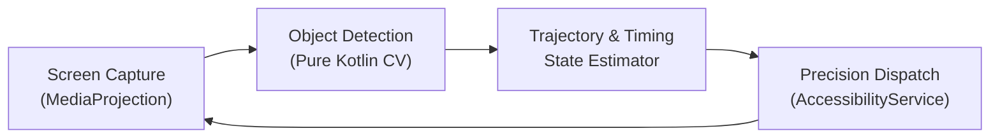

# AI Game Arena — Interactive Reinforcement Learning, MCTS & 3D Neuroevolution Lab

<div align="center">
  <a href="https://ai-lab-tthanh2006.vercel.app">
    
  </a>

  <br />

  <p align="center">
    <a href="https://ai-lab-tthanh2006.vercel.app">
      
    </a>
  </p>

  <p align="center">
    
    
    
    
    
  </p>
</div>

---

## 🧠 Overview

**AI Game Arena (`AI_Lab`)** is a cross-platform artificial intelligence laboratory (**Web SPA + Windows Electron Desktop App + Android Real-Screen Vision Agent**) where every search algorithm, neural network, genetic operator, and reinforcement learning loop is implemented **from scratch in pure TypeScript and Kotlin** with zero external ML libraries.

| Platform | Purpose | Tech Stack |
| :--- | :--- | :--- |
| **Web & Desktop Arena** | Train, visualize, and pit AI agents head-to-head across 9 interactive 2D & 3D environments in real time | React 19, TypeScript, HTML5 Canvas, Web Workers, Three.js, Electron |
| **Android Vision Agent (`android/`)** | Capture live mobile game frames (`MediaProjection`), run real-time computer vision & trajectory prediction, and dispatch taps (`AccessibilityService`) without root | Kotlin, Android SDK (`MediaProjection`, `AccessibilityService`), JUnit |

---

## 🎮 9 Interactive AI Environments

| Environment | Core Algorithm / Architecture | Real-Time Telemetry & Controls |
| :--- | :--- | :--- |
| **Gomoku (20×20 Caro)** | **Web Worker Minimax** (Alpha-Beta pruning, Iterative Deepening, Zobrist Hashing Transposition Table, Killer/History Heuristics) vs. **MCTS (UCT)** | Head-to-head AI vs. AI or Human vs. AI, search depth, node evaluation speed & self-evolving heuristic weights |
| **Connect Four** | **Minimax + Alpha-Beta Pruning** with positional window evaluation | Configurable search depth and real-time column score visualization |
| **2048** | **Expectimax Search** with monotonicity, smoothness & empty-tile heuristics | Chance-node probability trees and move throughput |
| **AI Racing (2D)** | **Feedforward Neural Network + Genetic Evolution** with 7-ray LIDAR sensors | Procedural track generator, custom track drawing tool, live neural synapse HUD & fitness curves |
| **Flappy Bird AI** | **Neuroevolution** (Population-based elitism, crossover & Gaussian weight mutation) | Multi-agent population survival telemetry across generations |
| **Q-Maze** | **Tabular Q-Learning** ($\epsilon$-greedy exploration + Bellman updates) | Live state-action $Q(s,a)$ heatmap arrows & reward convergence |
| **Soccer 3D** | **3D Multi-Agent Neuroevolution** in **Three.js** | Physics-based ball interception, team coordination & goal scoring |
| **Tag 3D** | **Competitive Co-Evolution (Chaser vs. Runner)** in **Three.js** | Dual-species adversarial fitness evolution with 3D obstacle avoidance |
| **Cell War** | **Multi-Faction Heuristic Cellular Automata** | Territory expansion dynamics and resource allocation |

---

## 📱 Android Real-Game Vision Agent (`android/`)

The Android module captures live game frames via `MediaProjection`, extracts obstacle/target coordinates using a pure-Kotlin computer vision pipeline, predicts physics trajectories, and dispatches precision touch gestures via `AccessibilityService` (supports **Flappy Bird** and **Mr Gun** without root access).



---

## 🚀 Quickstart

### 1. Web & Electron Desktop Arena
**Prerequisites:** Node.js **22.13+** and `npm`.

```powershell
git clone https://github.com/Tthanh2k6/AI_Lab.git
cd AI_Lab
npm ci
npm run dev
```

| Command | Action |
| :--- | :--- |
| `npm run dev` | Start Vite web development server (`http://localhost:5173`) |
| `npm run electron:dev` | Launch Vite + Electron desktop application |
| `npm run build` | Type-check and build production web bundle (`dist/`) |
| `npm run electron:build` | Package Windows desktop installer (`release/`) |

### 2. Android Vision Agent
```powershell
cd android
.\gradlew.bat :core:test
.\gradlew.bat :app:assembleDebug
```

---

**Author:** **Trung Thanh Tran** (*Trần Trung Thành*) · [GitHub `@Tthanh2k6`](https://github.com/Tthanh2k6) · [Upwork Profile](https://www.upwork.com/freelancers/~01ee7c2348cb4b62fe)
