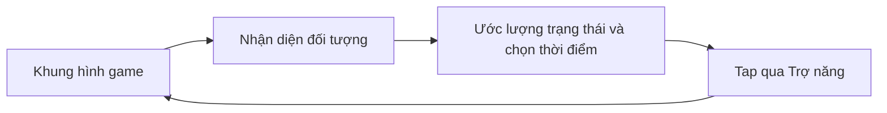

# AI Game Arena

**Quan sát thuật toán suy nghĩ — từ bàn cờ đến màn hình điện thoại.**


Phòng thí nghiệm AI tương tác: thay đổi tham số, xem mô phỏng và so sánh cách các thuật toán ra quyết định. Repo gồm một đấu trường game chạy trên web/desktop và một tác nhân Android đọc màn hình để điều khiển game trên điện thoại.

[Các mô phỏng](#các-mô-phỏng) · [Chạy web/desktop](#chạy-webdesktop) · [Android](#tác-nhân-android) · [Kiến trúc](#kiến-trúc)

## Hai môi trường thử nghiệm

| Môi trường | Mục đích | Công nghệ |
| --- | --- | --- |
| Web / Desktop | Quan sát và điều chỉnh AI trong mô phỏng 2D/3D | React, TypeScript, Canvas, Three.js, Electron |
| Android | Nhận diện khung hình và tap trực tiếp khi chơi | Kotlin, MediaProjection, Accessibility Service |

Phần Android nằm trên nhánh **`android-agent`**. Hướng dẫn clone bên dưới chọn nhánh này để có cả hai môi trường.

## Các mô phỏng

| Game | Thuật toán / cơ chế | Điều có thể quan sát |
| --- | --- | --- |
| Flappy Bird | Mạng nơ-ron + tiến hóa di truyền | Quần thể học cách vượt ống |
| Q-Maze | Q-Learning | Bảng giá trị và đường đi qua mê cung |
| 2048 | Expectimax + heuristic | Đánh đổi giữa nước đi và ô sinh ngẫu nhiên |
| Connect Four | Minimax + Alpha-Beta | Khả năng chơi theo độ sâu tìm kiếm |
| AI Racing | Mạng nơ-ron + tiến hóa | Cảm biến, điều khiển xe, đường đua theo seed và trình vẽ đường đua |
| Gomoku | Minimax / MCTS | Hai AI đối đầu, tham số tìm kiếm và trọng số lượng giá |
| Soccer 3D | Neuroevolution | Cầu thủ tương tác với bóng và môi trường 3D |
| Tag 3D | Tiến hóa đối kháng | Vai đuổi/bắt, cảm biến và tương tác chướng ngại vật |
| Cell War | Heuristic | Mô phỏng tranh giành lãnh thổ nhiều phe |

Mục đích của các mô phỏng là giúp thử nghiệm và quan sát; chất lượng AI phụ thuộc tham số, môi trường và thời gian chạy.

## Chạy web/desktop

**Yêu cầu:** Node.js **22.13+**, npm; trình duyệt hỗ trợ WebGL cho các mô phỏng 3D. Mốc Node được chọn theo yêu cầu Vite và ESLint trong lockfile của repo.

```powershell
git clone --branch android-agent https://github.com/Tthanh2k6/AI_Lab.git
cd AI_Lab
npm ci
npm run dev
```

Mở địa chỉ Vite in trong terminal, thường là `http://localhost:5173`.

| Lệnh | Kết quả |
| --- | --- |
| `npm run dev` | Mở môi trường phát triển web |
| `npm run electron:dev` | Chạy Vite và ứng dụng Electron |
| `npm run build` | Kiểm tra TypeScript và tạo bản web trong `dist/` |
| `npm run preview` | Xem bản web đã build |
| `npm run lint` | Chạy ESLint |
| `npm run electron:build` | Build giao diện, đóng gói Windows bằng cấu hình electron-builder |

Bản cài desktop được xuất vào `release/`. Script đóng gói Electron không thay thế bước kiểm tra TypeScript của `npm run build`.

## Tác nhân Android

Ứng dụng nhận khung hình qua MediaProjection, xử lý bằng lõi Kotlin, rồi gửi thao tác tap qua dịch vụ Trợ năng. Hiện hỗ trợ **Flappy Bird** và **Mr Gun**; không cần root.



Xem **[hướng dẫn Android](android/README.md)** để build, cấp quyền, chạy test mô phỏng và xử lý sự cố trên thiết bị.

```powershell
cd android
.\gradlew.bat :core:test
.\gradlew.bat :app:assembleDebug
```

## Kiến trúc

```text
src/
├── components/       # Giao diện và bảng điều khiển các mô phỏng
├── utils/            # Luật chơi, AI, vật lý và bộ dựng hình
├── hooks/            # Hook dùng chung
├── workers/          # Tìm kiếm AI cho Caro ở luồng nền
└── types/            # Kiểu trạng thái và cấu hình
android/
├── core/             # Thị giác, điều khiển, tác nhân và test JVM
└── app/              # Chụp màn hình, quyền hệ thống và tap
main.cjs              # Điểm vào Electron
```

Các thuật toán web làm việc với trạng thái mô phỏng. Tác nhân Android phải suy ra trạng thái từ hình ảnh, nên có giới hạn riêng về bố cục game, nền, độ trễ và chính sách chạy nền của thiết bị.

---

**Trần Trung Thành** · [@Tthanh2k6](https://github.com/Tthanh2k6)
