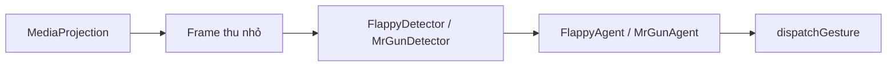

# AI Arena Agent · Android

**Nhìn khung hình. Ước lượng chuyển động. Chọn đúng lúc tap.**

[← AI Game Arena](../README.md)

Tác nhân chơi game chạy trên điện thoại, dùng **MediaProjection** để đọc màn hình và **Accessibility Service** để gửi thao tác. Lõi nhận diện và điều khiển viết bằng Kotlin thuần, tách khỏi Android để kiểm thử bằng mô phỏng và khung hình ghi lại.

## Game được hỗ trợ

| Game | Nhận diện | Điều khiển |
| --- | --- | --- |
| Flappy Bird | Chim, ống, mặt đất và tốc độ cuộn theo cấu trúc hình ảnh | Ước lượng vật lý, so sánh các lựa chọn vỗ cánh |
| Mr Gun | Nhân vật, địch, đầu trắng, tâm xoay và vạch ngắm | Dự đoán góc, chọn thời điểm bắn; nhận diện một số màn bắt đầu/chơi lại/hồi sinh |

Không có cam kết hỗ trợ mọi bản clone. Flappy giả định bố cục cuộn ngang với ống đứng; Mr Gun phụ thuộc hình học vạch ngắm, vị trí địch và đặc điểm nền.

## Build & kiểm thử

Chuẩn bị **JDK 17**, **Android SDK 36** và thiết bị **Android 11/API 30+**. Tạo `android/local.properties` với `sdk.dir` trỏ tới SDK của máy.

Từ thư mục `android/`:

```powershell
.\gradlew.bat :core:test
.\gradlew.bat :app:assembleDebug
adb install -r app/build/outputs/apk/debug/app-debug.apk
```

macOS/Linux dùng `./gradlew`. Test trong `core/` chạy trên JVM, không cần kết nối điện thoại; build ứng dụng cần SDK Android.

## Chạy trên điện thoại

1. Cài APK, mở **AI Arena Agent**.
2. Bật dịch vụ **Trợ năng** của ứng dụng; kiểm tra trạng thái đã kết nối trong app.
3. Cấp quyền thông báo nếu hệ thống yêu cầu để xem trạng thái và nút dừng.
4. Chọn **Flappy Bird** hoặc **Mr Gun**, bắt đầu phiên chụp màn hình rồi chuyển sang game.
5. Theo dõi thông báo của tác nhân; chọn **Dừng** khi kết thúc.

Chế độ chia sẻ màn hình tùy Android và thiết bị. Trên thiết bị HyperOS đã thử nghiệm, nếu chia sẻ một ứng dụng không nhận được khung hình, hãy dừng phiên rồi thử **Toàn bộ màn hình**. Không giữ thông báo hay cửa sổ khác che vùng game khi tác nhân đang nhận diện.

## Luồng xử lý



Tap mặc định của Flappy ở `(50%, 62%)`, của Mr Gun ở `(50%, 78%)`. Với một số menu Mr Gun, tác nhân dùng vị trí nút nhận diện được thay vì vị trí bắn mặc định; cấu hình nằm trong [`GameAgent.kt`](core/src/main/kotlin/ai/arena/core/agent/GameAgent.kt).

## Cấu trúc

| Module | Nội dung |
| --- | --- |
| [`core/`](core) | Khung hình, bộ nhận diện, ước lượng vật lý, bộ điều khiển và tác nhân |
| [`core/src/test/`](core/src/test) | Test mô phỏng và hồi quy bằng ảnh |
| [`core/src/test/resources/mrgun_real/`](core/src/test/resources/mrgun_real) | Bộ khung hình Mr Gun phục vụ test |
| [`app/`](app) | Màn hình cấp quyền, dịch vụ chụp màn hình, trạng thái và dịch vụ tap |

## Chẩn đoán & giới hạn

```powershell
adb logcat -s AgentService TapAccessibility
```

| Hiện tượng | Kiểm tra |
| --- | --- |
| Đã bật Trợ năng nhưng không tap | Trạng thái kết nối trong app; thử tắt/bật lại dịch vụ |
| Không có khung hình | Phiên MediaProjection, chế độ chia sẻ và app đang được chụp |
| Hoạt động rồi dừng | Chính sách pin, Game Turbo và quản lý tiến trình nền |
| Nhận diện sai | Bố cục game, hiệu ứng nền, vật thể che khuất và log nhận diện |

Repo có ghi nhận thử nghiệm trên Xiaomi 17 Pro/HyperOS/Android 16; điều này không thay thế kiểm thử tương thích trên từng máy. Mr Gun hiện dùng độ trễ tap cấu hình sẵn; chưa có lớp phủ debug. Quảng cáo toàn màn và các màn ngoài phạm vi nhận diện có thể cần thao tác thủ công.
